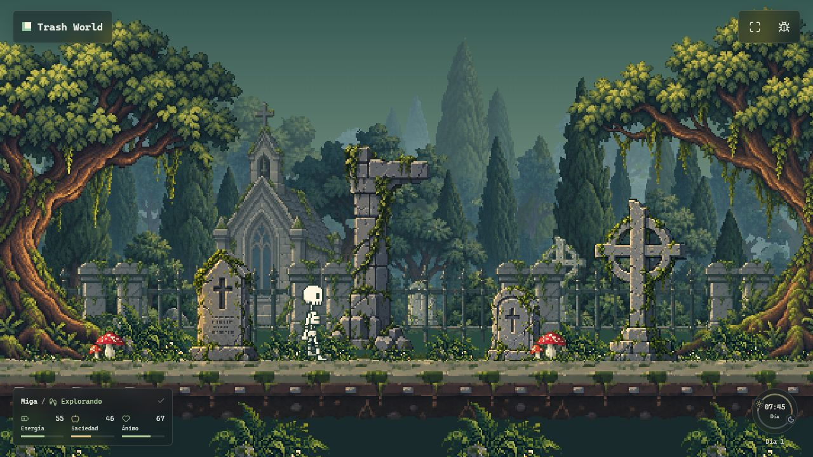
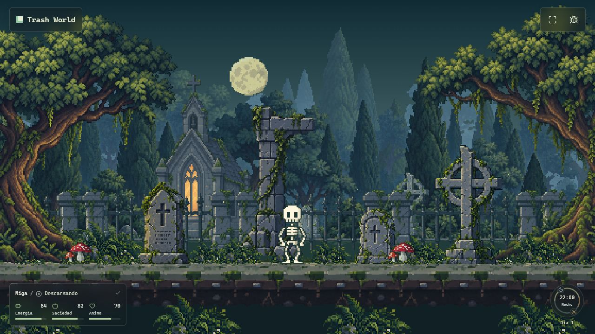
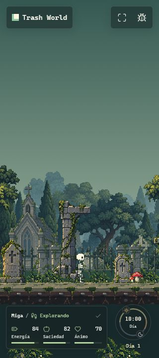
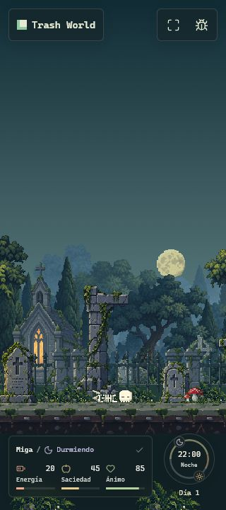
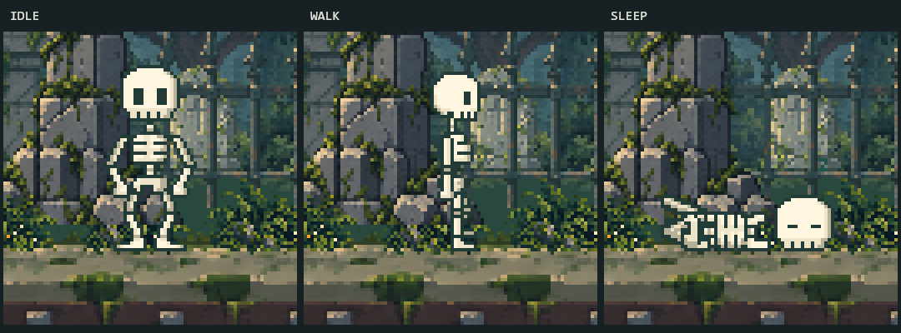
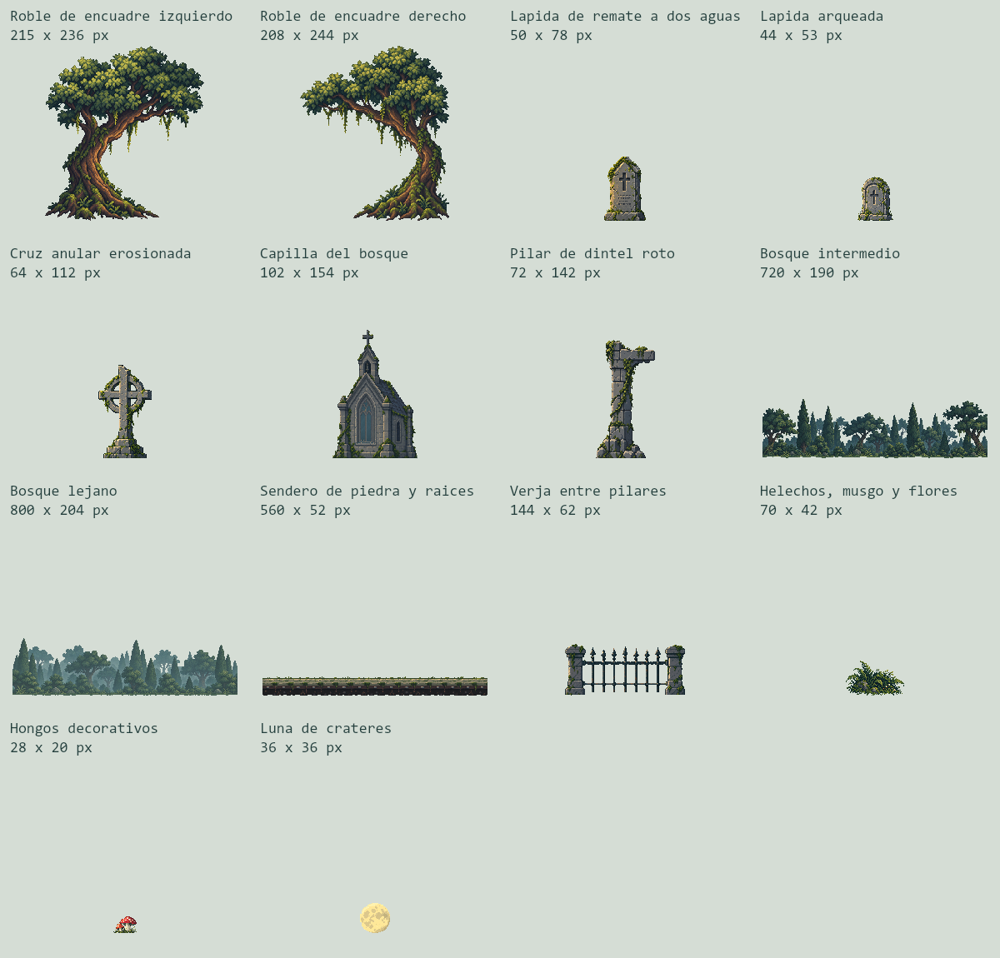

# Trash World

Un mundo de bolsillo habitado por Miga, una calaverita autonoma que pasea, observa, descansa en huesitos y vuelve a armarse.

**Canvas 2D | Vida autonoma | Cementerio del bosque | Guardado local**



*Captura real del juego autonomo en navegador a 1280 x 720. Escenario, personaje e interfaz son capas independientes.*

**Cementerio, interfaz y apoyo preparados para versionado.** La revision del 2026-10-15 anade cristal, estados de color, un reloj orbital y contacto con el sendero. El usuario solicita su entrega local y los comandos para publicarla; la etiqueta propuesta es `v0.1.10`, todavia sin crear. No modifica los dibujos aprobados ni las reglas de Miga.

## El Cementerio

- Dos robles distintos con troncos curvos, raices, copas e hiedra integrados en cada dibujo.
- Dos planos de bosque con parallax: fondos frios y claros; primer plano con verdes oliva y madera calida.
- Capilla con cruz completa y cristal frio de dia, ambar al atardecer y de noche. Variacion de vela continua y limitada al cristal.
- Tres monumentos: lapida a dos aguas, lapida arqueada y cruz anular. Ruina de dintel roto y verja entre pilares.
- Sendero, helechos con flores, hongos y luna independientes. Sin banda de niebla sobre el suelo ni deformacion de ramas.
- Miga mantiene su rig, paleta y clips aprobados. Sombras de contacto cortas y translucidas reemplazan la banda verde bajo su cuerpo; el ancla del sendero coincide con piedra opaca.



*Captura real de navegador con estado controlado: 22:00, reposo, renderer y HUD de produccion. No modifica la partida del juego. Edificios y arboles conservan sus dibujos.*

### En Movil

<p align="center">
  
  
</p>

*Capturas de navegador con viewport emulado y estados controlados, no de un telefono fisico ni de una partida autonoma. La muestra nocturna usa reservas de prueba para mostrar los tres niveles. La vista estrecha conserva la escala del mundo.*

## Interfaz Y Apoyo

- Mundo a pantalla completa, sin las bandas verdes de encabezado y pie.
- Cristal ahumado neutro con blur localizado en nombre, controles y stats; fondo translucido de respaldo para navegadores sin ese efecto.
- Estados con nombre, icono y color: exploracion verde, observacion celeste, descanso lavanda, despertar dorado, sorpresa coral y alegria rosa.
- Energia, saciedad y animo con valores y barras. Verde, ambar y coral indican reserva alta, media y baja; 100 de saciedad significa alimentada.
- Reloj de 24 horas del mundo: sol y luna opuestos recorren el dial, con hora y fase en el centro. El angulo sigue la simulacion, no una animacion decorativa independiente.
- Guardado correcto como confirmacion discreta; problemas de almacenamiento muestran un aviso persistente.



*Revision offline del renderer, ampliada por vecino mas cercano. Las sombras se calculan desde los pixeles proximos al piso y no cambian los sprites de Miga.*

Detalles y limites en [Interfaz de cristal y contacto](docs/GLASS_HUD.md).

## Miga

Personalidad y necesidades influyen en sus paseos, observacion y descanso. Responde al toque y al toque sostenido, duerme desarmandose y se reconstruye al despertar. La partida vive en el navegador, sin cuentas ni backend.

La escena actual no tiene objetos interactivos. Conserva los descubrimientos antiguos como historia, pero cancela al cargar las caminatas e inspecciones dirigidas a objetos retirados. Sin la planta ya no hay alimentacion ambiental automatica: no se inventa una planta invisible. El panel de diagnostico conserva el control de comida.

## Empezar

Requisito: Node.js 22.12 o posterior, con npm.

```bash
git clone https://github.com/bryanpineda-dev/trash-world.git
cd trash-world
npm ci
npm run dev
```

Abre la URL que muestre Vite. Para comprobar la version compilada:

```bash
npm run check
npm run preview
```

`dist/` contiene la aplicacion estatica. Dependencias, builds y caches no se versionan.

## Visores

| Ruta | Vista |
| --- | --- |
| `/` | Mundo autonomo, tacto y guardado local. |
| `/biome-lab.html` | Escenario actual, fases, poses, posicion, pausa y biblioteca por familias. No toca la partida. |
| `/asset-lab.html` | Kit original de Miga y objetos historicos. Sus props no se activan en el mundo. |

## Biblioteca De Assets



*Lamina offline del catalogo ambiental aprobado, conservada como referencia de dibujos sin cambios. No es evidencia nueva del HUD ni del ajuste de ancla del sendero.*

```text
assets/
  reference-biome/
    manifest.json             # 14 assets, dimensiones, anclas y SHA-256
    GENERATION.md             # Procedencia y briefs de regeneracion
    source/                   # Originales raster sin modificar
    native/                   # PNG del juego, alpha binario
      trees/                  # 2 robles
      gravestones/            # 3 monumentos
      architecture/           # Capilla, dintel y verja
      backgrounds/            # 2 planos de bosque
      terrain/                # Sendero
      vegetation/             # Helechos/flores y hongos decorativos
      sky/                    # Luna
  source/                     # Rig, piezas y clips originales de Miga
  generated/                  # Atlas original; entorno anterior archivado
```

Los nuevos dibujos son **raster generados individualmente con ImageGen**, guiados por la referencia del usuario; no son dibujos hechos a mano pixel por pixel. Se guardan originales y versiones recortadas, ajustadas con vecino mas cercano y alpha 0/255. El ambiente no usa el limite anterior de 32 tokens. Miga mantiene sus 16 colores.

Los PNG se reutilizan por su ancla. El sendero cubre el tramo actual de 560 unidades: extenderlo a un tileset con uniones certificadas queda pendiente. Los fondos son panoramicas reutilizables, no un mapa aplanado. Ver [composicion y limites](docs/REFERENCE_BIOME.md).

`npm run assets` regenera el kit JSON original, no los nuevos originales raster. Cambiar estos ultimos requiere actualizar PNG nativo, manifiesto y hashes, y pasar sus pruebas.

## Verificacion

Revision del 2026-10-15:

- **170 pruebas aprobadas**. Doce regresiones de esta pasada cubren estados, reservas, reloj, continuidad de medianoche, HUD, sombras y el ancla del sendero.
- Renderer de produccion offline: **432 casos**, tres luces, seis proporciones y tres posiciones; **289 980 pixeles opacos de Miga** cotejados, atlas/fallback iguales y pausa ambiental exacta.
- Piso opaco verificado en las 560 columnas, filas 11 y 12 del sendero. **254 archivos protegidos** sin cambios por SHA-256; el manifiesto cambia solo el ancla del terreno.
- Capturas de navegador separadas de los renders offline. Detalle y limites en [Verificacion](docs/VERIFICATION.md).

Pendientes: Android fisico, rendimiento del blur y consumo prolongados, desconexion real del nuevo build y partida nocturna prolongada. La entrega local y su verificacion son independientes del commit y la publicacion en GitHub.

## Guardado Y Offline

Guardado cada cinco segundos, al interactuar y al ocultar la app. Datos danados se respaldan; versiones futuras se protegen contra sobrescritura. Al regresar se resume un maximo de ocho horas de necesidades, descanso y reloj, sin inventar descubrimientos.

El service worker se genera con el build y se registra solo en produccion. Requiere localhost o HTTPS y una primera carga completa con conexion. Cada origen, puerto y perfil tiene su propia partida.

## Documentacion

- [Escenario actual y direccion visual](docs/REFERENCE_BIOME.md)
- [Interfaz de cristal, reloj y contacto](docs/GLASS_HUD.md)
- [Arquitectura](docs/ARCHITECTURE.md)
- [Miga](docs/CHARACTER.md)
- [Flujo del kit original](docs/ASSET_WORKFLOW.md)
- [Verificacion e historial](docs/VERIFICATION.md)
- [Roadmap](docs/ROADMAP.md)

Las guias de bioma, estilo e interacciones anteriores se conservan como historial, no como descripcion del entorno activo de esta propuesta. Las propuestas artisticas rechazadas no son una base visual aprobada.

Proyecto de [bryanpineda-dev](https://github.com/bryanpineda-dev).
