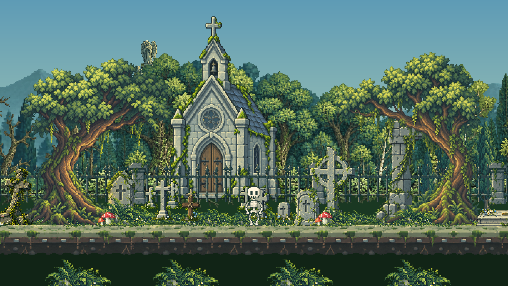
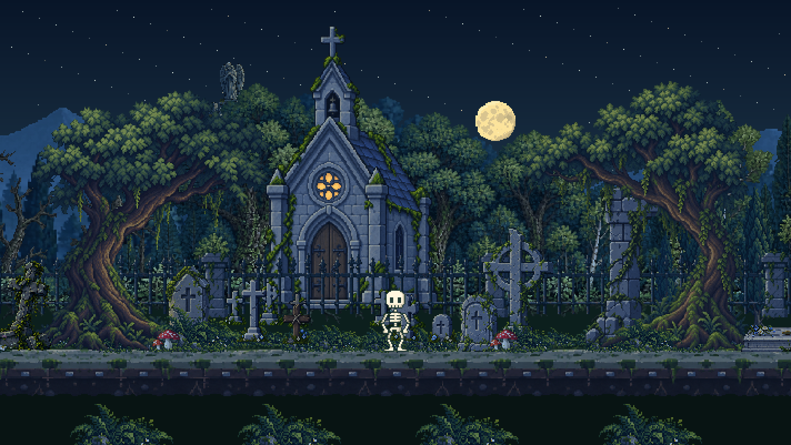
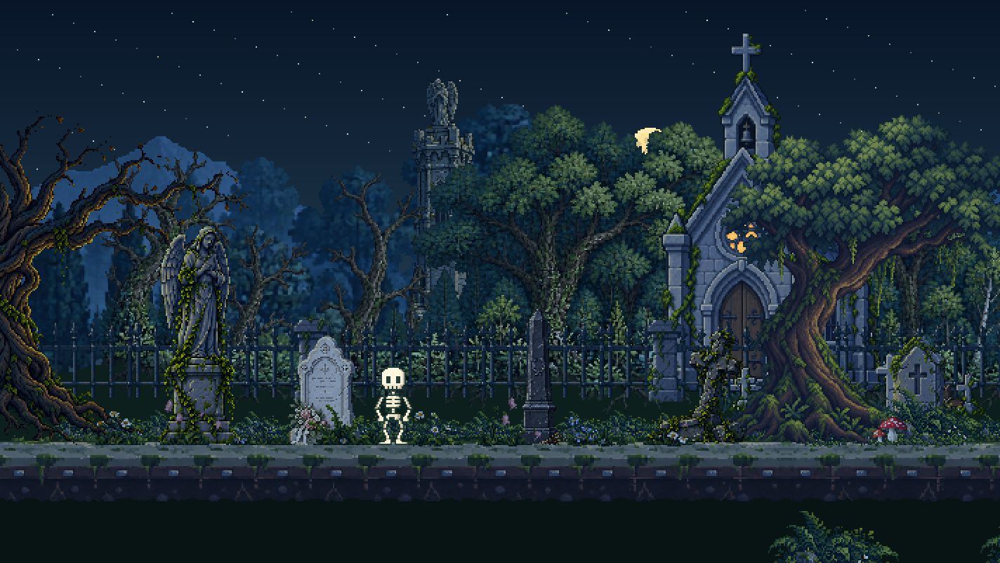
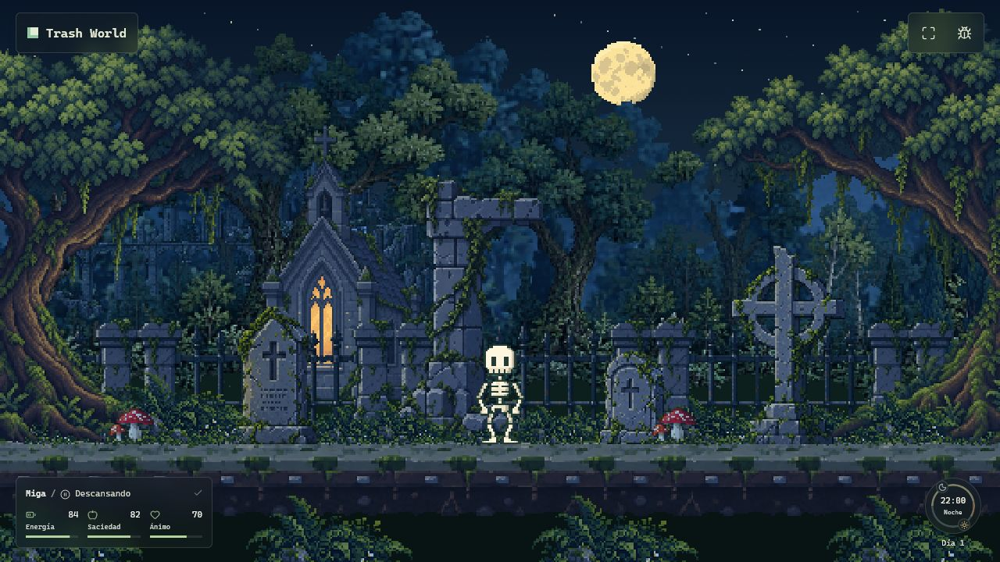
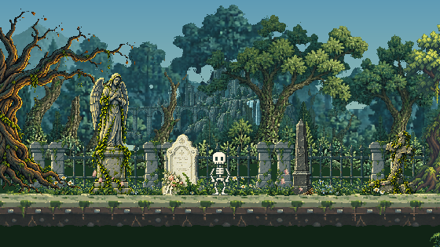
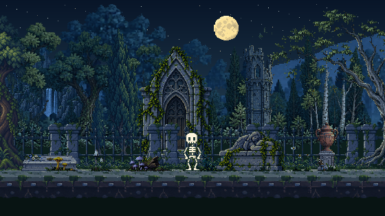
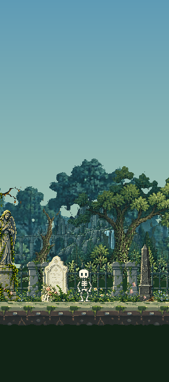
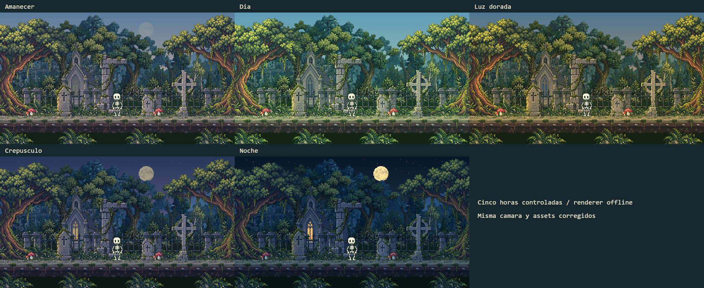
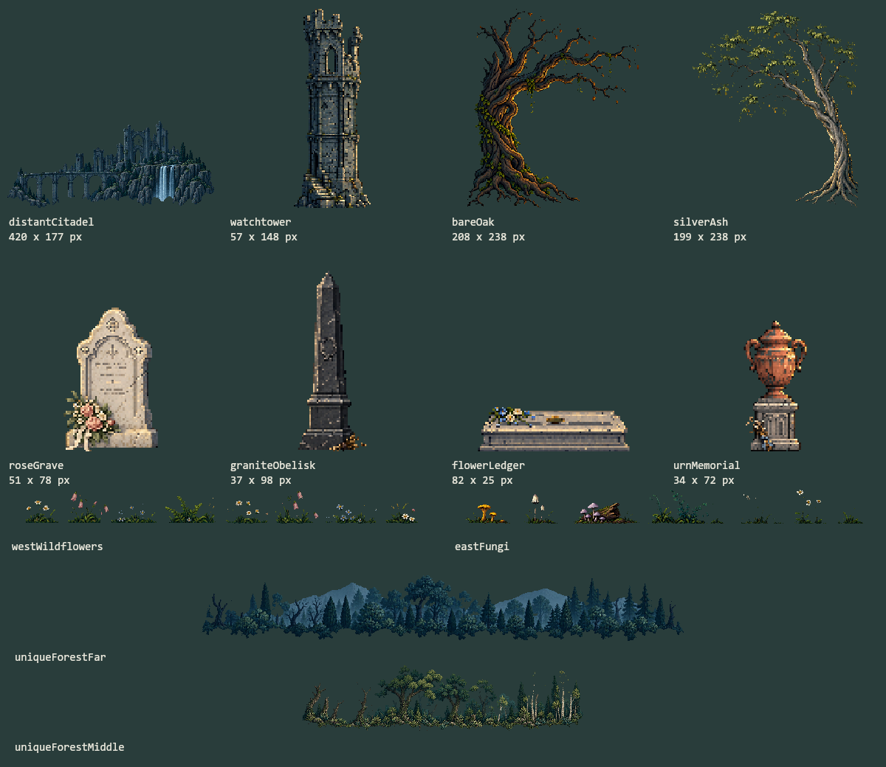

# Trash World

Un mundo de bolsillo habitado por Miga: una calaverita autonoma que explora, observa, se desarma para dormir y vuelve a levantarse.

**Canvas 2D | Pixel art | Cementerio del bosque | Guardado local**



*Render offline nuevo del renderer principal, 2026-10-19, canvas 712 x 401 ampliado exactamente 2x. No es una captura del navegador ni incluye el HUD.*

## Revision Actual

Bosque intermedio con copas reparadas, torre memorial con angel de piedra en lugar de la ciudadela y catarata, y verja continua con soportes espaciados. Se conservan la iglesia con puertas y roseton, el oratorio con crucifijo y tres velas, el sarcofago y los nueve marcadores funerarios.

Esta revision se prepara para aprobacion visual y commit. No equivale a una publicacion, etiqueta o release nuevos. Miga, su rig, animaciones, necesidades, controles, guardados y limites del mundo no cambian.



*Render offline nuevo a las 22:00, sin movimiento ambiental. No lee la partida ni demuestra rendimiento o interaccion en navegador.*

## Empezar

Requisito: Node.js 22.12 o posterior, con npm.

```bash
git clone https://github.com/bryanpineda-dev/trash-world.git
cd trash-world
npm ci
npm run dev
```

Abrir la URL que muestre Vite. Para verificar y probar el build:

```bash
npm run check
npm run preview
```

| Ruta | Vista |
| --- | --- |
| `/` | Mundo autonomo, interfaz de cristal y guardado local |
| `/biome-lab.html` | Zonas, hora, poses, camara, pausa y biblioteca por familias, sin tocar partidas |
| `/asset-lab.html` | Rig de Miga y kit historico de objetos; no activa esos props en el mundo |

`dist/` es la aplicacion estatica compilada. Dependencias, builds, caches y configuraciones locales no se versionan.

## El Mundo

Un recorrido continuo de 1680 unidades, desde -560 hasta 1120, con tres zonas:

| Zona | Contenido |
| --- | --- |
| Jardin de los angeles | Roble seco, estatua, tumba con rosas, obelisco y torre memorial alada distante |
| Claro de Miga | Iglesia unica, nueve cruces, robles y monumentos del cementerio |
| Patio del oratorio | Oratorio abierto, sarcofago, urna, cipreses, torre y fresno |



*Render offline nuevo del renderer principal, ampliado exactamente 2x sin suavizado. No es una captura de navegador.*

Los monumentos y arboles de encuadre se colocan una sola vez. El sendero y la verja son modulos estructurales reutilizables. Los tramos de hierro miden 84px, sin estirar barrotes; los pilares se colocan cada 252px, no en ambos extremos de cada tramo. Las dos panoramicas forestales conservan su parallax y todos los planos comparten el mismo origen de camara.

El encuadre de escritorio se abre globalmente: a 1280 x 720 el canvas logico es 712 x 401. No se estira la iglesia ni se cambia el pixel del personaje. En un movil de 320 x 720 sigue siendo 288 x 648. Los panoramas extremadamente bajos conservan el limite de 2048px y el ajuste de encuadre de edificios para no cortar sus remates.

## Luz Y Vida

- Dia de 24 minutos, con amanecer, dia, luz dorada, crepusculo y noche interpolados.
- Roseton frio de dia y ambar de noche; la variacion se limita a su cristal, sin iluminar la madera de las puertas.
- Tres velas pequenas independientes en el oratorio, con un derrame nocturno localizado.
- Luciernagas sutiles por la noche, mariposas diurnas y hojas ocasionales.
- Estrellas detras del paisaje y luna sin oscurecimiento de material.
- Desactivar movimiento ambiental congela sus animaciones sin detener el reloj del mundo.
- HUD de cristal, estados con color, reservas de energia/saciedad/animo y reloj orbital.

## Biblioteca De Assets

**39 PNG nativos activos, 33 originales distintos y ningun recurso precargado sin uso.** El hierro y el pilar comparten su original; nueve marcadores se recortan de dos hojas de origen. Dos originales de bosques sustituidos se mantienen solo como procedencia, fuera del catalogo activo.

```text
assets/reference-biome/
  manifest.json
  ARCHITECTURE_GENERATION.md
  ENVIRONMENT_POLISH_GENERATION.md
  source/
  native/
    architecture/    # Iglesia, oratorio, dos torres, ruina, hierro y pilar
    gravestones/     # 19 monumentos y cruces, incluido el sarcofago
    trees/           # Robles, fresno y cipreses
    backgrounds/     # Dos panoramicas activas
    vegetation/      # Helechos, flores y hongos
    terrain/         # Sendero
    sky/             # Luna
```

| Pieza | Resolucion nativa |
| --- | --- |
| Cuerpo visible de Miga | 28 x 56, dentro de frames de 64 x 64 |
| Iglesia | 173 x 256 |
| Oratorio | 116 x 144 |
| Sarcofago | 120 x 49 |
| Torre memorial alada | 70 x 190 |
| Bosque intermedio | 900 x 229 |
| Hierro / pilar de la verja | 84 x 62 / 26 x 62 |
| Nueve cruces/lapidas de las filas | 19-30px de ancho, 26-56px de alto |

El arte ambiental es raster generado con ImageGen y guiado por referencias, no dibujo manual pixel a pixel. Originales, recortes, dimensiones, anclas y hashes quedan registrados. Los exports usan vecino mas cercano y alpha binario; Miga conserva su paleta y clips aprobados.

Los identificadores internos `chapel`, `mausoleum`, `recliningAngel` y `distantCitadel` se conservan por compatibilidad del catalogo. Sus archivos y etiquetas visibles corresponden a iglesia, oratorio, sarcofago y torre alada. Los PNG sustituidos se retiran del proyecto tras respaldo; no se borran archivos ajenos.

`npm run assets` regenera el kit original y los atlas historicos requeridos por tests. `npm run assets:check` comprueba su reproducibilidad. `npm run assets:legacy` recupera exports historicos solo en `.cache/legacy-assets/`, fuera de las carpetas activas.

## Verificacion

Pruebas, renders y limites de esta revision se registran en [QA ambiental](docs/ENVIRONMENT_POLISH.md), [Verificacion](docs/VERIFICATION.md) y el [historial de integracion](docs/ARCHITECTURE_INTEGRATION.md). Se distinguen pruebas del motor, renders offline y capturas reales del navegador. Las imagenes de revisiones anteriores se conservan como historia, no como evidencia nueva.

La perspectiva y el acabado artistico siguen abiertos a mejoras posteriores. No se han validado Android fisico, rendimiento/consumo ni desconexion real en esta pasada.

## Guardado

Partida local por navegador y origen, sin cuentas ni backend. Se guarda al interactuar, cada cinco segundos y al ocultar la aplicacion. Se resume un maximo de ocho horas al regresar, sin desplazar a Miga ni inventar descubrimientos. Partidas futuras se protegen contra sobrescritura y datos danados se respaldan.

El service worker se registra solo en produccion. Requiere HTTPS o localhost y una primera carga completa con conexion. Cambiar de puerto no comparte la partida.

## Documentacion

- [Revision ambiental actual y limites de QA](docs/ENVIRONMENT_POLISH.md)
- [Integracion actual, escala, capas y entrega](docs/ARCHITECTURE_INTEGRATION.md)
- [Inventario actual con hashes](docs/ASSET_INVENTORY.json)
- [Verificacion e historial](docs/VERIFICATION.md)
- [Estudio de perspectiva y referencias de la tumba](docs/TOMB_PERSPECTIVE_REVIEW.md)
- [Luz, cielos y profundidad](docs/DAYLIGHT.md)
- [Vida ambiental](docs/LIVING_WORLD.md)
- [Interfaz y contacto con el suelo](docs/GLASS_HUD.md)
- [Miga y sus animaciones](docs/CHARACTER.md)
- [Investigacion sobre escala y perspectiva](docs/WORLD_SCALE_AND_PERSPECTIVE.md)
- [Limpieza y recuperacion de exports historicos](docs/ASSET_CLEANUP.md)

Los estudios previos y sus propuestas rechazadas son historial de diseno; no sustituyen la descripcion de esta integracion.

Proyecto de [bryanpineda-dev](https://github.com/bryanpineda-dev).
Un mundo de bolsillo habitado por Miga, una calaverita autonoma que pasea, observa, descansa en huesitos y vuelve a armarse.

**Canvas 2D | Vida autonoma | Cementerio del bosque | Guardado local**



*Captura real de la revision de encuadre del 2026-10-16 a 1280 x 720. Fixture controlado a las 22:00; no lee ni modifica una partida. Se conserva como muestra del entorno sin cambios, no como evidencia nueva de la limpieza.*

**Proporciones y encuadre en revision.** La correccion del 2026-10-16 recupera el ancho proporcional del pilar y el sotobosque desde sus originales, y mantiene completos edificios, monumentos y cipreses en ventanas bajas. Conserva los 31 assets, las 1680 unidades, el zoom habitual, Miga y el HUD. Esta pasada incluye pruebas reales de navegador, ademas de QA offline. Sigue en sandbox para aprobacion visual, sin copiar a estable ni publicar.

**Auditoria visual, 2026-10-18:** la propuesta todavia tiene hallazgos abiertos. La luna puede leerse fragmentada por las copas, el ajuste individual de edificios altera su escala relativa en ventanas muy bajas y falta vegetacion pequena modular a tamano real. Son hallazgos, no correcciones ya realizadas. [Informe integral con capturas nuevas](docs/VISUAL_REVIEW.md).

**Investigacion del mundo, 2026-10-19:** diagnostico con fuentes primarias, mediciones y dos laminas nuevas. Los bosques activos se dibujan a 1x; la ciudadela tiene otra reduccion en escena. Se propone estabilizar escala, composicion y dibujo nativo antes de extender el mapa, manteniendo Canvas 2D y evaluando Tiled para autoria. No se ha implementado un rediseno ni cambiado el motor. [Estudio y plan de prueba acotado](docs/WORLD_BUILDING_RESEARCH.md).

**Escalas y perspectiva:** ampliacion con capturas oficiales inspeccionadas de Blasphemous, The Last Faith y Kingdom Two Crowns, una lamina nueva de proporciones actuales y criterios para conservar la cruz de la iglesia. Miga visible mide 56 px; la capilla exportada, 154 px. Los rangos objetivo son propuestas, no cambios aplicados. [Referencias y contrato de escala](docs/WORLD_SCALE_AND_PERSPECTIVE.md).

**Limpieza de assets, 2026-10-19:** biblioteca activa de 29 recursos, sin los dos bosques sustituidos. Se retiran 162 exports obsoletos con respaldo externo al proyecto; las fuentes se conservan y 160 exports historicos siguen verificandose mediante regeneracion y hashes, sin reaparecer con el build normal. No incluye el rediseno pendiente de iglesia, oratorio o tumba. [Inventario, comprobaciones y recuperacion](docs/ASSET_CLEANUP.md).

**Muestra de arquitectura, revision 6 del 2026-10-19:** la tumba sigue pendiente de aprobacion. Tras rechazar las tapas y la alineacion de cruz anteriores, se estudiaron una tumba real y un modelo desde distintos angulos. La nueva cruz pequena, a la izquierda, proyecta su travesano en la profundidad de la tapa; conserva la esquina derecha completa. La iglesia candidata mide ahora 173 x 256, con cruz superior visible en un estudio de 640 x 400, y el oratorio mantiene crucifijo y velas independientes. Visor en `/studies/architecture/`. No se han reemplazado los assets del juego ni entregado esta propuesta al escritorio. [Referencias, comparacion nueva y limites](docs/TOMB_PERSPECTIVE_REVIEW.md).


*Comparacion nueva de revision 6 a escala nativa y 4x sin suavizado. Las revisiones anteriores son historial de propuestas, no disenos aprobados. El estudio tampoco representa la integracion completa del escenario.*

## Tres Zonas

| Zona | Coordenadas | Caracter |
| --- | --- | --- |
| Jardin de los angeles | -560 a 0 | Roble seco, ciudadela con puente, rosas, obelisco y cruz rota |
| Claro de Miga | 0 a 560 | Una sola iglesia, robles y monumentos originales |
| Patio del mausoleo | 560 a 1120 | Fresno plateado, torre, mausoleo, urna y angel reclinado |



*Render offline diurno a 560 x 315: la resolucion nativa habitual de una vista de escritorio. No modifica una partida.*

El visor permite saltar entre zonas, recorrer toda la longitud y ajustar la hora continuamente. Las partidas conservan sus coordenadas. [Luz, cielos y profundidad](docs/DAYLIGHT.md), [identidad y movimiento](docs/LIVING_WORLD.md) y [extension del recorrido](docs/LATERAL_WORLD.md).

## El Cementerio

- Cuatro arboles de encuadre distintos: los dos robles centrales, un roble seco y un fresno plateado. Ninguno se copia a otra zona.
- Dos bosques sin mosaico, ciudadela con puente y cascada, torre y cipreses con parallax desde una sola camara. La cascada es estatica en esta pasada.
- Capilla con cruz completa y cristal frio de dia, calentandose gradualmente al anochecer. Variacion de vela continua y limitada al cristal, sin apagarlo intermitentemente.
- Diez monumentos con dibujos distintos: los seis previos, marmol con rosas, obelisco de granito con espigas, losa con flores azules y urna de terracota con flores secas. Musgo, piedra limpia y ofrendas se distribuyen por objeto.
- Flores rosadas, azules y marfil, hierbas y hongos ocres, marfil y lilas. Las alas usan franjas diferentes, colocadas una sola vez. Sendero y verja siguen siendo modulos estructurales; la vegetacion central conserva su composicion anterior.
- Miga mantiene su rig, paleta y clips aprobados. Sombras de contacto cortas y translucidas reemplazan la banda verde bajo su cuerpo; el ancla del sendero coincide con piedra opaca.



*Render offline nocturno a 560 x 315. Los monumentos quedan detras de Miga y reciben la paleta horaria, sin convertirse en nuevas fuentes emisivas.*

### En Movil

<p align="center">
  
  
</p>

*Izquierda: render offline a 288 x 648, calculado para el juego en un viewport de 320 x 720. Derecha: captura real del visor a 320 x 720, con canvas 288 x 331 y sus controles. No validan un telefono fisico.*

## Ciclo Y Vida Ambiental



*Cinco renders offline nuevos del mismo encuadre, con horas controladas y sin cambiar el zoom. Cielo, materiales y luces interpolan cinco grados de color.*

- Noche: hasta ocho luciernagas visibles, nucleo de un pixel, halo limitado a 3 x 3 y brillo asincrono gradual.
- Atardecer y amanecer: aparicion y retirada graduales, conservando las mismas trayectorias. De dia no hay luciernagas.
- Dia: dos mariposas pequenas junto a las zonas florales y hojas ocasionales. No hay una nube de particulas sobre toda la pantalla.
- Cielo nocturno con estrellas de un pixel, detras del paisaje, y luna sin oscurecimiento de material. Las copas ocultan las estrellas de forma natural.
- El movimiento sigue el tiempo ambiental del renderer; desactivarlo congela trayectorias y aleteo, sin detener el ciclo de dia/noche ni su iluminacion. Los arboles no se deforman.

El mundo conserva un dia de 24 minutos. La [guia de luz](docs/DAYLIGHT.md) conserva la animacion offline de la pasada anterior como documentacion del ciclo, no como evidencia nueva de estos exports.

## Interfaz Y Apoyo

- Mundo a pantalla completa, sin las bandas verdes de encabezado y pie.
- Cristal ahumado neutro con blur localizado en nombre, controles y stats; fondo translucido de respaldo para navegadores sin ese efecto.
- Estados con nombre, icono y color: exploracion verde, observacion celeste, descanso lavanda, despertar dorado, sorpresa coral y alegria rosa.
- Energia, saciedad y animo con valores y barras. Verde, ambar y coral indican reserva alta, media y baja; 100 de saciedad significa alimentada.
- Reloj de 24 horas del mundo: sol y luna opuestos recorren el dial, con hora y fase en el centro. El angulo sigue la simulacion, no una animacion decorativa independiente.
- Guardado correcto como confirmacion discreta; problemas de almacenamiento muestran un aviso persistente.


*Revision offline de la pasada de apoyo anterior, conservada como documentacion del mecanismo sin cambios; no es evidencia nueva de la extension lateral.*

Detalles y limites en [Interfaz de cristal y contacto](docs/GLASS_HUD.md).

## Miga

Personalidad y necesidades influyen en sus paseos, observacion y descanso. Responde al toque y al toque sostenido, duerme desarmandose y se reconstruye al despertar. La partida vive en el navegador, sin cuentas ni backend.

La escena actual no tiene objetos interactivos. Conserva los descubrimientos antiguos como historia, pero cancela al cargar las caminatas e inspecciones dirigidas a objetos retirados. Sin la planta ya no hay alimentacion ambiental automatica: no se inventa una planta invisible. El panel de diagnostico conserva el control de comida.

## Empezar

Requisito: Node.js 22.12 o posterior, con npm.

```bash
git clone https://github.com/bryanpineda-dev/trash-world.git
cd trash-world
npm ci
npm run dev
```

Abre la URL que muestre Vite. Para comprobar la version compilada:

```bash
npm run check
npm run preview
```

`dist/` contiene la aplicacion estatica. Dependencias, builds y caches no se versionan.

## Visores

| Ruta | Vista |
| --- | --- |
| `/` | Mundo autonomo, tacto y guardado local. |
| `/biome-lab.html` | Tres zonas, hora continua, cinco momentos, poses, posicion, pausa y biblioteca por familias. No toca la partida. |
| `/asset-lab.html` | Kit original de Miga y objetos historicos. Sus props no se activan en el mundo. |

## Biblioteca De Assets



*Lamina offline de la pasada artistica anterior, cuyos dibujos activos no cambian con la limpieza. La biblioteca actual contiene 29 assets con originales, PNG nativos, anclas y hashes. Los originales de los dos bosques sustituidos se conservan solo como procedencia, fuera de la biblioteca cargada.*


*Captura nueva del visor en navegador tras la limpieza; no es una nueva version artistica de los dibujos.*

```text
assets/
  reference-biome/
    manifest.json             # 29 assets activos y 2 registros de fuente historica
    GENERATION.md             # Procedencia y briefs de regeneracion
    LATERAL_GENERATION.md     # Prompts y limites de las cinco piezas nuevas
    IDENTITY_PROMPTS.json     # Los doce prompts de esta pasada
    IDENTITY_GENERATION.md   # Procedencia, proporciones y limites actuales
    source/                   # 31 originales sin modificar; 2 solo de procedencia
    native/                   # PNG del juego, alpha binario
      trees/                  # 4 arboles de encuadre y grupo de cipreses
      gravestones/            # 10 monumentos
      architecture/           # Capilla, mausoleo, ciudadela, torre, dintel y verja
      backgrounds/            # Solo los 2 bosques activos
      terrain/                # Sendero
      vegetation/             # Helechos/flores y hongos decorativos
      sky/                    # Luna
  source/                     # Rig, piezas y clips originales de Miga
  generated/                  # Kit original y atlas historico usado por estudios/tests
```

Los nuevos dibujos son **raster generados individualmente con ImageGen**, guiados por la referencia del usuario; no son dibujos hechos a mano pixel por pixel. Se guardan originales y versiones recortadas, ajustadas con vecino mas cercano y alpha 0/255. El ambiente no usa el limite anterior de 32 tokens. Miga mantiene sus 16 colores.

Los PNG se reutilizan por su ancla. El sendero aprobado de 560 pixeles se alterna con su reflejo para igualar los bordes en 1680 unidades, sin cambiar el original. No es un tileset de pendientes o plataformas arbitrarias. Los fondos son panoramicas reutilizables, no un mapa aplanado. Ver [extension y profundidad](docs/LATERAL_WORLD.md) y [base ambiental](docs/REFERENCE_BIOME.md).

`npm run assets` regenera el kit JSON original y el atlas historico requerido por estudios/tests, no los originales raster ni los 160 exports historicos retirados. Cambiar un dibujo raster requiere actualizar PNG nativo, manifiesto y hashes, y pasar sus pruebas. `npm run assets:legacy` permite recuperar los exports regenerables en `.cache/legacy-assets/`, ignorada por Git; no los devuelve a `assets/`.

## Auditoria De Assets

La limpieza del 2026-10-19 deja **29 recursos colocados, sin reservas precargadas ni PNG nativos fuera del catalogo**. Se conservan los 31 originales por procedencia, las fuentes editables historicas y el atlas que todavia usan estudios/tests. Los 147 PNG individuales del entorno anterior y 13 exports de estudios se regeneran solo bajo demanda, fuera de las carpetas activas.

Se corrigieron el pilar (72 x 142 a 85 x 142), el sotobosque (70 x 42 a 79 x 42) y el encuadre vertical de los sujetos principales. Sus originales quedan intactos. Los arboles grandes de borde siguen funcionando como encuadre y pueden quedar parcialmente fuera de pantalla.

Siguen abiertos la proporcion/composicion de arquitectura, el detalle de plantas reducidas y el inspector nativo. Se resuelve la carga de los dos fondos sustituidos retirando sus exports y entradas activas, sin borrar originales. [Limpieza actual](docs/ASSET_CLEANUP.md), [auditoria previa](docs/ASSET_QA.md) e [inventario actualizado](docs/ASSET_INVENTORY.json).

## Verificacion

La limpieza tiene comprobaciones propias y medios nuevos en [ASSET_CLEANUP.md](docs/ASSET_CLEANUP.md). Los resultados siguientes pertenecen a las revisiones anteriores, no se reutilizan como prueba de esta limpieza.

Revision visual del 2026-10-18: se repiten la suite de 236 pruebas, build, 882 casos offline y auditoria de 31 pares original/nativo, sin cambiar runtime ni PNG. Las tres zonas se revisan de dia/noche en navegador, junto con momentos intermedios, descanso, biblioteca y HUD en cinco proporciones. Las pruebas tecnicas no equivalen a aprobar la composicion: los hallazgos y limites estan en [Revision visual integral](docs/VISUAL_REVIEW.md).

Revision del 2026-10-16:

- **236 pruebas aprobadas y build correcto**. Catorce regresiones nuevas cubren proporciones, anclas, originales, encuadre bajo, cipreses, mascaras de ventana, parallax y coordenadas de toque.
- Renderer de produccion offline: **882 casos**, tres horas, siete proporciones, siete posiciones, tres poses y dos direcciones; **562 422 pixeles opacos de Miga** cotejados, atlas/fallback iguales y pausa ambiental exacta.
- Alpha binario en **1 337 546 pixeles** de los 31 PNG; **304 archivos protegidos** intactos por SHA-256. Solo cambian dos exports ambientales y tres modulos de encuadre; Miga, originales, reglas, HUD y dependencias no cambian.
- Auditoria actualizada: 78 encuadres geometricos sin recorte vertical de sujetos revisados, 18 renders offline y cero PNG fuera del manifiesto o duplicados exactos.
- Navegador real: escritorio, movil, horizontal, panorama muy bajo, biblioteca y fixture del juego. Sin desbordamiento horizontal en las vistas medidas ni errores/avisos en la consola consultada. Detalle y limites en [Correcciones](docs/ASSET_FIXES.md) y [Verificacion](docs/VERIFICATION.md).

Pendientes: aprobacion visual y entrega estable, recorrido autonomo prolongado, Android fisico, rendimiento/consumo y desconexion real. No se extrapola el QA offline ni el viewport movil a un benchmark o telefono fisico.

## Guardado Y Offline

Guardado cada cinco segundos, al interactuar y al ocultar la app. Datos danados se respaldan; versiones futuras se protegen contra sobrescritura. Al regresar se resume un maximo de ocho horas de necesidades, descanso y reloj, sin inventar descubrimientos.

El service worker se genera con el build y se registra solo en produccion. Requiere localhost o HTTPS y una primera carga completa con conexion. Cada origen, puerto y perfil tiene su propia partida.

## Documentacion

- [Escenario actual y direccion visual](docs/REFERENCE_BIOME.md)
- [Extension lateral y planos](docs/LATERAL_WORLD.md)
- [Identidad de las zonas y vida ambiental](docs/LIVING_WORLD.md)
- [Luz continua, cielo y profundidad](docs/DAYLIGHT.md)
- [Auditoria critica de assets e inventario](docs/ASSET_QA.md)
- [Correcciones de proporcion y encuadre](docs/ASSET_FIXES.md)
- [Revision visual integral y pendientes actuales](docs/VISUAL_REVIEW.md)
- [Investigacion: pixel art, profundidad, mapas y rendimiento](docs/WORLD_BUILDING_RESEARCH.md)
- [Escalas, perspectiva y referencias de juegos](docs/WORLD_SCALE_AND_PERSPECTIVE.md)
- [Limpieza de exports, catalogo activo y recuperacion](docs/ASSET_CLEANUP.md)
- [Interfaz de cristal, reloj y contacto](docs/GLASS_HUD.md)
- [Arquitectura](docs/ARCHITECTURE.md)
- [Miga](docs/CHARACTER.md)
- [Flujo del kit original](docs/ASSET_WORKFLOW.md)
- [Verificacion e historial](docs/VERIFICATION.md)
- [Roadmap](docs/ROADMAP.md)

Las guias de bioma, estilo e interacciones anteriores se conservan como historial, no como descripcion del entorno activo de esta propuesta. Las propuestas artisticas rechazadas no son una base visual aprobada.

Proyecto de [bryanpineda-dev](https://github.com/bryanpineda-dev).
