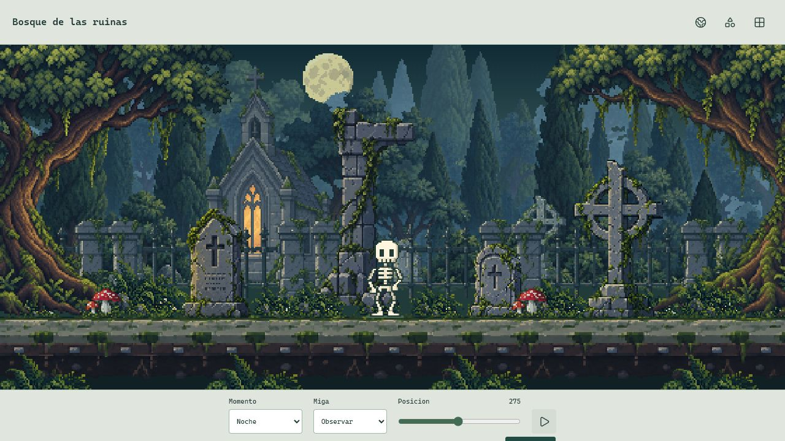
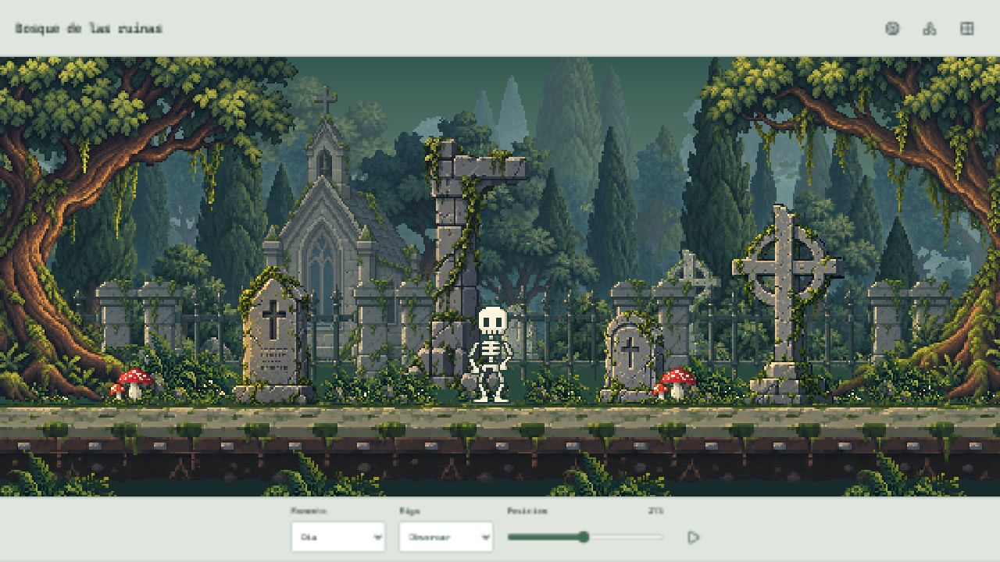
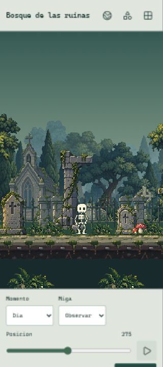
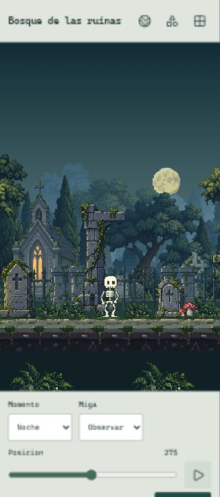

# Trash World

Un mundo de bolsillo habitado por Miga, una calaverita autonoma que pasea, observa, descansa en huesitos y vuelve a armarse.

**Canvas 2D | Vida autonoma | Cementerio del bosque | Guardado local**



*Captura real del visor en navegador a 1280 x 720. Escenario y personaje se dibujan por separado, no son una ilustracion aplanada.*

**Revision del 2026-10-15, preparada para versionar.** Se conservan la escala amplia aprobada y los sprites de Miga. Esta revision reemplaza el entorno visible y retira el farol, la lapida runica y las plantas interactivas. La entrega local, el commit, la etiqueta y la publicacion en GitHub son pasos separados.

## El Cementerio

- Dos robles distintos con troncos curvos, raices, copas e hiedra integrados en cada dibujo.
- Dos planos de bosque con parallax: fondos frios y claros; primer plano con verdes oliva y madera calida.
- Capilla con cruz completa y cristal frio de dia, ambar al atardecer y de noche. Variacion de vela continua y limitada al cristal.
- Tres monumentos: lapida a dos aguas, lapida arqueada y cruz anular. Ruina de dintel roto y verja entre pilares.
- Sendero, helechos con flores, hongos y luna independientes. Sin banda de niebla sobre el suelo ni deformacion de ramas.
- Miga mantiene su rig, paleta y clips aprobados. El ambiente se pinta antes del personaje, sin tintarlo.



*Captura real del mismo visor diurno. Edificios y arboles mantienen su dibujo entre fases.*

### En Movil

<p align="center">
  
  
</p>

*Capturas reales con viewport emulado, no de un telefono fisico. La vista estrecha muestra una seccion del mundo; no comprime el cementerio entero para que quepa.*

## Miga

Personalidad y necesidades influyen en sus paseos, observacion y descanso. Responde al toque y al toque sostenido, duerme desarmandose y se reconstruye al despertar. La partida vive en el navegador, sin cuentas ni backend.

La escena actual no tiene objetos interactivos. Conserva los descubrimientos antiguos como historia, pero cancela al cargar las caminatas e inspecciones dirigidas a objetos retirados. Sin la planta ya no hay alimentacion ambiental automatica: no se inventa una planta invisible. El panel de diagnostico conserva el control de comida.

## Empezar

Requisito: Node.js 22.12 o posterior, con npm.

```bash
git clone https://github.com/bryanpineda-dev/trash-world.git
cd trash-world
npm ci
npm run dev
```

Abre la URL que muestre Vite. Para comprobar la version compilada:

```bash
npm run check
npm run preview
```

`dist/` contiene la aplicacion estatica. Dependencias, builds y caches no se versionan.

## Visores

| Ruta | Vista |
| --- | --- |
| `/` | Mundo autonomo, tacto y guardado local. |
| `/biome-lab.html` | Escenario actual, fases, poses, posicion, pausa y biblioteca por familias. No toca la partida. |
| `/asset-lab.html` | Kit original de Miga y objetos historicos. Sus props no se activan en el mundo. |

## Biblioteca De Assets


*Lamina offline de los PNG nativos, no captura de navegador. Panoramicas y dibujos grandes se ajustan para caber; el manifiesto conserva su tamano y ancla reales.*

```text
assets/
  reference-biome/
    manifest.json             # 14 assets, dimensiones, anclas y SHA-256
    GENERATION.md             # Procedencia y briefs de regeneracion
    source/                   # Originales raster sin modificar
    native/                   # PNG del juego, alpha binario
      trees/                  # 2 robles
      gravestones/            # 3 monumentos
      architecture/           # Capilla, dintel y verja
      backgrounds/            # 2 planos de bosque
      terrain/                # Sendero
      vegetation/             # Helechos/flores y hongos decorativos
      sky/                    # Luna
  source/                     # Rig, piezas y clips originales de Miga
  generated/                  # Atlas original; entorno anterior archivado
```

Los nuevos dibujos son **raster generados individualmente con ImageGen**, guiados por la referencia del usuario; no son dibujos hechos a mano pixel por pixel. Se guardan originales y versiones recortadas, ajustadas con vecino mas cercano y alpha 0/255. El ambiente no usa el limite anterior de 32 tokens. Miga mantiene sus 16 colores.

Los PNG se reutilizan por su ancla. El sendero cubre el tramo actual de 560 unidades: extenderlo a un tileset con uniones certificadas queda pendiente. Los fondos son panoramicas reutilizables, no un mapa aplanado. Ver [composicion y limites](docs/REFERENCE_BIOME.md).

`npm run assets` regenera el kit JSON original, no los nuevos originales raster. Cambiar estos ultimos requiere actualizar PNG nativo, manifiesto y hashes, y pasar sus pruebas.

## Verificacion

Revision del 2026-10-15:

- **158 pruebas aprobadas**, incluidas 10 de la nueva biblioteca y retirada de objetos. Las pruebas historicas no certifican el acabado del nuevo dibujo.
- Renderer de produccion offline: **96 casos**, tres luces y cuatro proporciones; **64 440 pixeles opacos de Miga** cotejados, atlas/fallback iguales y pausa ambiental exacta.
- **483 668 pixeles de assets** revisados para alpha binario; **208 archivos protegidos** sin cambios por SHA-256.
- Capturas de navegador separadas de los renders offline. Detalle y limites en [Verificacion](docs/VERIFICATION.md).

Pendientes: Android fisico, rendimiento y consumo prolongados, desconexion real del nuevo build, partida nocturna prolongada y refinamientos visuales futuros. Una prueba tecnica no demuestra semejanza artistica con la referencia.

## Guardado Y Offline

Guardado cada cinco segundos, al interactuar y al ocultar la app. Datos danados se respaldan; versiones futuras se protegen contra sobrescritura. Al regresar se resume un maximo de ocho horas de necesidades, descanso y reloj, sin inventar descubrimientos.

El service worker se genera con el build y se registra solo en produccion. Requiere localhost o HTTPS y una primera carga completa con conexion. Cada origen, puerto y perfil tiene su propia partida.

## Documentacion

- [Escenario actual y direccion visual](docs/REFERENCE_BIOME.md)
- [Arquitectura](docs/ARCHITECTURE.md)
- [Miga](docs/CHARACTER.md)
- [Flujo del kit original](docs/ASSET_WORKFLOW.md)
- [Verificacion e historial](docs/VERIFICATION.md)
- [Roadmap](docs/ROADMAP.md)

Las guias de bioma, estilo e interacciones anteriores se conservan como historial, no como descripcion del entorno activo de esta propuesta. Las propuestas artisticas rechazadas no son una base visual aprobada.

Proyecto de [bryanpineda-dev](https://github.com/bryanpineda-dev).
