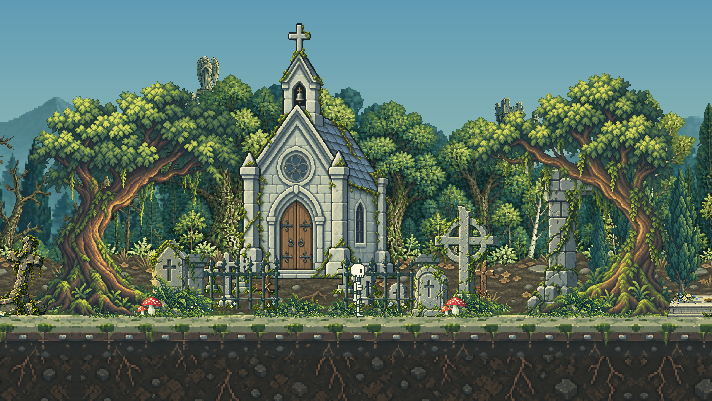
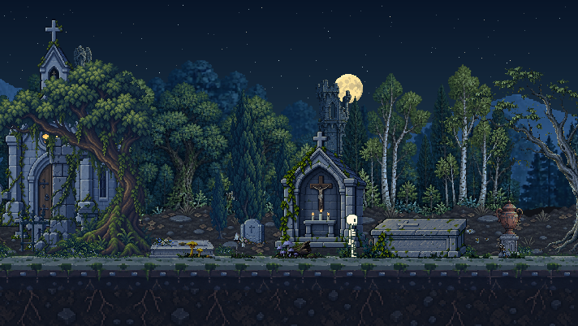

# Trash World

Un mundo de bolsillo habitado por Miga: una calaverita autonoma que explora, observa, se desarma para dormir y vuelve a levantarse.

**Canvas 2D | Pixel art | Cementerio del bosque | Guardado local**



*Revision aprobada, 2026-10-20, a las 12:00: render offline nativo de 712 x 401. No es captura de navegador ni medida de FPS.*

## Revision Actual

**Revision aprobada: cementerio estable y verja localizada.** Las doce piezas pequenas del cementerio y su tierra comparten un desplazamiento de camara, manteniendo las dos alturas de las filas. La verja se dibuja delante de ellas y solo ocupa dos tramos de hierro junto a la iglesia: 232px de extremo a extremo, mas el espesor de los dos apoyos exteriores, con una apertura central de 64px. Ya no se repite a lo largo del bioma. [Alcance y comparacion](docs/CEMETERY_MOTION.md), [QA de esta revision](docs/CEMETERY_MOTION_QA.json).

La [entrega actual](docs/CEMETERY_MOTION_DELIVERY.json) registra la copia estable y sus comprobaciones. La [entrega anterior](docs/CONTINUITY_DELIVERY.json) retiro las cinco plantas inferiores y agrego tres marcadores unicos; se conserva como historial, no como evidencia de esta correccion.

Miga conserva sus clips de produccion. La direccion anatomica del candidato esta aprobada para seguir afinandola, no como sustitucion final del personaje. El [laboratorio](studies/locomotion/index.html?view=world) compara ambas caminatas sobre el terreno real, con camara, sombras e iluminacion diurna/nocturna. Es una prueba opcional de desarrollo, no un motor completo ni una reconstruccion de todos los estados.


*Secuencia offline nueva de seis segundos, con Miga y la camara del renderer principal. Muestreo cada 50ms; no es una grabacion ni un benchmark de navegador. El salto del final reinicia la comparacion.*

[Alcance ambiental anterior](docs/CONTINUITY.md), [investigacion y plan de Miga](docs/LOCOMOTION_RESEARCH.md) y [QA anterior del visor en terreno](docs/LOCOMOTION_WORLD_QA.json). Quedan pendientes aprobacion de la caminata en contexto e integracion de la locomocion. El acceso automatizado al navegador sigue bloqueado.

El suelo de tierra, piedra y raices, el sendero, las torres lejanas, la hiedra discreta y la fauna de las revisiones anteriores se conservan. Historia y procedencia en [Suelo](docs/SOIL_REVIEW.md) y [Torres e iglesia](docs/DEPTH_VEGETATION.md). No cambian IA, guardados, limites, velocidad del juego ni dependencias. La copia estable no equivale a un commit, etiqueta o publicacion nuevos.

## Empezar

Requisito: Node.js 22.12 o posterior, con npm.

```bash
git clone https://github.com/bryanpineda-dev/trash-world.git
cd trash-world
npm ci
npm run dev
```

Abrir la URL que muestre Vite. Para verificar y probar el build:

```bash
npm run check
npm run preview
```

| Ruta | Vista |
| --- | --- |
| `/` | Mundo autonomo, interfaz de cristal y guardado local |
| `/biome-lab.html` | Zonas, hora, poses, camara, pausa y biblioteca por familias, sin tocar partidas |
| `/asset-lab.html` | Rig de Miga y kit historico de objetos; no activa esos props en el mundo |
| `/studies/locomotion/` | Comparacion articular candidata, solo desarrollo; no incluida en `dist/` |

`dist/` es la aplicacion estatica compilada. Dependencias, builds, caches y configuraciones locales no se versionan.

## El Mundo

Un recorrido continuo de 1680 unidades, desde -560 hasta 1120, con tres zonas:

| Zona | Contenido |
| --- | --- |
| Jardin de los angeles | Roble seco, estatua, tumba con rosas, obelisco y torre memorial alada distante |
| Claro de Miga | Iglesia unica, nueve cruces, robles y monumentos del cementerio |
| Patio del oratorio | Oratorio abierto, sarcofago, urna, cipreses, torre y fresno |



*Render offline nuevo del renderer principal, a resolucion nativa. No es una captura de navegador.*

Los monumentos y arboles de encuadre se colocan una sola vez. Solo el terreno se repite a lo largo del bioma. Los dos tramos locales de hierro conservan sus 84px nativos, sin estirar barrotes ni insertar muros intermedios. Las panoramicas forestales mantienen sus factores de parallax. La proyeccion de cada plano redondea una traslacion comun, no el desplazamiento de cada sprite por separado.

El encuadre de escritorio se abre globalmente: a 1280 x 720 el canvas logico es 712 x 401. No se estira la iglesia ni se cambia el pixel del personaje. En un movil de 320 x 720 sigue siendo 288 x 648. Los panoramas extremadamente bajos conservan el limite de 2048px y el ajuste de encuadre de edificios para no cortar sus remates.

## Luz Y Vida

- Dia de 24 minutos, con amanecer, dia, luz dorada, crepusculo y noche interpolados.
- Roseton frio de dia y ambar de noche; la variacion se limita a su cristal, sin iluminar la madera de las puertas.
- Tres velas pequenas independientes en el oratorio, con un derrame nocturno localizado.
- Hasta ocho luciernagas sutiles, con pausas de vuelo y destellos desfasados; de dia no aparecen.
- Un murcielago nocturno ocasional, con intervalos sin vuelo, sin repetirlo por zona o viewport.
- Mariposas diurnas y hojas ocasionales; abejas y libelulas quedan para la siguiente etapa.
- Estrellas con canales de posicion independientes, separacion minima de referencia y titilacion suave; sin movimiento artificial del cielo.
- Estrellas detras del paisaje y luna sin oscurecimiento de material.
- Desactivar movimiento ambiental congela sus animaciones sin detener el reloj del mundo.
- HUD de cristal, estados con color, reservas de energia/saciedad/animo y reloj orbital.

## Biblioteca De Assets

**44 PNG ambientales activos, 38 originales distintos y un sprite de fauna de 13 x 9 con cuatro poses.** La revision agrega tres marcadores, sin modificar los 41 exports anteriores. El murcielago usa mascaras de pixeles editables, consumidas directamente por el mundo y la categoria Fauna de la biblioteca; no genera PNG duplicados. El hierro y el pilar comparten su original; nueve marcadores se recortan de dos hojas de origen. Dos originales de bosques sustituidos se mantienen solo como procedencia, fuera del catalogo activo.

```text
assets/reference-biome/
  manifest.json
  ARCHITECTURE_GENERATION.md
  ENVIRONMENT_POLISH_GENERATION.md
  source/
  native/
    architecture/    # Iglesia, oratorio, dos torres, ruina, hierro y pilar
    gravestones/     # 22 monumentos y cruces, incluido el sarcofago
    trees/           # Robles, fresno y cipreses
    backgrounds/     # Dos panoramicas activas
    vegetation/      # Helechos, flores y hongos
    terrain/         # Sendero, tierra del cementerio y subsuelo
    sky/             # Luna
```

| Pieza | Resolucion nativa |
| --- | --- |
| Cuerpo visible de Miga | 28 x 56, dentro de frames de 64 x 64 |
| Iglesia | 173 x 256 |
| Oratorio | 116 x 144 |
| Sarcofago | 120 x 49 |
| Torre memorial alada | 70 x 190 |
| Bosque intermedio | 900 x 229 |
| Hierro / pilar de la verja | 84 x 62 / 26 x 62 |
| Murcielago, cuatro poses | 13 x 9 |
| Nueve cruces/lapidas de las filas | 19-30px de ancho, 26-56px de alto |

El arte del escenario es raster generado con ImageGen y guiado por referencias, no dibujo manual pixel a pixel. Originales, recortes, dimensiones, anclas y hashes quedan registrados. Los exports usan vecino mas cercano y alpha binario. El murcielago nuevo es un sprite code-native definido en `assets/source/ambient/bat.js`, siguiendo el dibujado por pixeles del proyecto, sin generacion raster nueva. Miga conserva su paleta y clips aprobados.

Los identificadores internos `chapel`, `mausoleum`, `recliningAngel` y `distantCitadel` se conservan por compatibilidad del catalogo. Sus archivos y etiquetas visibles corresponden a iglesia, oratorio, sarcofago y torre alada. Los PNG sustituidos se retiran del proyecto tras respaldo; no se borran archivos ajenos.

`npm run assets` regenera el kit original y los atlas historicos requeridos por tests. `npm run assets:check` comprueba su reproducibilidad. `npm run assets:legacy` recupera exports historicos solo en `.cache/legacy-assets/`, fuera de las carpetas activas.

## Verificacion

[La pasada actual](docs/CEMETERY_MOTION_QA.json) distingue pruebas del motor, build principal, secuencia de movimiento y renders offline nuevos de las tres zonas de dia/noche. Comprueba separacion constante entre cruces, tierra y verja; los 44 PNG ambientales y ambas bases de animacion de Miga permanecen intactos. La distribucion de la verja esta aprobada; QA interactivo de navegador y rendimiento siguen pendientes. La caminata candidata aun no forma parte del mundo principal; su [prueba anterior](docs/LOCOMOTION_WORLD_QA.json) no sustituye el QA de esta correccion.

La propuesta de suelo tiene resultados nuevos en [Revision del suelo](docs/SOIL_REVIEW.md) y [QA](docs/SOIL_QA.json). Se distinguen pruebas del motor, renders offline y comprobaciones reales en navegador: el acceso automatizado al navegador quedo bloqueado por su politica y no se presenta como aprobado. El visor HTTP esta disponible para revision manual. Las pruebas de navegador de [la revision anterior](docs/DEPTH_VEGETATION.md) y las imagenes anteriores se conservan como historia, no como evidencia de este cambio.

La perspectiva y el acabado artistico siguen abiertos a mejoras posteriores. No se han validado Android fisico, rendimiento/consumo ni desconexion real en esta pasada.

## Guardado

Partida local por navegador y origen, sin cuentas ni backend. Se guarda al interactuar, cada cinco segundos y al ocultar la aplicacion. Se resume un maximo de ocho horas al regresar, sin desplazar a Miga ni inventar descubrimientos. Partidas futuras se protegen contra sobrescritura y datos danados se respaldan.

El service worker se registra solo en produccion. Requiere HTTPS o localhost y una primera carga completa con conexion. Cambiar de puerto no comparte la partida.

## Documentacion

- [Cementerio fijo y verja localizada, propuesta actual](docs/CEMETERY_MOTION.md)
- [Continuidad del bioma y biblioteca nueva](docs/CONTINUITY.md)
- [Investigacion de caminata y base de personajes](docs/LOCOMOTION_RESEARCH.md)
- [Muestra de suelo, comparacion y limites actuales](docs/SOIL_REVIEW.md)
- [Profundidad de torres e hiedra de iglesia](docs/DEPTH_VEGETATION.md)
- [Vida nocturna y limpieza anterior](docs/NIGHTLIFE.md)
- [Revision ambiental actual y limites de QA](docs/ENVIRONMENT_POLISH.md)
- [Integracion actual, escala, capas y entrega](docs/ARCHITECTURE_INTEGRATION.md)
- [Inventario actual con hashes](docs/ASSET_INVENTORY.json)
- [Verificacion e historial](docs/VERIFICATION.md)
- [Estudio de perspectiva y referencias de la tumba](docs/TOMB_PERSPECTIVE_REVIEW.md)
- [Luz, cielos y profundidad](docs/DAYLIGHT.md)
- [Vida ambiental](docs/LIVING_WORLD.md)
- [Interfaz y contacto con el suelo](docs/GLASS_HUD.md)
- [Miga y sus animaciones](docs/CHARACTER.md)
- [Investigacion sobre escala y perspectiva](docs/WORLD_SCALE_AND_PERSPECTIVE.md)
- [Limpieza y recuperacion de exports historicos](docs/ASSET_CLEANUP.md)

Los estudios previos y sus propuestas rechazadas son historial de diseno; no sustituyen la descripcion de esta integracion.

Proyecto de [bryanpineda-dev](https://github.com/bryanpineda-dev).
