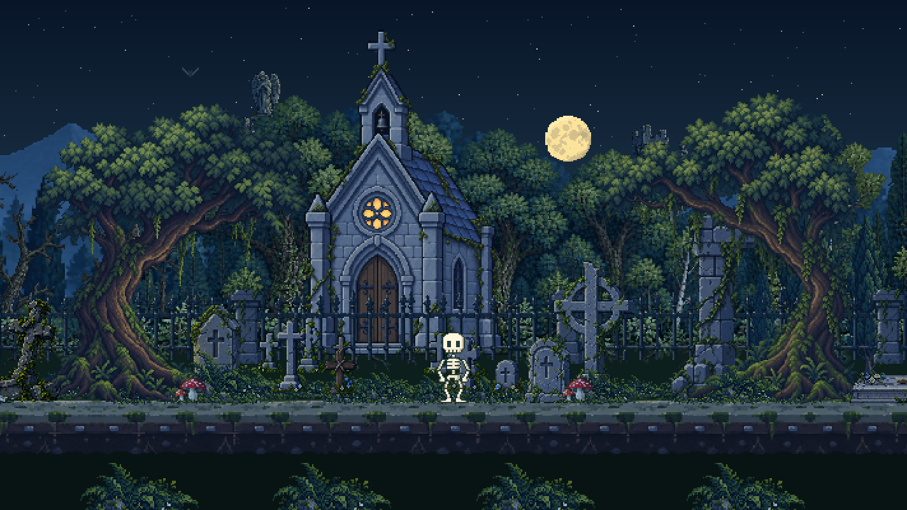
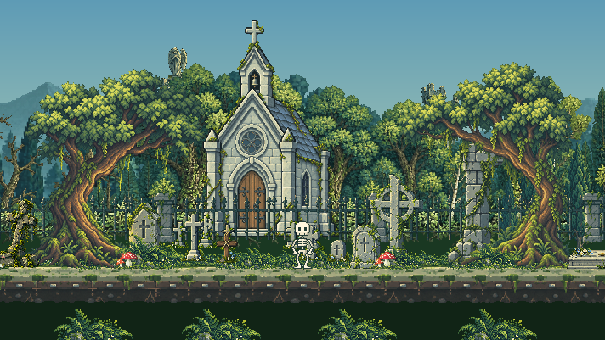
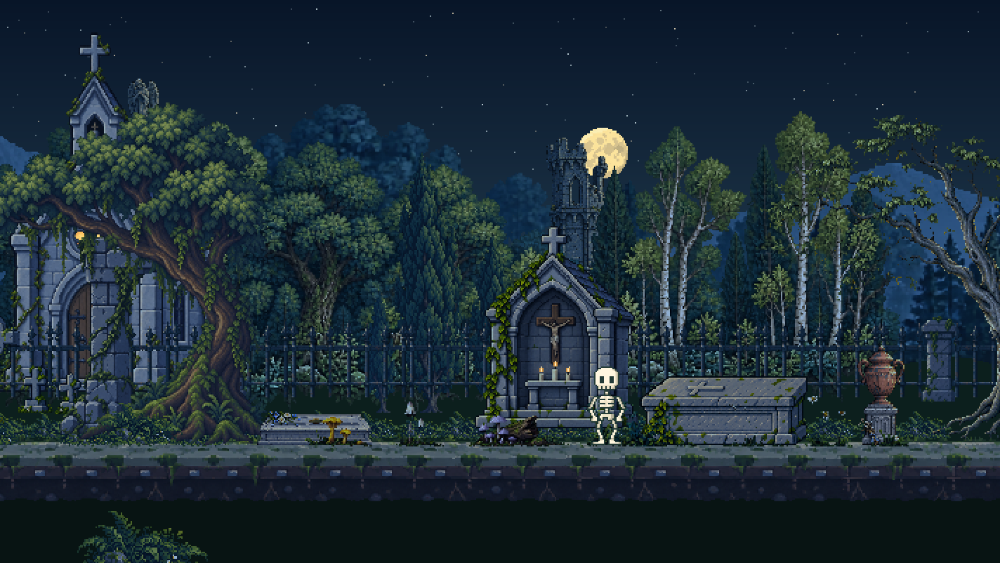

# Trash World

Un mundo de bolsillo habitado por Miga: una calaverita autonoma que explora, observa, se desarma para dormir y vuelve a levantarse.

**Canvas 2D | Pixel art | Cementerio del bosque | Guardado local**



*Render offline nuevo del renderer principal, 2026-10-19, a las 22:00: canvas 712 x 401 ampliado exactamente 2x sin suavizado. No es una captura de navegador ni una medida de FPS.*

## Revision Actual

Las dos torres lejanas comparten parallax 0.22, apoyo 71 unidades sobre el sendero y orden de capas detras del bosque intermedio. La torre derecha conserva su export nativo de 57 x 148; no se agranda ni se cambian los arboles para simular distancia.

La iglesia conserva encuadre, ancla y export de 173 x 256, con hiedra mas fina y discreta aprobada por el usuario. La cobertura verde medida baja aproximadamente un 49%; el roseton sigue frio de dia y ambar de noche. No cambia el zoom del mundo.

Se mantienen la fauna nocturna y las estrellas revisadas de la pasada anterior, junto con la biblioteca sin duplicados del estudio. [Detalle de los dos ajustes y QA](docs/DEPTH_VEGETATION.md).

Esta revision se prepara para aprobacion visual y commit. No equivale a una publicacion, etiqueta o release nuevos. Miga, su rig, animaciones, necesidades, controles, guardados y limites del mundo no cambian.



*Render offline nuevo a las 12:00, sin movimiento ambiental. No lee la partida ni demuestra rendimiento o interaccion en navegador.*

## Empezar

Requisito: Node.js 22.12 o posterior, con npm.

```bash
git clone https://github.com/bryanpineda-dev/trash-world.git
cd trash-world
npm ci
npm run dev
```

Abrir la URL que muestre Vite. Para verificar y probar el build:

```bash
npm run check
npm run preview
```

| Ruta | Vista |
| --- | --- |
| `/` | Mundo autonomo, interfaz de cristal y guardado local |
| `/biome-lab.html` | Zonas, hora, poses, camara, pausa y biblioteca por familias, sin tocar partidas |
| `/asset-lab.html` | Rig de Miga y kit historico de objetos; no activa esos props en el mundo |

`dist/` es la aplicacion estatica compilada. Dependencias, builds, caches y configuraciones locales no se versionan.

## El Mundo

Un recorrido continuo de 1680 unidades, desde -560 hasta 1120, con tres zonas:

| Zona | Contenido |
| --- | --- |
| Jardin de los angeles | Roble seco, estatua, tumba con rosas, obelisco y torre memorial alada distante |
| Claro de Miga | Iglesia unica, nueve cruces, robles y monumentos del cementerio |
| Patio del oratorio | Oratorio abierto, sarcofago, urna, cipreses, torre y fresno |



*Render offline nuevo del renderer principal, ampliado exactamente 2x sin suavizado. No es una captura de navegador.*

Los monumentos y arboles de encuadre se colocan una sola vez. El sendero y la verja son modulos estructurales reutilizables. Los tramos de hierro miden 84px, sin estirar barrotes; los pilares se colocan cada 252px, no en ambos extremos de cada tramo. Las dos panoramicas forestales conservan su parallax y todos los planos comparten el mismo origen de camara.

El encuadre de escritorio se abre globalmente: a 1280 x 720 el canvas logico es 712 x 401. No se estira la iglesia ni se cambia el pixel del personaje. En un movil de 320 x 720 sigue siendo 288 x 648. Los panoramas extremadamente bajos conservan el limite de 2048px y el ajuste de encuadre de edificios para no cortar sus remates.

## Luz Y Vida

- Dia de 24 minutos, con amanecer, dia, luz dorada, crepusculo y noche interpolados.
- Roseton frio de dia y ambar de noche; la variacion se limita a su cristal, sin iluminar la madera de las puertas.
- Tres velas pequenas independientes en el oratorio, con un derrame nocturno localizado.
- Hasta ocho luciernagas sutiles, con pausas de vuelo y destellos desfasados; de dia no aparecen.
- Un murcielago nocturno ocasional, con intervalos sin vuelo, sin repetirlo por zona o viewport.
- Mariposas diurnas y hojas ocasionales; abejas y libelulas quedan para la siguiente etapa.
- Estrellas con canales de posicion independientes, separacion minima de referencia y titilacion suave; sin movimiento artificial del cielo.
- Estrellas detras del paisaje y luna sin oscurecimiento de material.
- Desactivar movimiento ambiental congela sus animaciones sin detener el reloj del mundo.
- HUD de cristal, estados con color, reservas de energia/saciedad/animo y reloj orbital.

## Biblioteca De Assets

**39 PNG ambientales activos, 33 originales distintos y un sprite de fauna de 13 x 9 con cuatro poses.** El murcielago usa mascaras de pixeles editables, consumidas directamente por el mundo y la categoria Fauna de la biblioteca; no genera PNG duplicados. El hierro y el pilar comparten su original; nueve marcadores se recortan de dos hojas de origen. Dos originales de bosques sustituidos se mantienen solo como procedencia, fuera del catalogo activo.

```text
assets/reference-biome/
  manifest.json
  ARCHITECTURE_GENERATION.md
  ENVIRONMENT_POLISH_GENERATION.md
  source/
  native/
    architecture/    # Iglesia, oratorio, dos torres, ruina, hierro y pilar
    gravestones/     # 19 monumentos y cruces, incluido el sarcofago
    trees/           # Robles, fresno y cipreses
    backgrounds/     # Dos panoramicas activas
    vegetation/      # Helechos, flores y hongos
    terrain/         # Sendero
    sky/             # Luna
```

| Pieza | Resolucion nativa |
| --- | --- |
| Cuerpo visible de Miga | 28 x 56, dentro de frames de 64 x 64 |
| Iglesia | 173 x 256 |
| Oratorio | 116 x 144 |
| Sarcofago | 120 x 49 |
| Torre memorial alada | 70 x 190 |
| Bosque intermedio | 900 x 229 |
| Hierro / pilar de la verja | 84 x 62 / 26 x 62 |
| Murcielago, cuatro poses | 13 x 9 |
| Nueve cruces/lapidas de las filas | 19-30px de ancho, 26-56px de alto |

El arte del escenario es raster generado con ImageGen y guiado por referencias, no dibujo manual pixel a pixel. Originales, recortes, dimensiones, anclas y hashes quedan registrados. Los exports usan vecino mas cercano y alpha binario. El murcielago nuevo es un sprite code-native definido en `assets/source/ambient/bat.js`, siguiendo el dibujado por pixeles del proyecto, sin generacion raster nueva. Miga conserva su paleta y clips aprobados.

Los identificadores internos `chapel`, `mausoleum`, `recliningAngel` y `distantCitadel` se conservan por compatibilidad del catalogo. Sus archivos y etiquetas visibles corresponden a iglesia, oratorio, sarcofago y torre alada. Los PNG sustituidos se retiran del proyecto tras respaldo; no se borran archivos ajenos.

`npm run assets` regenera el kit original y los atlas historicos requeridos por tests. `npm run assets:check` comprueba su reproducibilidad. `npm run assets:legacy` recupera exports historicos solo en `.cache/legacy-assets/`, fuera de las carpetas activas.

## Verificacion

266 tests, `assets:check` y build aprobados en el sandbox; 24 renders de produccion offline en cuatro proporciones y tres zonas. Comprobacion real del visor y del mundo principal a 495 x 452, sin extrapolar a escritorio, FPS o Android. Detalle de esta revision en [Profundidad e hiedra](docs/DEPTH_VEGETATION.md), [Verificacion](docs/VERIFICATION.md) y el [historial ambiental](docs/ENVIRONMENT_POLISH.md). Se distinguen pruebas del motor, renders offline y capturas reales del navegador. Las imagenes de revisiones anteriores se conservan como historia, no como evidencia nueva.

La perspectiva y el acabado artistico siguen abiertos a mejoras posteriores. No se han validado Android fisico, rendimiento/consumo ni desconexion real en esta pasada.

## Guardado

Partida local por navegador y origen, sin cuentas ni backend. Se guarda al interactuar, cada cinco segundos y al ocultar la aplicacion. Se resume un maximo de ocho horas al regresar, sin desplazar a Miga ni inventar descubrimientos. Partidas futuras se protegen contra sobrescritura y datos danados se respaldan.

El service worker se registra solo en produccion. Requiere HTTPS o localhost y una primera carga completa con conexion. Cambiar de puerto no comparte la partida.

## Documentacion

- [Profundidad de torres e hiedra de iglesia](docs/DEPTH_VEGETATION.md)
- [Vida nocturna y limpieza anterior](docs/NIGHTLIFE.md)
- [Revision ambiental actual y limites de QA](docs/ENVIRONMENT_POLISH.md)
- [Integracion actual, escala, capas y entrega](docs/ARCHITECTURE_INTEGRATION.md)
- [Inventario actual con hashes](docs/ASSET_INVENTORY.json)
- [Verificacion e historial](docs/VERIFICATION.md)
- [Estudio de perspectiva y referencias de la tumba](docs/TOMB_PERSPECTIVE_REVIEW.md)
- [Luz, cielos y profundidad](docs/DAYLIGHT.md)
- [Vida ambiental](docs/LIVING_WORLD.md)
- [Interfaz y contacto con el suelo](docs/GLASS_HUD.md)
- [Miga y sus animaciones](docs/CHARACTER.md)
- [Investigacion sobre escala y perspectiva](docs/WORLD_SCALE_AND_PERSPECTIVE.md)
- [Limpieza y recuperacion de exports historicos](docs/ASSET_CLEANUP.md)

Los estudios previos y sus propuestas rechazadas son historial de diseno; no sustituyen la descripcion de esta integracion.

Proyecto de [bryanpineda-dev](https://github.com/bryanpineda-dev).
