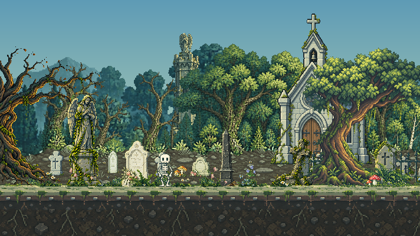
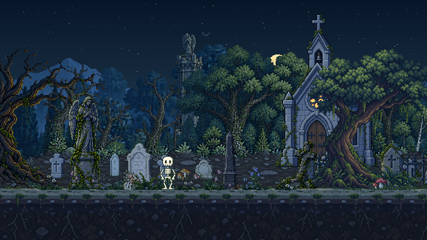

# Trash World

Un mundo de bolsillo habitado por Miga: una calaverita autonoma que explora, observa, se desarma para dormir y vuelve a levantarse.

**Canvas 2D | Pixel art | Cementerio del bosque | Guardado local**



*Revision aprobada, 2026-10-20, a las 12:00: render offline nativo de 712 x 401. No es captura de navegador ni medida de FPS.*

## Revision Actual

**Revision aprobada: jardin occidental con mas vida.** Tres lapidas originales, violetas y hongos ocres enriquecen el lado izquierdo sin repetir monumentos. Los tonos marrones de la tierra se acercan a un suelo mineral mas neutro, conservando piedra, raices y hojarasca. De dia hay abejas, libelulas y mas habitats de mariposas; de noche, luciernagas mas perceptibles y distribuidas. [Alcance y comparacion](docs/WEST_GARDEN.md), [QA de esta revision](docs/WEST_GARDEN_QA.json).

La [entrega actual](docs/WEST_GARDEN_DELIVERY.json) registra la copia estable y sus comprobaciones. La [entrega anterior](docs/CEMETERY_MOTION_DELIVERY.json), base de esta revision, conserva la verja localizada delante del cementerio. No se han agregado plantas debajo del sendero. La copia no equivale a commit, etiqueta o publicacion nuevos.

Miga conserva sus clips de produccion. La direccion anatomica del candidato esta aprobada para seguir afinandola, no como sustitucion final del personaje. El [laboratorio](studies/locomotion/index.html?view=world) compara ambas caminatas sobre el terreno real, con camara, sombras e iluminacion diurna/nocturna. Es una prueba opcional de desarrollo, no un motor completo ni una reconstruccion de todos los estados.


*Detalle offline nuevo de seis segundos del renderer principal: recortes nativos de 450 x 110 por momento, muestreados cada 50ms. No es una grabacion ni un benchmark de navegador. El bucle reinicia la muestra.*

[Alcance ambiental anterior](docs/CONTINUITY.md), [investigacion y plan de Miga](docs/LOCOMOTION_RESEARCH.md) y [QA anterior del visor en terreno](docs/LOCOMOTION_WORLD_QA.json). Quedan pendientes aprobacion de la caminata en contexto e integracion de la locomocion. El acceso automatizado al navegador sigue bloqueado.

El sendero, las torres lejanas, la hiedra discreta y las capas existentes se conservan. Los originales y exports anteriores no se redibujan: el ajuste de tierra se aplica al material, no al resto de la paleta. Historia y procedencia en [Suelo](docs/SOIL_REVIEW.md) y [Torres e iglesia](docs/DEPTH_VEGETATION.md). No cambian IA, guardados, limites, velocidad del juego ni dependencias.

## Empezar

Requisito: Node.js 22.12 o posterior, con npm.

```bash
git clone https://github.com/bryanpineda-dev/trash-world.git
cd trash-world
npm ci
npm run dev
```

Abrir la URL que muestre Vite. Para verificar y probar el build:

```bash
npm run check
npm run preview
```

| Ruta | Vista |
| --- | --- |
| `/` | Mundo autonomo, interfaz de cristal y guardado local |
| `/biome-lab.html` | Zonas, hora, poses, camara, pausa y biblioteca por familias, sin tocar partidas |
| `/asset-lab.html` | Rig de Miga y kit historico de objetos; no activa esos props en el mundo |
| `/studies/locomotion/` | Comparacion articular candidata, solo desarrollo; no incluida en `dist/` |

`dist/` es la aplicacion estatica compilada. Dependencias, builds, caches y configuraciones locales no se versionan.

## El Mundo

Un recorrido continuo de 1680 unidades, desde -560 hasta 1120, con tres zonas:

| Zona | Contenido |
| --- | --- |
| Jardin de los angeles | Roble seco, estatua, tumbas variadas, obelisco, violetas, hongos ocres y torre memorial alada distante |
| Claro de Miga | Iglesia unica, nueve cruces, robles y monumentos del cementerio |
| Patio del oratorio | Oratorio abierto, sarcofago, urna, cipreses, torre y fresno |



*Render offline nuevo del renderer principal, a resolucion nativa. No es una captura de navegador.*

Los monumentos y arboles de encuadre se colocan una sola vez. Solo el terreno se repite a lo largo del bioma. Los dos tramos locales de hierro conservan sus 84px nativos, sin estirar barrotes ni insertar muros intermedios. Las panoramicas forestales mantienen sus factores de parallax. La proyeccion de cada plano redondea una traslacion comun, no el desplazamiento de cada sprite por separado.

El encuadre de escritorio se abre globalmente: a 1280 x 720 el canvas logico es 712 x 401. No se estira la iglesia ni se cambia el pixel del personaje. En un movil de 320 x 720 sigue siendo 288 x 648. Los panoramas extremadamente bajos conservan el limite de 2048px y el ajuste de encuadre de edificios para no cortar sus remates.

## Luz Y Vida

- Dia de 24 minutos, con amanecer, dia, luz dorada, crepusculo y noche interpolados.
- Roseton frio de dia y ambar de noche; la variacion se limita a su cristal, sin iluminar la madera de las puertas.
- Tres velas pequenas independientes en el oratorio, con un derrame nocturno localizado.
- Hasta doce luciernagas sutiles, con mas habitats en el oeste, pausas de vuelo y destellos desfasados; de dia no aparecen.
- Un murcielago nocturno ocasional, con intervalos sin vuelo, sin repetirlo por zona o viewport.
- Cuatro habitats de mariposas, hasta cuatro abejas y dos libelulas diurnas segun encuadre, con fases de vuelo y pausas independientes. Una abeja puede posarse en las violetas y compartir exactamente su plano de camara.
- Hojas ocasionales, sin convertirlas en objetos del sendero. No hay insectos diurnos durante la noche.
- Estrellas con canales de posicion independientes, separacion minima de referencia y titilacion suave; sin movimiento artificial del cielo.
- Estrellas detras del paisaje y luna sin oscurecimiento de material.
- Desactivar movimiento ambiental congela sus animaciones sin detener el reloj del mundo.
- HUD de cristal, estados con color, reservas de energia/saciedad/animo y reloj orbital.

## Biblioteca De Assets

**49 PNG ambientales activos, 43 originales distintos y tres sprites de fauna editables.** La revision agrega cinco dibujos, sin modificar los 44 exports anteriores. Abeja de 9 x 6 y libelula de 13 x 7 tienen vuelo y reposo; el murcielago de 13 x 9 mantiene sus cuatro poses. Los tres se consumen directamente en el mundo y en la categoria Fauna de la biblioteca, sin PNG duplicados. El hierro y el pilar comparten su original; nueve marcadores se recortan de dos hojas de origen. Dos originales de bosques sustituidos se mantienen solo como procedencia, fuera del catalogo activo.

```text
assets/reference-biome/
  manifest.json
  ARCHITECTURE_GENERATION.md
  ENVIRONMENT_POLISH_GENERATION.md
  source/
  native/
    architecture/    # Iglesia, oratorio, dos torres, ruina, hierro y pilar
    gravestones/     # 25 monumentos y cruces, incluido el sarcofago
    trees/           # Robles, fresno y cipreses
    backgrounds/     # Dos panoramicas activas
    vegetation/      # Helechos, flores y hongos
    terrain/         # Sendero, tierra del cementerio y subsuelo
    sky/             # Luna
```

| Pieza | Resolucion nativa |
| --- | --- |
| Cuerpo visible de Miga | 28 x 56, dentro de frames de 64 x 64 |
| Iglesia | 173 x 256 |
| Oratorio | 116 x 144 |
| Sarcofago | 120 x 49 |
| Torre memorial alada | 70 x 190 |
| Bosque intermedio | 900 x 229 |
| Hierro / pilar de la verja | 84 x 62 / 26 x 62 |
| Murcielago, cuatro poses | 13 x 9 |
| Abeja / libelula, vuelo y reposo | 9 x 6 / 13 x 7 |
| Pizarra / estela / memorial bajo nuevos | 26 x 42 / 21 x 40 / 38 x 33 |
| Violetas / hongos ocres nuevos | 16 x 19 / 22 x 20 |
| Nueve cruces/lapidas de las filas | 19-30px de ancho, 26-56px de alto |

El arte del escenario es raster generado con ImageGen y guiado por referencias, no dibujo manual pixel a pixel. Originales, recortes, dimensiones, anclas, hashes y [prompts de los cinco dibujos](docs/WEST_GARDEN_PROMPTS.json) quedan registrados. Los exports usan vecino mas cercano y alpha binario. La fauna es code-native: `assets/source/ambient/bat.js` y `assets/source/ambient/pollinators.js`, siguiendo el dibujado por pixeles del proyecto. Miga conserva su paleta y clips aprobados.

Los identificadores internos `chapel`, `mausoleum`, `recliningAngel` y `distantCitadel` se conservan por compatibilidad del catalogo. Sus archivos y etiquetas visibles corresponden a iglesia, oratorio, sarcofago y torre alada. Los PNG sustituidos se retiran del proyecto tras respaldo; no se borran archivos ajenos.

`npm run assets` regenera el kit original y los atlas historicos requeridos por tests. `npm run assets:check` comprueba su reproducibilidad. `npm run assets:legacy` recupera exports historicos solo en `.cache/legacy-assets/`, fuera de las carpetas activas.

## Verificacion

[La pasada actual](docs/WEST_GARDEN_QA.json) distingue pruebas del motor, build, secuencia de insectos y renders offline nuevos. Comprueba visibilidad de los cinco dibujos nuevos, inventario, alpha, estabilidad del plano, material y ciclos de fauna. Los 44 PNG ambientales previos y ambas bases de animacion de Miga permanecen intactos. La revision artistica esta aprobada; QA interactivo de navegador y rendimiento siguen pendientes. La caminata candidata aun no forma parte del mundo principal; su [prueba anterior](docs/LOCOMOTION_WORLD_QA.json) no sustituye el QA de esta correccion.

La propuesta de suelo tiene resultados nuevos en [Revision del suelo](docs/SOIL_REVIEW.md) y [QA](docs/SOIL_QA.json). Se distinguen pruebas del motor, renders offline y comprobaciones reales en navegador: el acceso automatizado al navegador quedo bloqueado por su politica y no se presenta como aprobado. El visor HTTP esta disponible para revision manual. Las pruebas de navegador de [la revision anterior](docs/DEPTH_VEGETATION.md) y las imagenes anteriores se conservan como historia, no como evidencia de este cambio.

La perspectiva y el acabado artistico siguen abiertos a mejoras posteriores. No se han validado Android fisico, rendimiento/consumo ni desconexion real en esta pasada.

## Guardado

Partida local por navegador y origen, sin cuentas ni backend. Se guarda al interactuar, cada cinco segundos y al ocultar la aplicacion. Se resume un maximo de ocho horas al regresar, sin desplazar a Miga ni inventar descubrimientos. Partidas futuras se protegen contra sobrescritura y datos danados se respaldan.

El service worker se registra solo en produccion. Requiere HTTPS o localhost y una primera carga completa con conexion. Cambiar de puerto no comparte la partida.

## Documentacion

- [Jardin occidental y polinizadores, revision actual](docs/WEST_GARDEN.md)
- [Cementerio fijo y verja localizada, propuesta actual](docs/CEMETERY_MOTION.md)
- [Continuidad del bioma y biblioteca nueva](docs/CONTINUITY.md)
- [Investigacion de caminata y base de personajes](docs/LOCOMOTION_RESEARCH.md)
- [Muestra de suelo, comparacion y limites actuales](docs/SOIL_REVIEW.md)
- [Profundidad de torres e hiedra de iglesia](docs/DEPTH_VEGETATION.md)
- [Vida nocturna y limpieza anterior](docs/NIGHTLIFE.md)
- [Revision ambiental actual y limites de QA](docs/ENVIRONMENT_POLISH.md)
- [Integracion actual, escala, capas y entrega](docs/ARCHITECTURE_INTEGRATION.md)
- [Inventario actual con hashes](docs/ASSET_INVENTORY.json)
- [Verificacion e historial](docs/VERIFICATION.md)
- [Estudio de perspectiva y referencias de la tumba](docs/TOMB_PERSPECTIVE_REVIEW.md)
- [Luz, cielos y profundidad](docs/DAYLIGHT.md)
- [Vida ambiental](docs/LIVING_WORLD.md)
- [Interfaz y contacto con el suelo](docs/GLASS_HUD.md)
- [Miga y sus animaciones](docs/CHARACTER.md)
- [Investigacion sobre escala y perspectiva](docs/WORLD_SCALE_AND_PERSPECTIVE.md)
- [Limpieza y recuperacion de exports historicos](docs/ASSET_CLEANUP.md)

Los estudios previos y sus propuestas rechazadas son historial de diseno; no sustituyen la descripcion de esta integracion.

Proyecto de [bryanpineda-dev](https://github.com/bryanpineda-dev).
