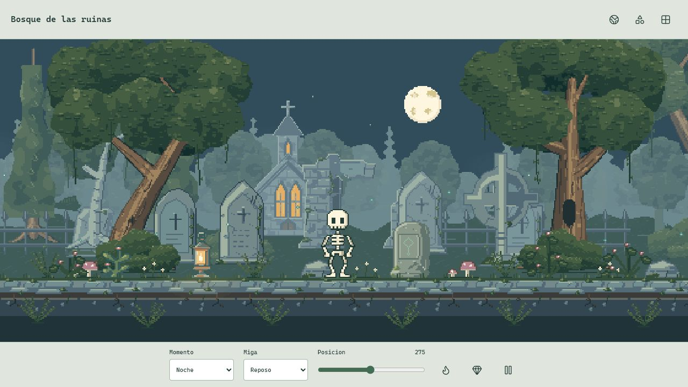
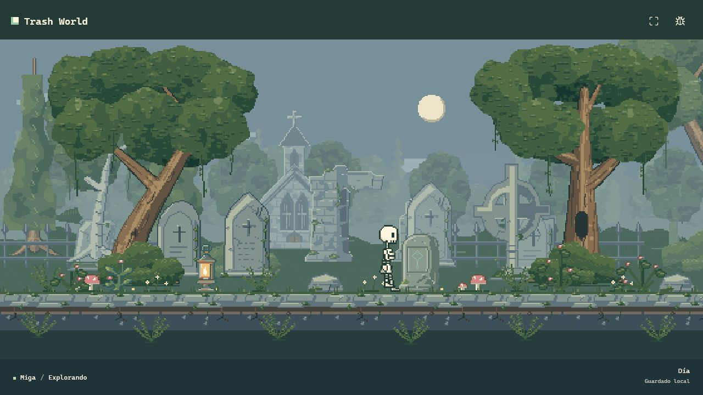
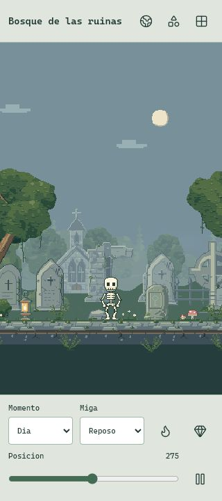
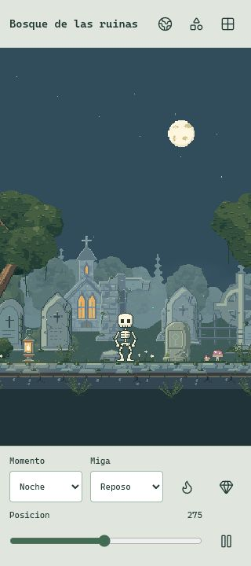
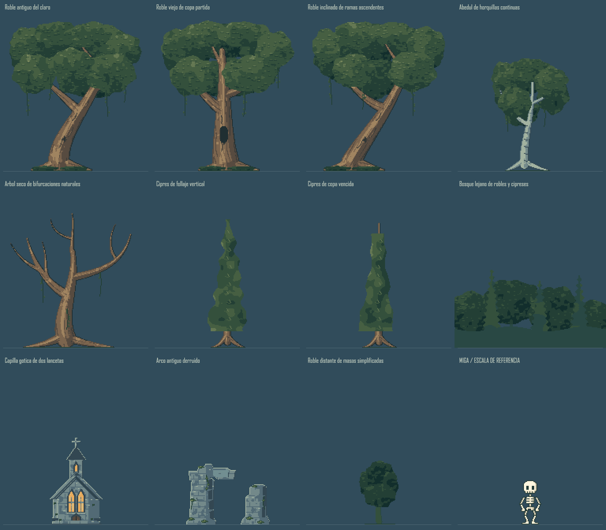
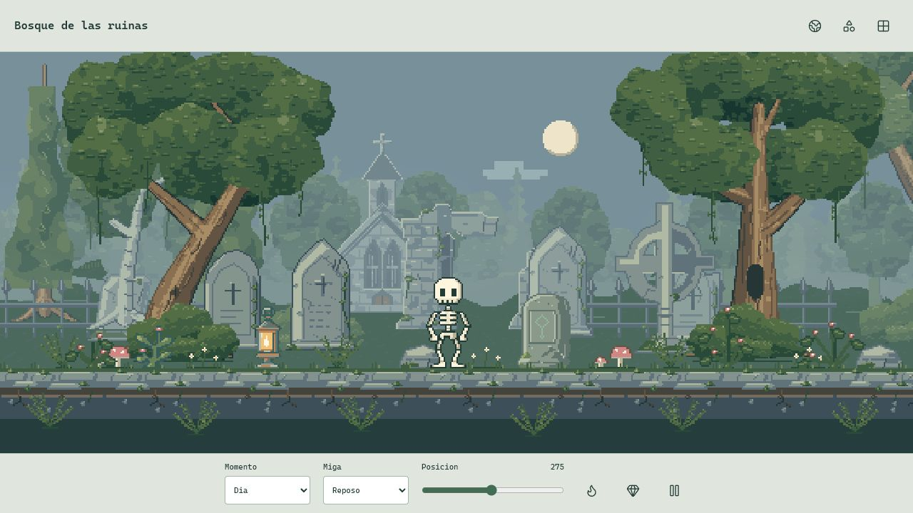
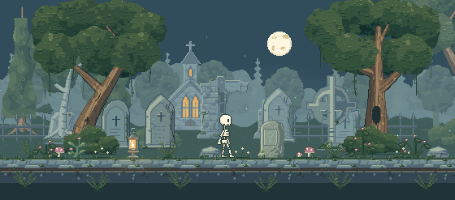

# Trash World

Un pequeno mundo de fantasia que cabe en tu telefono. Miga, una calaverita curiosa, explora, descubre, descansa y vuelve a armarse para seguir su aventura.

**Pixel art original | Vida autonoma | Bosque encantado | Guardado local**

**Encuadre amplio aprobado:** mas mundo visible, Miga mas pequena y correccion de la niebla y luz de la iglesia. Se conserva el personaje y su vida autonoma; el acabado de arquitectura y fuentes secundarias sigue en refinamiento.

[Empezar](#empezar) | [Visores](#visores) | [Assets](#biblioteca-de-assets) | [Documentacion](#documentacion)



*Captura real del visor a 1280 x 720. Canvas de 560 x 246 pixeles nativos en su area de 1280 x 563; encabezado y controles quedan fuera de la escena. Miga conserva su sprite original y se ve aproximadamente un 31% mas pequena que antes.*

## Un Mundo Con Vida Propia

Trash World es un prototipo de mundo de bolsillo inspirado en los cubitos fisicos con personajes autonomos. La idea es observar a Miga viviendo a su ritmo, acompanarla e interactuar con su entorno, sin convertir cada momento en una orden.

- **Miga decide:** necesidades y personalidad influyen en explorar, investigar, comer y dormir.
- **Tiene memoria:** conserva descubrimientos y su vida se guarda en el navegador.
- **Responde al tacto:** tocar a Miga, mantener el toque o tocar el entorno produce distintas reacciones.
- **El farol responde:** una observacion nocturna mas pausada aumenta suavemente el brillo del vidrio, sin cambiar la silueta ni los sprites de Miga.
- **La runa despierta:** la luz sube por el grabado cuando Miga investiga la lapida, con una respuesta discreta de dia y mas visible de noche.
- **El bosque cambia:** dia, atardecer y noche; ruinas, niebla baja, luciernagas, viento suave y luz de vela en la capilla.
- **El cementerio tiene variedad:** arboles adultos de distintas siluetas, lapidas desgastadas y arbustos de bayas, con contornos propios de cada material.
- **Los huesitos tienen personalidad:** caminar de perfil, gestos, saludo y descanso en piezas que se reconstruyen al despertar.

Canvas 2D, JavaScript y Vite. Sin backend, cuentas, analitica ni servicios remotos para jugar.

## Galeria

### Mundo Autonomo



*Captura actual del juego autonomo en navegador a 1280 x 720, durante una caminata diurna. No es una pose dirigida desde el laboratorio.*

### Dia Y Noche En Formato Movil

<p align="center">
  
  
</p>

*Capturas reales del navegador a 320 x 720. El canvas de 288 x 455 pixeles nativos queda entre encabezado y controles. Miga se ve un 33% mas pequena. No son pruebas de un telefono fisico.*

### Biblioteca A Escala Comun



*Lamina del estudio anterior, a zoom entero 2, incluyendo Miga como referencia. Se conserva como historial: el borde inferior de los dos fondos de bosque se reviso despues. No es una captura actual de navegador ni representa toda la biblioteca.*

[Comparativa detallada de los tres robles](docs/images/style-master-trees-comparison.png).

### Ultima Pasada: Observar El Mundo

- Camara mas abierta: 288 pixeles de ancho minimo en movil, 560 en escritorio habitual y mas espacio horizontal en ventanas muy bajas. No se encogen ni redibujan sprites individualmente.
- Cuando cabe el tramo jugable completo, la camara queda centrada en el mundo de 560 pixeles, no sigue cada paso de Miga. Las vistas estrechas conservan seguimiento y parallax.
- Encabezado y controles fuera del canvas en todas las vistas del mundo. La cruz de la iglesia queda completa, tambien en formato apaisado.
- Retiro de las superficies azules solidas y del borde recto de los fondos. El suelo lejano usa tierra, vegetacion baja y una silueta irregular.
- Niebla mucho mas tenue en manchas separadas, sin una banda que cubra todo el ancho. Sigue detras de Miga y se congela al desactivar movimiento.
- Ventanas nocturnas con su ambar propio, sin mezclarlo con la niebla azulada. De dia el cristal sigue frio y apagado. Luna recolocada para el encuadre amplio.
- Miga, sus clips aprobados, reglas, objetos activos, dependencias y guardados permanecen intactos. El acabado de ruinas, lapidas y vegetacion sigue pendiente; esta pasada no declara logrado el arte de la referencia.



*Captura diurna actual del navegador. La [comparativa del estudio anterior](docs/images/style-master-comparison.png) se conserva como historial de una propuesta rechazada, no como evidencia del encuadre actual.*

La [revision de encuadre y atmosfera](docs/WORLD_VIEW.md) documenta esta correccion. La [guia del estudio](docs/STYLE_MASTER.md) y su [QA](docs/STYLE_MASTER_QA.md) conservan el contexto anterior, sin presentarlo como arte aprobado. La aprobacion visual precede a nuevas familias de assets y funciones.

### Interaccion Conservada: La Lapida Runica

- Miga llega desde cualquiera de los dos lados, se detiene y mira la lapida, conservando su inspeccion de 4.5 segundos.
- La luz nace en el extremo inferior del grabado, sube por el tallo y recorre las dos ramas del rombo hasta la punta.
- Respuesta limitada a los 23 pixeles de la runa original: piedra, desgaste, musgo y contornos permanecen quietos. La entrada y la salida son continuas, incluso si la visita se interrumpe.
- De dia es sutil, al atardecer aumenta y de noche se lee con mayor claridad. No hay halos, particulas ni cambios de escala o de dibujo.
- Boton de gema en el visor para ensayar la misma IA; pausa, cambio de objetivo y selector sincronizado, sin acceder a la partida.
- Miga, los assets, la interaccion del farol, las recompensas y los guardados siguen intactos. Las variantes originales de la runa siguen disponibles en el laboratorio.

La [lapida runica](docs/RUNE_INTERACTION.md) conserva su comportamiento de `v0.1.7`. La [interaccion del farol](docs/LANTERN_INTERACTION.md) mantiene la revision anterior. No se crea ni publica una etiqueta automaticamente.

### Base Visual: Ramas Y Luz

- Tres robles con bifurcaciones que nacen del tronco y suben a la copa, sin la rama transversal que cruzaba el roble antiguo.
- Enredaderas afinadas en los robles, abedul y arbol seco: puntos de apoyo, caida mas fina y hojas irregulares, sin hileras repetitivas.
- Lapidas redonda y partida, tres arbustos decorativos de bayas y los tiles de suelo siguen disponibles como assets reutilizables.
- Seis arboles con transiciones suaves entre tonos de pequenos grupos de hojas; siluetas, troncos y raices permanecen fijos.
- Capilla con cristal frio y luz apagada de dia. Al atardecer y de noche conserva luz calida continua, sin parpadeo de interruptor.
- El farol aporta un tinte suave al sendero y a la vegetacion cercana, sin blur, halos ni alterar a Miga. Ese aporte ambiental desaparece de dia.
- Camara mas reactiva y proyeccion de parallax coherente con el sendero y los objetos.
- Refinamiento del farol, ruinas, suelo y vegetacion, sin cambiar el diseno ni los clips aprobados de Miga.
- Retiro del arbolito pequeno del suelo: su fuente se conserva en el laboratorio y los guardados antiguos mantienen sus recuerdos.

Los detalles de la biblioteca anterior estan en [Variantes y animacion ambiental](docs/LIVING_CEMETERY.md).

La [revision de ramas y luz](docs/NATURAL_BRANCHES_LIGHT.md) documenta la base visual de `v0.1.5`. La [revision anterior](docs/PREMIUM_FOREST.md) conserva el contexto de forma y material. El commit, la etiqueta y el push se realizan por separado; la entrega local no equivale a una publicacion en GitHub.

### Una Visita A La Runa



*90 fotogramas a 15 fps de la IA y el renderer de produccion fuera del navegador, con la lapida como objetivo inicial. No es una captura de navegador ni una medicion de rendimiento. La [secuencia del estudio anterior](docs/images/style-master-motion.gif) y la [secuencia de la runa](docs/images/rune-interaction-motion.gif) se conservan como historial.*

## Empezar

Requisito: **Node.js 22.12 o posterior**, con npm.

```bash
git clone https://github.com/bryanpineda-dev/trash-world.git
cd trash-world
npm ci
npm run dev
```

Abre la URL que muestre Vite, normalmente `http://127.0.0.1:5173`. Si el puerto esta ocupado, la terminal indica otro disponible.

Para compilar y revisar la version de produccion:

```bash
npm run build
npm run preview
```

`dist/` contiene la aplicacion estatica lista para servir. `node_modules/` y `dist/` no se versionan.

## Visores

Las tres vistas estan disponibles en desarrollo y en el build, bajo el mismo origen:

| Ruta | Vista | Uso |
| --- | --- | --- |
| `/` | Mundo vivo | Observar e interactuar con la vida autonoma de Miga. |
| `/asset-lab.html` | Personaje y objetos | Revisar piezas, clips, direccion y objetos animados. |
| `/biome-lab.html` | Composicion del bosque | Comparar luz, posicion, poses y familias de assets. |

El visor del bioma comparte el renderer del juego, pero no lee ni escribe su partida. Los botones de llama y gema ensayan las visitas al farol y a la runa con la misma IA; el selector refleja caminar u observar. La biblioteca se abre desde el boton de cuadricula y mantiene a Miga como referencia de escala.

## Biblioteca De Assets

La biblioteca distingue el kit del personaje de la escenografia. Todos usan el mismo pixel nativo: un arbol adulto tiene un dibujo mayor, no una ampliacion individual de un sprite pequeno. Los bordes del entorno usan tonos propios del material.

| Kit | Fuentes | Paleta | Exportacion |
| --- | --- | --- | --- |
| Miga y objetos | 5 piezas, 7 slots, 10 clips; 3 objetos activos y 1 archivado | 16 colores | Atlas de 109 frames, personaje y laminas comparativas. |
| Bosque y cementerio | 31 assets en 8 familias | 32 tokens de material | Atlas de 441 frames y 147 PNG transparentes; cristal diurno apagado, viento y luz nocturna continua. |

```text
assets/
  source/
    parts.json                 # Miga, tres objetos activos y el roble archivado
    characters.json            # Rigs, anclas y secuencias de objetos
    animations.json            # Poses y clips compartidos
    style.json                 # Paleta y contrato del personaje
    biome.json                 # Indice del entorno, paletas y capas
    environment/
      trees/
        forest-backdrop.json / forest-backdrop-east.json
      vegetation/              # Helechos, hongos, flores y matorrales
        berries/               # Variantes decorativas de bayas
      gravestones/
      ruins/
      fences/
      terrain/
      sky/
        moon.json / sun.json
      architecture/churches/
  generated/
    atlas.png / atlas.json     # Kit animado
    biome.png / biome.json     # Escenografia compartida
    environment/               # PNG individuales por familia, asset y fase
```

Los JSON son las fuentes editables. Los PNG y sus metadatos se generan de forma determinista y se incluyen en Git junto a ellas.

El suelo usa tres tiles reutilizables con uniones compatibles. Hongos, flores, helechos, bayas, arboles y lapidas tambien son assets independientes, no partes de una imagen de fondo aplanada. Cada exportacion vive en `assets/generated/environment/<familia>/<asset>/`: `day.png`, `evening.png` y `night.png`, mas archivos `<fase>-<variante>.png` cuando hay animacion. Las subfamilias, como `vegetation/berries/`, conservan sus carpetas.

Despues de modificar un dibujo, pose o paleta:

```bash
npm run assets
npm run check
```

Las pruebas comparan cada pixel exportado con su fuente; detectan atlas desactualizados, anclas incorrectas y cambios en las animaciones aprobadas. Para agregar assets, consulta el [flujo de trabajo](docs/ASSET_WORKFLOW.md) y el [contrato del bioma](docs/BIOME.md).

## Verificacion

**Ultima verificacion local: 144 pruebas aprobadas y build correcto.** Alcance y limites en [Encuadre amplio](docs/WORLD_VIEW.md).

```bash
npm run assets:check  # Validar fuentes del personaje y del bioma
npm test             # Simulacion, assets, persistencia y cache offline
npm run check        # Tests y build de las tres vistas
```

La cobertura incluye identidad de Miga, animaciones, siluetas conectadas, escala, uniones del terreno, paletas por profundidad, rutas de la biblioteca, toques, autonomia, guardados y progreso offline. Tambien comprueba cada variante ambiental y la carga de partidas dirigidas al arbol retirado.

Las capturas actuales muestran el encuadre amplio en navegador, de dia y noche, en escritorio y movil. Las pruebas nuevas cubren resolucion, limites de camara, proyeccion de toques, cruz completa, cristal nocturno y base irregular del bosque. Los tests de animaciones aprobadas siguen activos. Los resultados del renderer offline se distinguen de las pruebas reales de navegador y no se presentan como medidas de FPS. La entrega local coteja archivos y medios por SHA-256 antes del versionado; una copia no equivale a una publicacion en GitHub.

El renderer actual se coteja en 64 casos de pose/direccion, cuatro proporciones de viewport y dia/noche: atlas y fallback identicos, 42960 pixeles opacos de Miga sin tintes ni recorte y congelacion exacta del ambiente. SHA-256 conserva 33 archivos de logica, dependencias y kit protegidos. Estas pruebas no certifican la calidad artistica.

**Pendiente:** telefono Android fisico, medicion de framerate y consumo prolongado en el hardware de destino, comportamiento nocturno prolongado en una partida autonoma y repetir la desconexion real. La revision del visor en navegador no sustituye esas pruebas ni certifica todos los flujos del mundo autonomo. El historial y alcance de cada pasada estan en [Verificacion](docs/VERIFICATION.md).

## Guardado Y Modo Offline

- La partida se guarda cada cinco segundos, al interactuar y al ocultar la app, bajo `localStorage["trash-world.save"]`.
- Los datos incluyen necesidades, personalidad, posicion, descanso y descubrimientos. Los guardados danados se respaldan antes de reemplazarlos; versiones futuras se protegen contra sobrescritura.
- Al volver se resume un maximo de ocho horas de necesidades, descanso y reloj. No se reproducen todos los fotogramas ni se inventan descubrimientos.
- Si el almacenamiento falla, la escena sigue funcionando y avisa que no esta guardando. El reinicio del panel requiere confirmacion y borra la vida de ese origen.
- El cache de la PWA se genera con el build y el service worker se registra solo en produccion. Requiere HTTPS o localhost y una primera carga completa con conexion.

**Cada origen tiene su propia vida:** cambiar el puerto, dominio, navegador o perfil no transporta la partida anterior.

<details>
<summary>Probar la escena desde Android en la misma red</summary>

```bash
npm run dev -- --host 0.0.0.0
```

Abre `http://IP-DE-LA-PC:PUERTO` en el telefono, usando la IP local de la PC y el puerto que indique Vite. Windows puede solicitar acceso a la red local.

HTTP en una IP local permite revisar la escena, pero no ofrece instalacion PWA ni cache offline. Para una prueba completa, sirve `dist/` desde HTTPS o usa un tunel localhost con depuracion USB. En un Android antiguo, prueba el build de produccion, no solo el servidor de desarrollo.

</details>

## Estado Y Roadmap

Trash World sigue en desarrollo. La base de vida autonoma y el personaje estan construidos; el primer bioma permite afinar la identidad visual y ampliar la biblioteca.

| Etapa | Enfoque | Estado |
| --- | --- | --- |
| V0.1 - The Creature | Miga, autonomia, interaccion, guardados y PWA | Base implementada; refinamiento visual en curso. |
| V0.2 - The Phone | Inclinacion, sacudidas, rotacion, calibracion y vibracion | Pendiente; el adaptador actual entrega valores neutros. |
| V0.3 - The World | Eventos, mas objetos, audio y pruebas prolongadas | Planeado. |
| V1.0 - The Toy | Estabilidad, instalacion y posible APK o carcasa fisica | Planeado. |

La conexion entre dispositivos queda para una etapa independiente. No se presenta como funcionalidad disponible.

## Documentacion

- [Arquitectura](docs/ARCHITECTURE.md)
- [Personaje: Miga](docs/CHARACTER.md)
- [Guia de estilo](docs/ASSET_STYLE.md)
- [Patrones de materiales](docs/MATERIAL_STYLE.md)
- [Flujo de trabajo de assets](docs/ASSET_WORKFLOW.md)
- [Objetos y escala](docs/ENVIRONMENT.md)
- [Bosque y biblioteca](docs/BIOME.md)
- [Variantes y animacion ambiental](docs/LIVING_CEMETERY.md)
- [Forma, material y movimiento del bosque](docs/PREMIUM_FOREST.md)
- [Ramas, enredaderas y luces por momento](docs/NATURAL_BRANCHES_LIGHT.md)
- [Miga y el farol](docs/LANTERN_INTERACTION.md)
- [La lapida runica](docs/RUNE_INTERACTION.md)
- [Escena patron y reglas de estilo](docs/STYLE_MASTER.md)
- [QA de arte y escena](docs/STYLE_MASTER_QA.md)
- [Verificacion](docs/VERIFICATION.md)
- [Roadmap](docs/ROADMAP.md)

Proyecto de [bryanpineda-dev](https://github.com/bryanpineda-dev).
