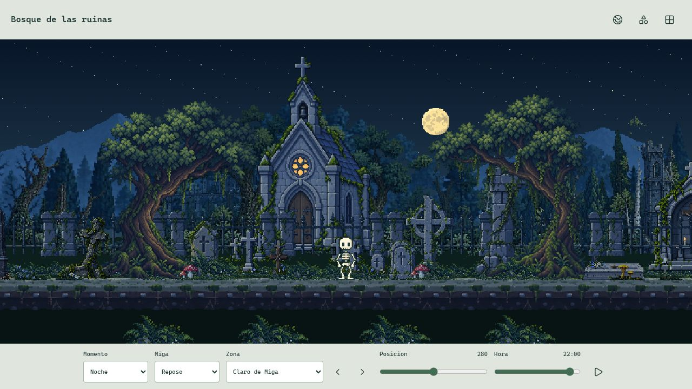
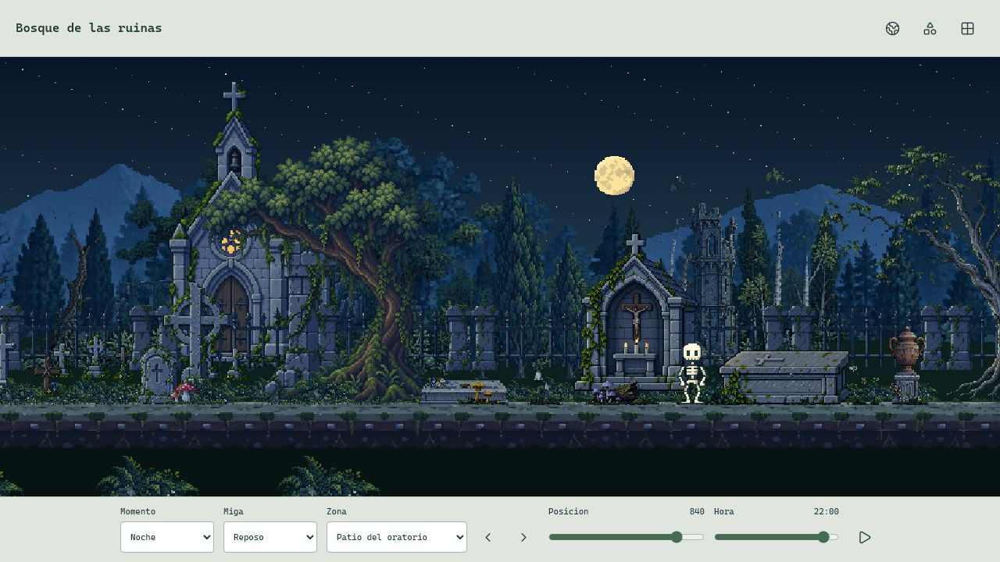

# Integracion De Arquitectura

2026-10-19. El usuario solicita integrar la revision actual y copiarla a su carpeta para revisar el proyecto completo antes de aprobar el commit. Esto autoriza la integracion y entrega, no un commit, push o publicacion.

## Cambios

- Iglesia de 173 x 256, con puertas cerradas, roseton circular y cruz superior completa. Se situa a parallax 0.48 y base 38px por encima del sendero, detras de nueve cruces independientes en dos filas.
- Cinco marcadores posteriores a parallax 0.66 y cuatro delanteros a 0.84. Se reutilizan las dos hojas de origen, no se duplican los PNG de cada marcador en el mundo.
- Oratorio abierto de 116 x 144, con crucifijo y tres velas independientes. Es un objeto cercano con parallax 0.86; se dibuja despues de la verja y el terreno para que estos no oculten el interior. Su base se mantiene 12px detras del plano de apoyo de Miga.
- Sarcofago de 120 x 49, con cruz pequena en la izquierda y travesano siguiendo la profundidad de la tapa. Se conserva la esquina derecha completa. La perspectiva sigue abierta a mejoras visuales posteriores; integrarlo no se documenta como aprobacion artistica definitiva.
- La ruina y las lapidas cercanas del claro se redistribuyen para dejar visible la entrada de la iglesia. No se agregan nuevas zonas ni se repiten monumentos.

Ambas son capturas nuevas de navegador a 1280 x 720. Los visores usan el renderer del juego, pero no la simulacion ni los guardados de la aplicacion principal.

## Escala Y Render

El canvas de escritorio muestra mas espacio nativo globalmente: 712 x 401 para una ventana de 1280 x 720. Su ancho es par para mantener el origen de camara en pixeles enteros. En 320 x 720 se mantienen 288 x 648. La proyeccion del toque conserva su correspondencia con las coordenadas del mundo.

Los edificios no se deforman ni se agrandan en runtime. En las proporciones habituales la iglesia conserva escala 1. Las ventanas panoramicas extremadamente bajas siguen usando el limite de 2048px y el ajuste de remates existente para evitar recortes. No se cambia la velocidad, la IA, los limites de 1680 unidades, Miga, sus clips, el HUD ni el guardado.

El roseton se enfria de dia y permanece ambar de noche. La mascara proporcional excluye las puertas de madera. El tiempo de brillo y las velas siguen el reloj ambiental del renderer; las velas no encienden y apagan toda la estructura. La logica compartida vive en `ArchitectureLighting.js` y no depende de archivos de `studies/`.

## Catalogo Y Procedencia

38 nativos activos, 33 originales distintos, incluidos dos originales forestales historicos fuera del catalogo cargado. Cada nativo tiene uso en el mundo y no quedan PNG nativos fuera del manifiesto. Se retiran los seis PNG de iglesia, mausoleo y angel reclinado sustituidos tras comprobar su respaldo y hash.

Se conservan los IDs internos anteriores para no cambiar el contrato del catalogo; las rutas y nombres visibles ya son los nuevos. [Inventario](ASSET_INVENTORY.json), [procedencia](../assets/reference-biome/ARCHITECTURE_GENERATION.md). El estudio anterior se conserva como historial y comparacion tecnica, no como la vista principal de esta entrega.

## Comprobaciones

La suite y el build se ejecutan en sandbox y, tras copiar, de nuevo en la carpeta estable. El QA offline usa el renderer de produccion en siete proporciones, siete posiciones, tres horas, tres estados de Miga y ambas direcciones. Comprueba alpha, hashes, uso del catalogo, Miga sin alteraciones, equivalencia atlas/fallback y pausa exacta. No es un benchmark de navegador.

[Resultados del renderer y la suite](ARCHITECTURE_INTEGRATED_QA.json). [Entrega, hashes y comprobaciones en la carpeta estable](ARCHITECTURE_DELIVERY.json). El primer informe se genera en sandbox y su estado de copia inicial no sustituye al acta de entrega posterior.

Capturas nuevas del centro diurno/nocturno y el patio nocturno se revisan realmente en navegador. Se revisa tambien la aplicacion principal desde el escritorio. No se afirma una prueba nueva de Android fisico, consumo, rendimiento o desconexion real, ni una aprobacion de todos los controles del visor.

El commit queda a la espera de aprobacion del usuario. No se hace staging, commit, etiqueta, push ni release en esta entrega.
