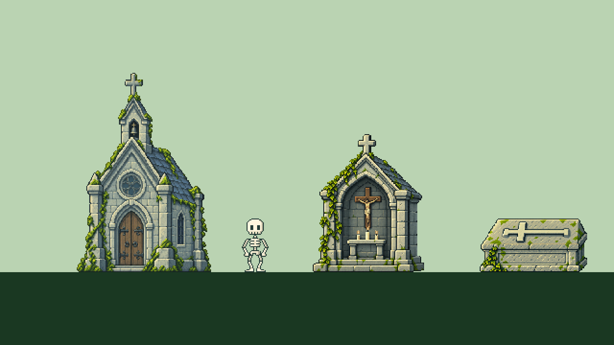
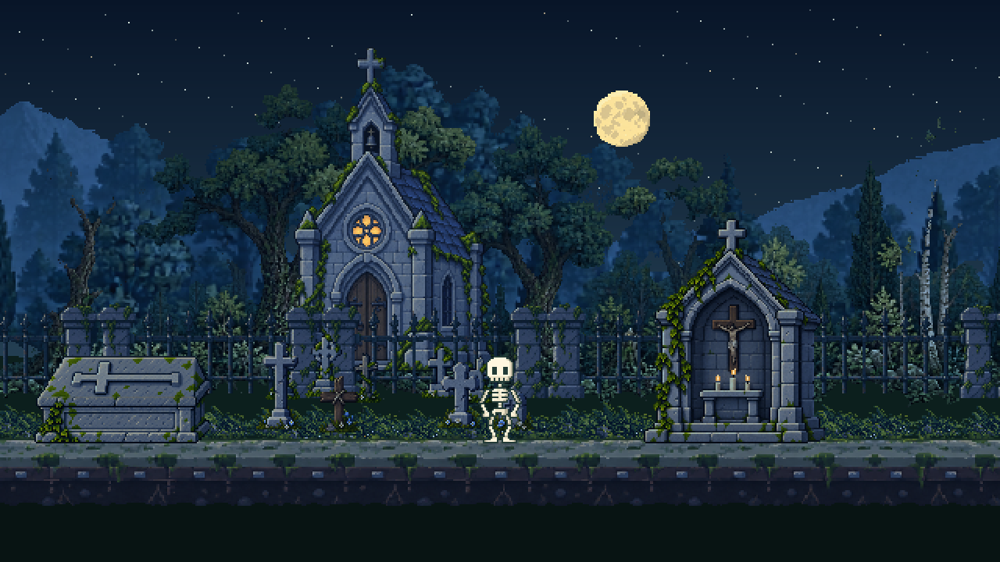
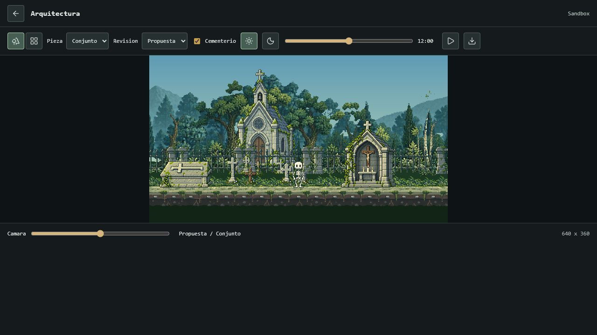
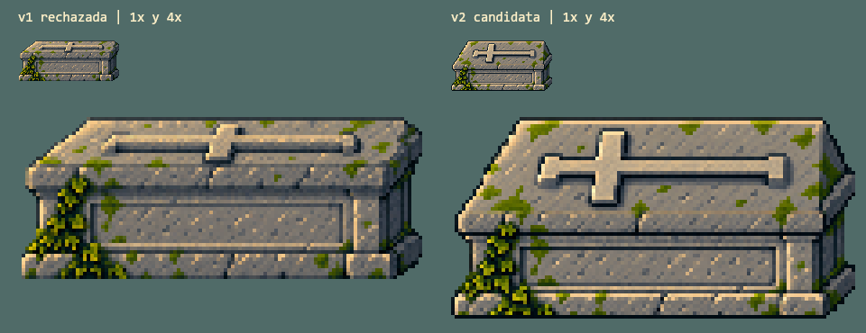

# Muestra De Arquitectura

**Estado posterior:** los assets de revision 6 se integran por solicitud del usuario. Este documento y su visor quedan como historial del estudio; la vista actual es el juego y `/biome-lab.html`. [Integracion principal](ARCHITECTURE_INTEGRATION.md).

**Estado actual: revision 6, pendiente de aprobacion.** El texto y los medios de revision 2 que siguen se conservan como historial, no describen el candidato actual ni prueban su calidad. Su tapa inclinada fue rechazada. La revision 5 tambien fue rechazada por la alineacion de la cruz. La iglesia actual del estudio mide 173 x 256, la tumba 120 x 49 y el visor 640/320 x 400. [Revision actual y referencias de perspectiva](TOMB_PERSPECTIVE_REVIEW.md).

Revision 2, 2026-10-19. Propuesta acotada en sandbox, pendiente de aprobacion visual. La revision anterior de la tumba fue rechazada por el usuario: su relieve se leia como una barra, no como una cruz. Las pruebas tecnicas de aquella pasada no demostraban legibilidad artistica. Esta revision cambia esa tapa y la composicion del cementerio, no Miga, su rig, el juego, el guardado, las dependencias o la camara de produccion.

## Ver La Muestra

Con `npm run dev`, abrir `/studies/architecture/`. El visor permite escena o piezas aisladas, actual o propuesta, foco por pieza, hora continua, pausa y desplazamiento lateral. La casilla `Cementerio` permite comparar la misma iglesia con y sin las dos filas; esta deshabilitada en piezas aisladas o assets actuales. `Actual` muestra los assets de produccion en el encuadre del estudio, no una captura del juego. No lee ni escribe partidas. El foco individual coloca una copia de referencia de Miga al lado del objeto; no representa un cambio de su posicion en el juego.

*Render offline nuevo a 640 x 360, ampliado exactamente 2x. Base comun para comparar el dibujo y las proporciones, no para situar todos los objetos a la misma distancia.*

| Pieza | Export actual | Candidato | Papel propuesto |
| --- | --- | --- | --- |
| Iglesia | 102 x 154 | 140 x 208 | Plano intermedio, entrada doble y roseton |
| Mausoleo/oratorio | 114 x 170 | 116 x 144 | Oratorio cercano, hueco abierto, crucifijo y altar |
| Tumba | 106 x 58 | 112 x 56 | Tapa inclinada con cruz latina en relieve, sin figura reclinada |
| Marcadores de fondo | Nuevos | 19-27 x 30-40 | Cinco cruces pequenas en la fila trasera |
| Marcadores intermedios | Nuevos | 26-30 x 26-56 | Cuatro dibujos, con cruz de madera y lapida baja |
| Miga | Cuerpo 28 x 56 | Sin cambios | Unidad de referencia |

Las dimensiones son las del export completo. El hueco del oratorio ronda 80 px de alto; la madera de la puerta de la iglesia ronda 56 px en su proyeccion intermedia. Son estimaciones visuales, no medidas fisicas ni una promesa de puerta cercana de 70-90 px. La iglesia conserva el mismo PNG, sin agrandarlo: base 46 px por encima del sendero y parallax 0.48. Delante se situa la verja de fondo, parallax 0.58, luego las cruces de la fila trasera a 0.66 y las de delante a 0.84. Miga, oratorio y tumba conservan el plano cercano a 1. Son elecciones artisticas, no distancias fisicas calculadas a partir del parallax.

La iglesia mantiene un margen superior de 30 px logicos en la presentacion principal, incluida toda su cruz. No hay `fitHeadroom`, escalado individual en runtime, espejo ni deformacion. El visor usa 640 x 360, o un recorte horizontal de 320 x 360 en estrecho. Ambos mantienen cada pixel y la altura logica de Miga. La ampliacion de pantalla es entera cuando cabe; ventanas menores que el canvas requieren ajuste global o scroll, nunca encoger un edificio solo.

## Materiales Y Luz

- Piedra gris verdosa, luz desde arriba a la izquierda, volumen lateral corto a la derecha y verticales rectas. No se fuerza una simetria total sobre un volumen con lateral visible.
- Iglesia con puertas cerradas y roseton circular. El cristal es frio a pleno dia y ambar de noche; la variacion continua solo afecta su mascara, no apaga la ventana.
- Oratorio con crucifijo, altar y tres velas. La base PNG no contiene llamas: cada mecha recibe una llama pequena con fase independiente. Las velas siguen encendidas de dia, con derrame de luz nocturno muy limitado; no hacen parpadear toda la fachada.
- Tumba sin angel ni escultura vertical. Se descarta tambien una primera regeneracion que mantenia el travesano demasiado corto. La seleccionada muestra una tapa inclinada mas visible, brazos separados del borde, cabeza corta a la izquierda, pie largo a la derecha y travesano a un tercio del largo. La cruz esta acostada en el plano de la tapa, no erguida. La comparacion a 1x y 4x se revisa como juicio visual, no como consecuencia de que pasen tests.
- Nueve marcadores extraidos individualmente de dos originales transparentes. Ninguno se repite en el estudio; cinco forman la fila trasera y cuatro la delantera. Los extremos de cada recorte se comprueban fuera de los pixeles opacos. No se agrega una banda de niebla, suelo falso o marco gris para tapar las uniones.

*Render offline nuevo, ampliado 2x. Los bosques, suelo y verja son los existentes: esta muestra no corrige todavia sus problemas de dibujo o composicion.*

## QA De Esta Pasada

- 247 pruebas del proyecto pasan, incluidas siete del estudio sobre inventario, hashes, proporcion, encuadre, mascara, velas y planos de las tumbas.
- `assets:check`, build de produccion y bundle separado del visor pasan. El estudio no se incluye en `dist/` ni en el precache de produccion mientras sea candidato.
- 150 hashes de codigo, assets activos, catalogos, dependencias declaradas y configuracion coinciden con el respaldo previo. Produccion no cambia.
- 96 renders offline: dos anchos, seis horas, cuatro focos y actual/propuesta. Originales y exports cotejados por hash; los doce PNG nativos tienen alpha binario. Inspeccion visual de cruz de iglesia completa, bases y laterales, ademas de esas comprobaciones automaticas.
- Cinco instantes por asset a lo largo de dos segundos: siluetas inmoviles; cambios del roseton limitados a su ventana; cambios de las velas limitados a la pequena zona del altar; tumba estatica. La envolvente de brillo se comprueba adicionalmente durante 20 segundos a 60 muestras/s.
- La revision 1 tenia pruebas de controles y ventanas anidadas; no se reutilizan como evidencia nueva. La escena diurna de revision 2 se ha inspeccionado realmente en navegador a 1280 x 720. El estado de los controles, capturas y limites finales de revision 2 se registra por separado en [Verificacion](VERIFICATION.md).

Se inspeccionaron tambien la misma escena de noche y la tumba aislada a tamano nativo en navegador. Las tres capturas se guardan con prefijo `architecture-v2-browser-`. La prueba interactiva del checkbox sufrio timeout de la herramienta y queda pendiente: no se declara aprobada por haber abierto una URL. [Datos de revision 2](ARCHITECTURE_V2_QA.json).

*Comparacion offline nueva: izquierda v1 rechazada, derecha v2 candidata. Las muestras pequenas son de 112 px de ancho real; las grandes se amplian sin suavizado.*

## Lo Que Sigue Abierto

La aprobacion de estas tres piezas no resuelve por si sola la ciudadela, su terreno de apoyo, las ramas/enredaderas, la simplificacion del bosque lejano o la luna parcialmente tapada. La composicion completa y el recorrido con oclusiones, perfiles de camara y escalas de todos los objetos quedan para la integracion posterior. No se ha medido rendimiento ni probado el modo offline desconectado en esta muestra.

Los assets activos antiguos no se borran: todavia tienen uso real. Tras aprobar e integrar los candidatos se retiraran solo los que queden sin uso, con respaldo, inventario y hashes. La carpeta estable del escritorio permanece sin tocar hasta aprobar la entrega; no hay commit, etiqueta o publicacion nuevos.

Fuentes, parametros y limites del proceso de generacion: [Proveniencia](../studies/architecture/GENERATION.md). Los originales generados no equivalen a retoque manual pixel a pixel.
