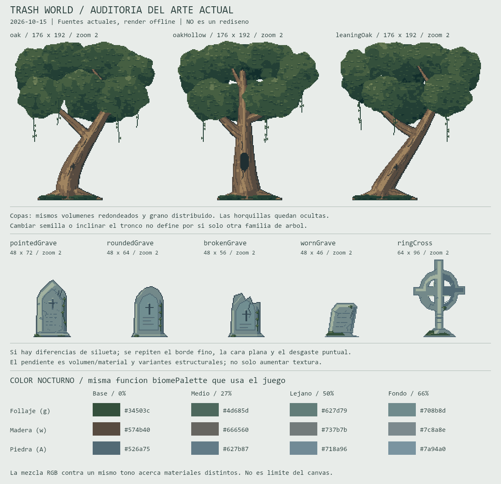

# Revision De Direccion Artistica

Fecha: 2026-10-15. Estado: investigacion y auditoria; no es un rediseno implementado ni un estilo aprobado.

El usuario rechaza el acabado de color, arboles y lapidas. La aprobacion anterior corresponde al encuadre mas abierto, no a la calidad del dibujo. Se conserva esa escala y Miga. No se extiende el mundo antes de resolver una muestra visual.

## Referencia Principal

La escena de cementerio enviada por el usuario sigue siendo el objetivo. Se inspecciono de nuevo junto con `world-view-night.jpg`. No se copia al repositorio porque no se ha identificado su autoria o licencia.

Lectura visual propia de esa referencia:

- Primer plano verde azulado profundo, hojas iluminadas amarillo verdosas y madera con matices calidos. No todo tiene el mismo tinte gris.
- Copas que enmarcan desde arriba y los lados, con huecos que muestran bifurcaciones. Las ramas se afinan y la corteza sigue su direccion.
- Piedra con frente, lateral y bisel superior distintos. Musgo sobre coronaciones, grietas y zonas de humedad, no repartido uniformemente.
- Tumbas con arquitecturas diferentes: remate a dos aguas, losa arqueada, cruz anular. Comparten material y luz, no una plantilla con detalles intercambiados.
- Profundidad por superposicion, escala y grupos de valores distintos. La atmosfera deja leer masas del bosque; no es un velo gris uniforme ni una superficie azul horizontal.

## Referencias Externas

Las observaciones visuales son analisis propio; las especificaciones proceden de los autores. No se compra, importa o usa ningun pack como entrada de generacion de imagenes.

### Anokolisa: Moon Graveyard

[Pagina del autor](https://anokolisa.itch.io/moon-graveyard). Declara tiles y props de 32 x 32 y tres capas de fondo. Se inspecciono su imagen publica de escena, no solamente la descripcion.

Lo util: grosor visible en bloques, sepulturas inclinadas, contornos por material y edificios oscuros que conservan identidad. La madera sigue calida junto a vegetacion amarillenta aunque el cielo es azul. No adoptamos sus plataformas, distribucion jugable o paleta otonal como direccion de Trash World.

### SLYNYRD: Landscape Backgrounds

[Pixelblog 62, Raymond Schlitter](https://www.slynyrd.com/blog/2026/5/27/pixelblog-62-landscape-backgrounds). Se leyo el articulo y se inspecciono su estudio de bosque. Explica profundidad con tono, saturacion y luminosidad; demuestra paisajes con 16 colores o menos.

Lo util: planos con relaciones de color elegidas, ramas reconocibles a distancia y masas que dejan espacios de luz. Su bosque es mas luminoso y tiene otra perspectiva: sirve para organizar valores y color, no para copiar su composicion o perspectiva de suelo a nuestra vista lateral.

### SLYNYRD: Side View Tiles

[Pixelblog 28](https://www.slynyrd.com/blog/2020/5/21/pixelblog-28-side-view-tiles). Lectura del proceso de bloques de color, grupos de pixeles y detalle, con tiles 16 x 16. Destaca superposicion y espacio sin textura para evitar ruido.

Aplicacion: definir volumen y luz de suelo y ruinas antes del detalle. El tamano de tile no determina el tamano total del arbol ni exige cambiar los pixeles de Miga.

### Fuentes Complementarias Y Limites

- [GothicVania Cemetery, Ansimuz](https://ansimuz.itch.io/gothicvania-cemetery): pagina leida, con tres fondos y tiles 16 x 16 declarados. La imagen accesible inspeccionada era el logotipo: no se presenta como estudio visual completo de sus assets. La pagina muestra CC0 y un comentario antiguo del autor restringe redistribucion; resolver esa discrepancia antes de importar archivos.
- [Fantasy Swamp Forest, The Flavare](https://theflavare.itch.io/forest-nature-fantasy-tileset): pagina y condiciones revisadas, con tiles 16 x 16 y tres capas declaradas. No se completo inspeccion visual del pack; no se usa como evidencia de dibujo. Sus condiciones restringen redistribucion y usos relacionados con IA; no se descarga ni se utiliza en generacion.
- Se descartan agregadores sin autoria clara y ejemplos generados. No se publican hojas ajenas en nuestra biblioteca. Permiso para usar arte en un juego no implica permiso para redistribuir sus fuentes en GitHub.

## Auditoria Actual

Lamina nueva renderizada offline desde los JSON actuales. Sprites a zoom entero 2, misma paleta nocturna cercana y misma linea de apoyo. No es captura del juego ni propuesta nueva. La tabla usa la funcion de color del motor, sin correccion fotografica.

### Color Y Profundidad

`src/rendering/BiomeModel.js` mezcla los colores contra un mismo `mist`: 27% en plano medio y 50% en lejano. Los dos fondos de bosque suman `haze: 0.16`, para 66% total. De noche el destino es `#8faab6`.

| Material nocturno | Base | Plano medio | Plano lejano | Fondo con haze |
| --- | --- | --- | --- | --- |
| Follaje g | #34503c | #4d685d | #627d79 | #708b8d |
| Madera w | #574b40 | #666560 | #737b7b | #7c8a8e |
| Piedra A | #526a75 | #627b87 | #718a96 | #7a94a0 |

La mezcla aproxima materiales distintos y comprime sus diferencias. Es una causa verificable del lavado, no su unica explicacion: tambien pesan paleta base, textura distribuida y composicion. Los 32 tokens son una restriccion de nuestro validador, no del canvas. Agregar colores sin disenar sus relaciones no lo arregla.

Correccion a ensayar: rampas por material y plano, sombras azul verdosas, medios verdes y luces de musgo amarillo verdosas; madera calida y piedra fria con coronaciones mas calidas. Reducir contraste a distancia sin neutralizar todos los matices. Evaluar niebla local aparte del color atmosferico, sin fijar porcentajes definitivos antes de comparar muestras.

### Arboles

`scripts/draw-forest-study.js` contiene coordenadas y horquillas distintas: los robles no son copias identicas. Sin embargo, comparten lienzo 176 x 192, volumen de copa parecido y `leafMass`: elipses perturbadas, ruido y grupos con semilla. `woodSurface` calcula sombreado y veta. Una union geometricamente conectada no asegura una rama natural.

El resultado mantiene copas redondeadas, detalle pequeno en casi toda la superficie y bifurcaciones tapadas por las masas delanteras. Las enredaderas repiten varios hilos largos. Una variante debe cambiar crecimiento, peso y espacios vacios; otra semilla no basta. Se necesitan masas de sombra y luz dibujadas con intencion antes de textura.

### Lapidas Y Ruinas

Hay diferencias reales: ojival 48 x 72, redonda 48 x 64, partida 48 x 56, erosionada 48 x 46 y cruz anular 64 x 96. El fallo no es ausencia total de variantes. Se repiten cara plana, borde fino uniforme, biseles poco diferenciados y desgaste que no siempre describe espesor o fractura.

Prioridad: frente, lateral y coronacion antes de grietas; bases con peso y contacto con el suelo; fracturas que interrumpan volumen y musgo sujeto a superficies. Ruinas y lapidas comparten geometria de piedra, no una plantilla ampliada. La runa activa y su comportamiento no se modifican en esta fase.

## Muestra De Redibujo Propuesta

No implementada en esta pasada. Antes de sustituir de nuevo todo el bioma:

1. **Un roble de encuadre:** silueta primero, una direccion dominante de crecimiento, dos bifurcaciones legibles y huecos de cielo. Dibujar hojas y sombras segun ramas y luz, sin finalizar toda la copa con ruido. Revisar enredaderas despues de la estructura.
2. **Tres tumbas diferentes:** remate a dos aguas con pedestal; piedra baja redondeada e inclinada; losa gruesa rota con lateral y fractura visibles. Deben distinguirse sin inscripciones, musgo o recolores. La cruz anular se trabaja despues como monumento.
3. **Un fragmento de escena de dia y noche:** plano lejano, bosque intermedio, arquitectura y muestra cercana. Escala abierta vigente y Miga intacta como referencia. Elegir los planos de color antes de sumar niebla. Mantener pixeles nativos y zoom entero; no reducir una ilustracion grande para simular pixel art.

No extender funcionalidad ni regenerar todo el atlas con otra receta de textura antes de revisar esta muestra. Los tests no aprueban una familia artistica.

## Criterios De Aprobacion

- Silueta legible sin textura; ramas afinadas, conectadas y visibles entre huecos.
- Tumbas distintas sin depender de inscripciones o recolores.
- Luz coherente que revela volumen; sin borde negro universal ni todo el perimetro igualmente iluminado.
- Madera, hoja y piedra distinguibles en el plano medio. Distancia no significa pintar el objeto de gris.
- Detalle concentrado en zonas utiles, con superficies de descanso visual.
- Comparacion con la referencia a igual altura visible de Miga, no igual tamano de imagen; se conserva el encuadre abierto.
- Revision a 1x y zoom entero, aislado y en escena, dia/noche y escritorio/movil. Animacion y parallax despues de validar el dibujo estatico.

## Verificacion Y Entrega

Carga y validacion de 31 sprites; 247 archivos de fuentes, runtime, scripts, tests y dependencias cotejados por SHA-256 con Desktop. Lamina nueva de 1200 x 1160 y tabla calculada con `biomePalette`. No se modifica codigo del juego, Miga, animaciones, paletas, atlas o partida.

Los tests, builds y pruebas de navegador anteriores no se atribuyen a esta auditoria ni certifican criterio artistico. Esta pasada verifica fuentes, imagen y documentacion; no prueba un nuevo aspecto en el navegador porque no lo implementa.

Solo documentacion y lamina en sandbox. Sin copia estable ni staging, commit, tag o push: no es una entrega visual aprobada ni una solicitud de publicacion.
