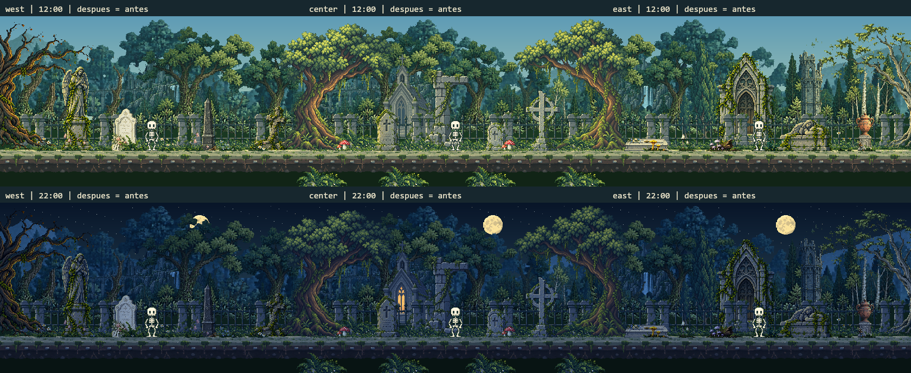
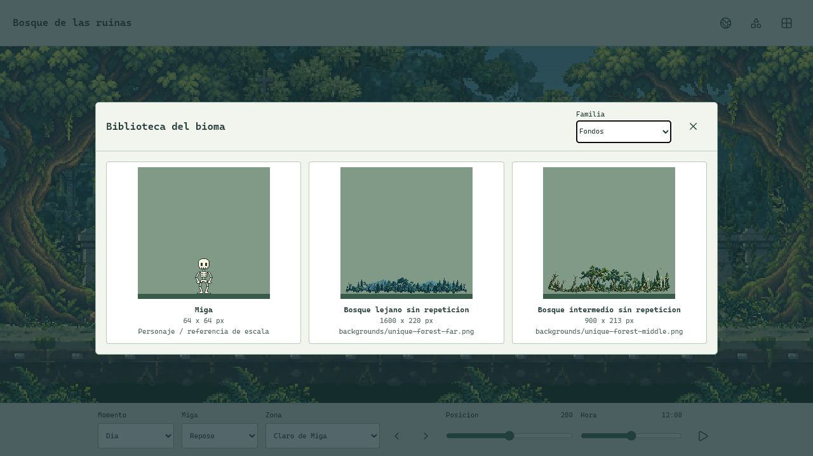
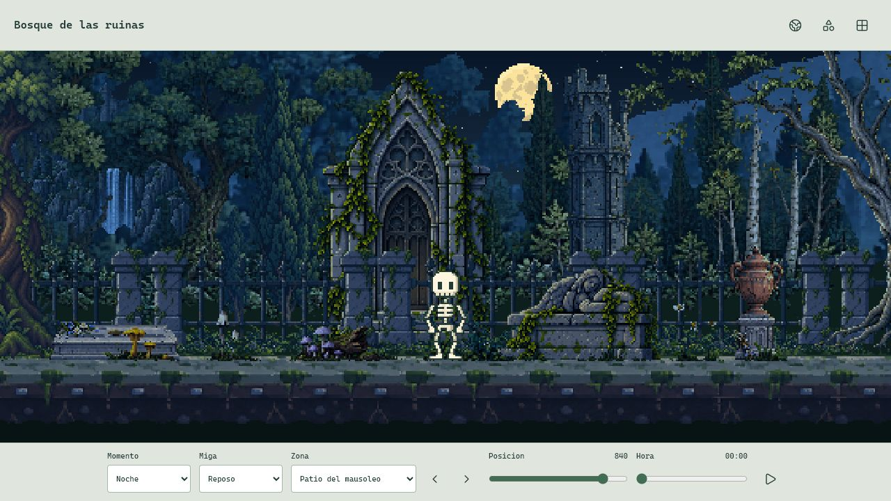

# Limpieza De Assets

Fecha: 2026-10-19. Alcance: retirar exports obsoletos en sandbox, sin cambiar el dibujo ni la colocacion del mundo.

## Retirado

| Grupo | Archivos | Motivo |
| --- | --- | --- |
| PNG individuales del entorno procedural anterior | 147 | El juego actual no los carga; el atlas y las fuentes historicas siguen disponibles para estudios/tests |
| Exports del estudio de cementerio | 13: ocho PNG y cinco JSON | El estudio usa sus dibujos JavaScript; no necesita duplicados exportados dentro de assets |
| Bosques anteriores `forestFar` y `forestMiddle` | Dos PNG nativos | Sustituidos en el mundo por los dos bosques unicos; ya no se precargan ni aparecen en biblioteca |
| Total | **162 archivos, 866 487 bytes** | Respaldo individual comprobado por SHA-256 antes de retirar cada archivo |

Se conservan los 29 PNG que usa el mundo y sus fuentes. Los dos originales de bosque retirados permanecen intactos y catalogados como `retiredSources`, no como recursos que el juego deba cargar.

No se eliminan Miga, rig, clips, atlas del personaje, iconos, partidas, reglas, fuentes editables, documentacion historica o capturas antiguas con procedencia. Tampoco se retiran aun iglesia, mausoleo ni angel reclinado: siguen colocados y sus reemplazos se estan definiendo; borrarlos ahora dejaria huecos.

## Sin Regeneracion Accidental

El build normal conserva el atlas ambiental historico porque todavia lo consumen estudios/pruebas, pero deja de producir sus 147 PNG individuales. Las pruebas reconstruyen esos PNG y los 13 exports del estudio en memoria y cotejan sus bytes con hashes capturados antes de limpiar. No se elimina cobertura para conseguir una suite verde.

La exportacion historica sigue disponible de manera explicita:

```bash
npm run assets:legacy
```

Sus 160 archivos se escriben bajo `.cache/legacy-assets/`, ya ignorada por Git, no en la biblioteca activa. Los dos fondos raster retirados no pertenecen a ese generador: sus originales y metadatos se conservan, y existe respaldo externo de los exports anteriores.

## Inventario Actual

- 29 entradas activas: todas tienen uso en el mundo, incluyendo luna, suelo y verja.
- 29 PNG nativos: sin sobrantes ni rutas ausentes.
- 31 originales raster: 29 activos y dos de procedencia historica, con hashes comprobados.
- Fuentes procedurales y del estudio conservadas; atlas historico necesario conservado.
- Exportaciones opcionales y caches fuera del inventario versionado.

Datos actualizados: [ASSET_INVENTORY.json](ASSET_INVENTORY.json). Los informes del 16 y 18 conservan sus conteos originales; describen revisiones anteriores y no se usan como evidencia nueva de esta limpieza.

## Comprobacion Visual



*Renders offline nuevos del renderer antes/despues: el objetivo es conservar exactamente los pixeles del mundo. No son nuevos dibujos ni capturas de navegador.*



*Captura nueva del visor en navegador. La biblioteca deja de incluir los dos bosques sustituidos. No prueba rendimiento de un telefono ni desconexion real.*



*Segunda captura nueva del navegador, con el selector de noche y patio activo. Los edificios y la tumba que esperan rediseno siguen presentes.*

Resultado tecnico: 240 pruebas y build aprobados; 54 casos antes/despues con 8 776 512 pixeles identicos; 45 archivos del build cubiertos por precache. La exportacion opcional de los 160 archivos historicos se comprueba por SHA-256. No es una prueba nueva de desconexion ni rendimiento.

Los resultados tecnicos de esta pasada se registran al terminar en [VERIFICATION.md](VERIFICATION.md). Las mejoras pendientes de perspectiva, iglesia con puertas/roseton, oratorio con crucifijo/velas y tumba con cruz en relieve **no se consideran implementadas por esta limpieza**.

## Respaldo Y Entrega

Se verifican 499 archivos de base en un respaldo fuera del proyecto antes de editar, incluidos todos los exports retirados. La carpeta de respaldo local es `work/archive/assets-cleanup-2026-10-19/` en el sandbox padre; no forma parte del repositorio a publicar. Conserva `project/` y `snapshot.json` con las rutas relativas y hashes previos.

Una recuperacion debe seleccionar archivos concretos y comprobar primero que no sobrescribe trabajo posterior; no ejecutar una copia espejo ni restaurar toda la base sobre el proyecto actual.

Esta revision no se copia a Desktop ni se publica automaticamente. Tras la aprobacion de la entrega se debe verificar la base estable, copiar los cambios y retirar alli solamente los mismos exports identificados y respaldados. Pedir comandos Git no autoriza ejecutarlos.
