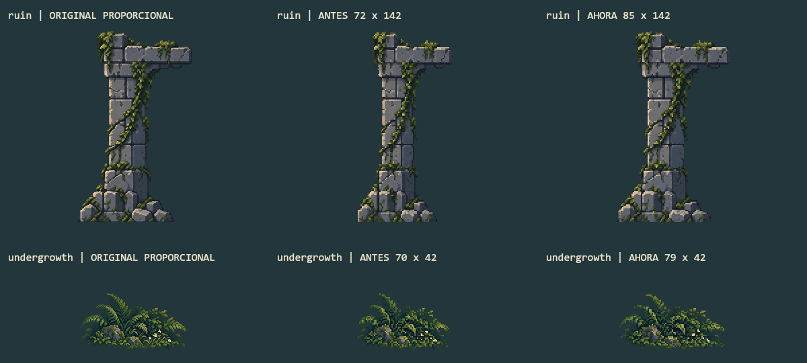
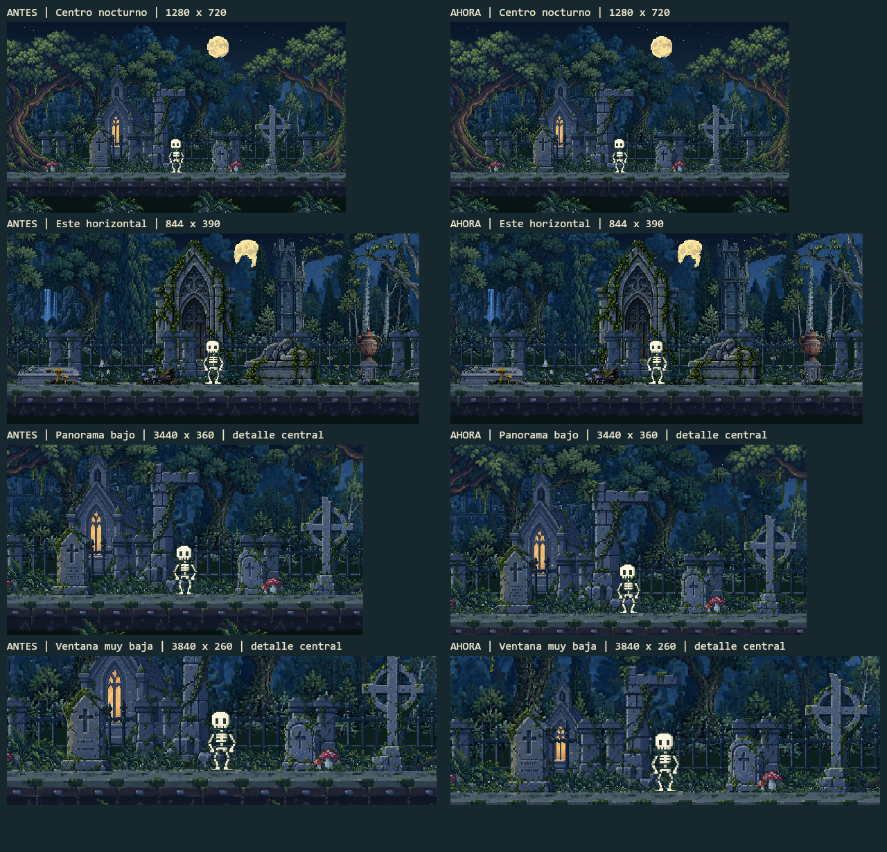
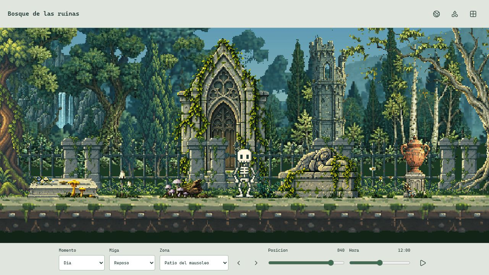
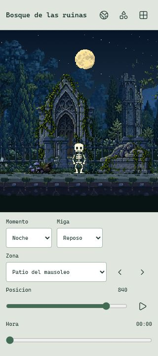
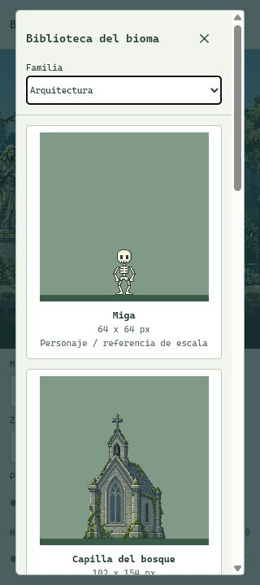
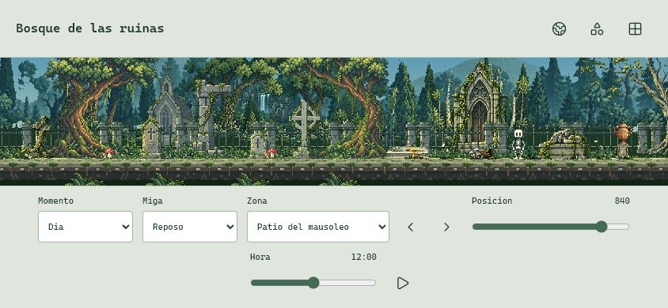

# Proporcion Y Encuadre

2026-10-16. Correcciones posteriores a la [auditoria critica](ASSET_QA.md). Propuesta en sandbox para revision visual, sin publicacion ni copia a estable.

## Dos Exports Proporcionales

| Asset | Antes | Ahora | Ancla actual |
| --- | --- | --- | --- |
| Pilar/dintel `ruin` | 72 x 142 | 85 x 142 | 31, 142 |
| Helechos/flores `undergrowth` | 70 x 42 | 79 x 42 | 40, 42 |

Se reexportan desde los `sourceRect` originales inmutables, no estirando los PNG pequenos. Misma altura, vecino mas cercano y alpha 0/255. El error de proporcion queda por debajo de 0.5 %; las anclas horizontales conservan el punto proporcional con redondeo menor a medio pixel. No se crea arte nuevo ni se recupera detalle inexistente a resolucion pequena.

*Comparacion offline nueva. Original recortado a altura equivalente; PNG anterior desde el respaldo y PNG corregido, ampliados 2x sin suavizado. No es una captura de navegador.*

## Ventanas Bajas

- Camara normal y zoom habitual intactos; el ancho nativo sigue limitado a 2048. No se estira el canvas ni se cambia el rango del mundo.
- En ventanas bajas el suelo dispone de mas altura superior, manteniendo al menos 12 filas por debajo. A 3440 x 360, el canvas es 2048 x 214 y el suelo pasa de 169 a 190.
- Edificios, monumentos y cipreses marcados con `fitHeadroom` reducen escala y offset vertical juntos solo cuando no caben. Reservan ocho pixeles superiores, con tolerancia de un pixel por redondeo. No cambian su X ni el factor de parallax.
- La mascara del cristal usa el mismo rectangulo que la capilla: luz y piedra permanecen alineadas. El ciclo horario, colores y emision no cambian.
- Los cuatro arboles grandes de borde, panoramicas y suelo quedan fuera de esa regla. Sus entradas y salidas por los bordes son parte del encuadre; en ventanas extremas las copas pueden verse parcialmente. No se certifica toda la biblioteca completa en toda posicion.

*Renders offline nuevos de ambas revisiones: el antes se calcula desde el respaldo previo, no desde una captura antigua. Las dos filas inferiores son detalles centrales del viewport indicado para hacer visibles las coronaciones, no capturas de toda su anchura. Las otras filas muestran el canvas completo. La lamina se reduce para presentacion; los sprites del juego siguen usando vecino mas cercano.*

## Navegador Real

Se comprueba el visor local en escritorio 1280 x 720, movil 320 x 720, horizontal 844 x 390 y panorama 3440 x 360. Las barras del visor reducen la altura disponible: sus canvases medidos son 560 x 246, 288 x 331, 1250 x 240 y 2048 x 121 respectivamente. El documento no supera el ancho de esos viewports. Se prueban seleccion de zona/hora y apertura, filtro y cierre de biblioteca. La biblioteca muestra el pilar a 85 x 142 y las dimensiones actualizadas del sotobosque.

*Captura real nueva del navegador a 1280 x 720, este de dia y pausa activada.*

  
  

*Capturas reales nuevas, no simulaciones de layout. No equivalen a Android fisico.*

*844 x 390. Los cipreses y edificios quedan completos; las copas de encuadre pueden salir por el borde superior.*

La captura principal del README procede de un fixture local del juego a 1280 x 720 y las 22:00, usando Renderer y WorldHUD actuales sin leer ni guardar una partida. La consola consultada no presenta errores ni avisos. Las capturas JPEG conservan el formato de salida del navegador; los assets del juego siguen siendo PNG. La comparacion exacta de pixeles se realiza offline, no mediante lectura del canvas del navegador.

## Comprobaciones

- 236 pruebas aprobadas y build completo, con sus pasos pre/post. Catorce regresiones nuevas; una asercion historica se actualiza del margen fijo de 32 al margen minimo de 12 en ventanas bajas.
- 882 casos del renderer de produccion offline; atlas y fallback iguales, pausa exacta y 562 422 pixeles opacos de Miga cotejados sin tinte, recorte u oclusion.
- Auditoria de 78 encuadres: cero recortes verticales de edificios, monumentos y cipreses revisados. No incluye como fallo las panoramicas, arboles de borde ni sujetos cuyo centro quede fuera del viewport. Dieciocho renders adicionales de las tres zonas y seis proporciones.
- 31 PNG nativos y 31 originales: hashes/dimensiones correctos, sin archivos fuera del manifiesto ni duplicados exactos. Alpha binario en 1 337 546 pixeles nativos, sin contenido alpha alto perdido fuera de los recortes fuente.
- 304 archivos protegidos intactos. Todos los originales raster, Miga, su atlas, rig, clips, reglas, persistencia, HUD y dependencias se conservan. Cambian dos exports y tres modulos de encuadre. Los 47 recursos compilados estan en el precache; no es una nueva prueba de desconexion.

## Pendientes

La cruz y lapida arqueada conservan diferencias menores de proporcion; suelo modular y luna no se cambian automaticamente. Las plantas reducidas aun pierden detalle y requieren variantes pequenas dibujadas a su resolucion de destino. Los dos bosques de reserva siguen precargandose; su carga diferida y un inspector nativo de biblioteca son otra tarea. Los historicos dependientes de generadores/tests no se borran.

Faltan aprobacion visual, entrega estable, recorrido autonomo prolongado, telefono fisico, FPS/consumo y desconexion real. El viewport extremo comprueba ausencia de cortes en sujetos marcados, no una composicion artistica ideal en cualquier relacion de aspecto. Ver [inventario actual](ASSET_INVENTORY.json).
