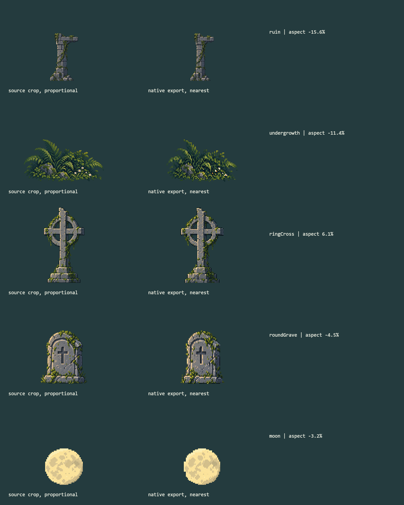
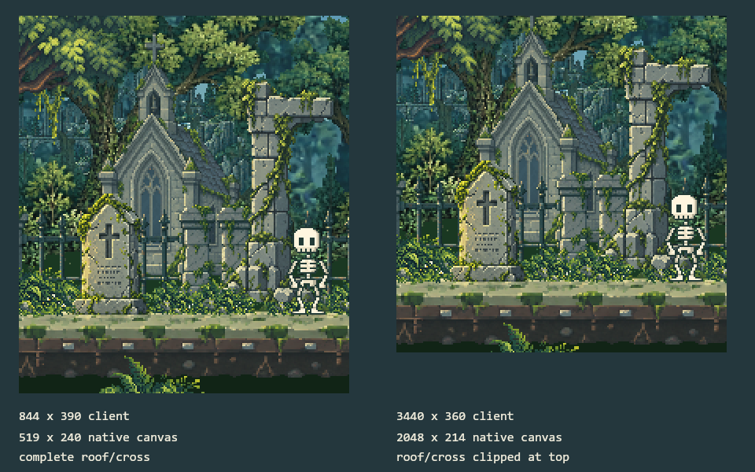
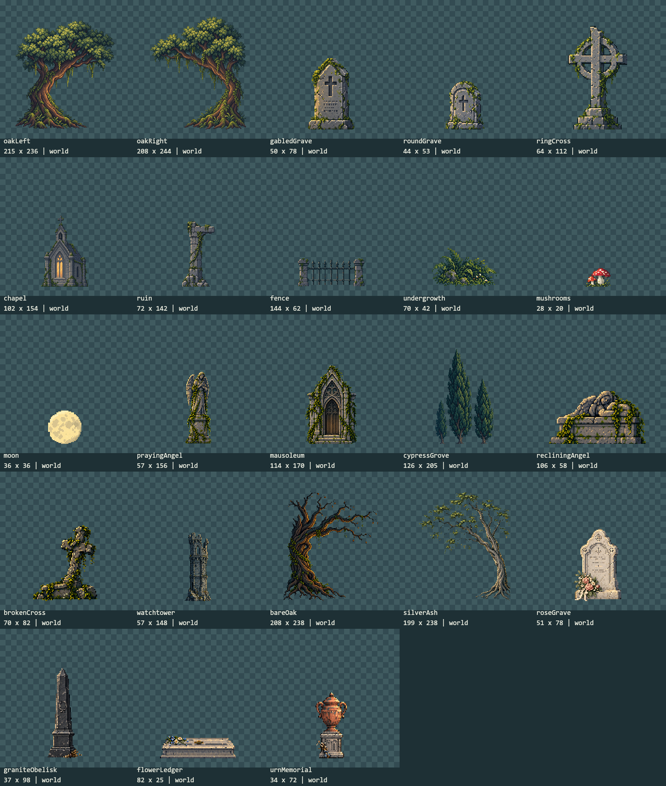

# Auditoria Critica De Assets

**Informe historico previo a las correcciones.** Las cifras, capturas y hallazgos de este documento describen la base auditada, no el estado final. Pilar, sotobosque y encuadre se corrigieron despues; ver [correcciones y pruebas actuales](ASSET_FIXES.md). El inventario JSON enlazado se actualiza al estado actual.

Actualizacion del 2026-10-19: la [limpieza de exports](ASSET_CLEANUP.md) retira los dos fondos de reserva y 160 exports regenerables. La biblioteca actual tiene 29 PNG activos y conserva 31 originales por procedencia; no se reescriben aqui las mediciones de la auditoria anterior.

2026-10-16. Revision del sandbox, sin modificar el runtime, los PNG, el rig de Miga ni las animaciones aprobadas. Esta es una auditoria con hallazgos abiertos, no una declaracion de aprobacion artistica. La carpeta estable permanece intacta.

## Hallazgos

### P2: Proporciones De Exportacion

Los primeros exports no siempre conservaron la relacion ancho/alto del recorte original. La comparacion usa el `sourceRect` del manifiesto, no el margen transparente de toda la imagen.

| Asset | Cambio horizontal relativo | Lectura |
| --- | --- | --- |
| `ruin` | -15.6 % | El pilar/dintel queda mas estrecho que el original. Prioridad de correccion. |
| `undergrowth` | -11.4 % | Helechos, piedras y flores quedan comprimidos. Se suma a su reduccion posterior en escena. |
| `ringCross` | +6.1 % | El aro y el fuste se ensanchan respecto al original. Revisar junto a las lapidas. |
| `roundGrave` | -4.5 % | Compresion menor de la lapida arqueada. |
| `ground` | +6.4 % | El ancho se ajusto al modulo de 560 px; no cambiar sin volver a comprobar las uniones. |
| `moon` | -3.2 % | El export se normalizo a 36 x 36; valorar el disco, no corregir automaticamente. |
| `forestFar` | +11.8 % | Fondo anterior, no colocado en el escenario actual. No es prioritario. |

El porcentaje indica deformacion de proporcion, no porcentaje de calidad ni de pixeles perdidos. La ciudadela, los dos bosques actuales y las incorporaciones recientes conservan las proporciones con diferencias pequenas de redondeo.

*Lamina nueva offline. Izquierda: original recortado a la misma altura. Derecha: PNG nativo con ampliacion entera y vecino mas cercano. La muestra original sirve para comparar forma; no se usa para prometer que un sprite de 42 px conservara todo el detalle de un original grande.*

Para el pilar, conservar altura 142 daria aproximadamente 85 px de ancho, no 72; para el sotobosque, conservar altura 42 daria aproximadamente 79, no 70. Son candidatos de reexportacion, no archivos ya cambiados. Habria que recalcular anclas y revisar solapes antes de incorporarlos.

### P2: Recortes De Encuadre

Los PNG no estan incompletos por el recorte de exportacion: no hay pixeles con alpha >= 240 fuera de los `sourceRect`, todos los recortes quedan dentro de sus originales y los 62 PNG decodifican. Eso no garantiza que una generacion original no tuviese ya una forma artisticamente incompleta; se complementa con inspeccion visual.

La camara puede cortar edificios en ventanas extremadamente anchas y bajas. A **3440 x 360**, el limite de ancho nativo de 2048 produce un canvas de **2048 x 214**, insuficiente para mantener todas las coronaciones:

| Asset | Filas nativas perdidas arriba |
| --- | --- |
| Ciudadela | 5 |
| Torre | 14 |
| Capilla | 10 |
| Mausoleo | 13 |

En 1280 x 720, 320 x 720, 390 x 844, 844 x 390 y 1920 x 260 no aparecen estos recortes de edificios en los encuadres auditados. El grupo de cipreses si pierde 18 filas de copa en las dos vistas bajas de 240 px nativos. Se clasifica como encuadre de vegetacion de fondo, no como PNG roto; debe decidirse si queremos mostrar esa copa completa. Los cuatro arboles de borde y las panoramicas pueden entrar/salir lateralmente del campo visual de forma deliberada.

*Dos recortes offline del renderer de produccion ampliados 2x. Las dimensiones de cliente son entradas del fixture, no mediciones del navegador. No incluye HUD ni controles del visor. El visor real puede tener menos altura de canvas por sus barras; ese caso sigue pendiente de medir.*

No se cambia la camara en esta auditoria: aumentar el limite, cambiar el zoom o introducir encuadre alternativo tiene consecuencias para el mundo y requiere una decision de presentacion.

### P3: Detalle Reducido En Vegetacion

El renderer desactiva suavizado. No hay JPEG ni blur de escalado sobre los PNG del juego, pero vecino mas cercano no recupera detalles descartados por una reduccion. El mismo grupo de 70 x 42 se usa alrededor de 30 x 18 a 40 x 24 px, ademas de otras escalas fraccionarias; algunas flores y hojas pasan a puntos aislados o desaparecen.

La recomendacion es dibujar variantes pequenas a su resolucion de destino y reservar el grupo grande para el primer plano. No aplicar esa regla a ciegas a la ciudadela: su escala 0.58 es parte de la profundidad aprobada para revision.

La biblioteca comprime las panoramicas a 192 px de ancho y no tiene inspeccion 1x/2x. Esa miniatura no permite juzgar su detalle real. Las laminas de esta auditoria separan los recursos anchos para verlos sin cortarlos ni hacerlos invadir otra celda.

### P3: Carga De Reservas E Historial

`ReferenceScenery` precarga los 31 PNG del manifiesto. `forestFar` y `forestMiddle` no tienen colocacion en el mundo actual, pero se cargan igual. Siguen siendo recursos disponibles en la galeria: no son archivos corruptos o duplicados. Conviene cargarlos solo al abrir la biblioteca, manteniendo sus originales y exports.

El entorno procedural anterior no llega al bundle de produccion. Sin embargo, `generate-assets` sigue llamando a `generateBiome`, y los tests historicos leen sus exports. Mover o borrar esos archivos sin ajustar ese contrato romperia la regeneracion y las pruebas. No se elimina nada en esta revision.

## Inventario Y Orden

| Ubicacion | Cantidad | Funcion |
| --- | --- | --- |
| `assets/reference-biome/native/` | 31 PNG: 29 colocados y 2 reservas | Runtime actual y biblioteca |
| `assets/reference-biome/source/` | 31 PNG originales | Regeneracion y procedencia; no se descargan en el juego |
| `assets/reference-biome/` | 5 archivos de metadatos/documentacion | Manifiesto, prompts y procedencia |
| `assets/source/` y kit compartido de `assets/generated/` | 9 archivos | Miga, atlas, fuentes y material del laboratorio original |
| `assets/source/environment/` y `assets/source/biome.json` | 32 JSON | Fuentes del entorno procedural anterior |
| `assets/generated/environment/` | 147 PNG | Exports historicos dependientes de generadores/tests |
| `assets/generated/biome.png` y `.json` | 2 archivos | Atlas procedural anterior; no usado por el runtime actual |
| `assets/studies/cemetery/` | 13 archivos: 8 PNG y 5 JSON | Estudios anteriores; no usados por el runtime actual |

Las familias actuales estan bien separadas: `architecture`, `backgrounds`, `gravestones`, `sky`, `terrain`, `trees`, `vegetation`, tanto en originales como en nativos. No hay PNG nativos/originales fuera del manifiesto, rutas rotas ni duplicados exactos por SHA-256. Hay 31 originales distintos y 31 exports distintos, no 62 assets de juego diferentes.

El punto organizativo pendiente es distinguir mejor **actual**, **reserva** e **historico** en las herramientas. La documentacion ya lo indica; las carpetas antiguas siguen llamandose `environment` y el laboratorio no muestra estado de uso. No se propone una mudanza masiva de carpetas en medio de esta revision.

Datos completos por asset, dimensiones, anclas, bordes, proporciones, uso, hashes y recortes: [Inventario JSON](ASSET_INVENTORY.json).

*Lamina offline nueva, ampliaciones enteras 1x/2x. Los elementos anchos se muestran aparte en la [lamina de panoramicas a escala nativa](images/asset-audit-panoramas.png). Las dos laminas cubren los 31 recursos sin superponerlos.*

## Verificacion Y Limites

- 78 encuadres geometricos: seis proporciones y trece posiciones solicitadas, con limites reales de camara. Algunas posiciones extremas comparten camara por el clamp; no son 78 composiciones unicas.
- 18 renders nuevos de produccion offline: las tres zonas en las seis proporciones, a las 12:00, con Miga y el color actuales. Las comprobaciones geometricas usan noche para incluir tambien la luna; la geometria de edificios no depende de la hora.
- 31 pares de archivos originales/nativos: formato PNG real, dimensiones, hashes, alpha binario nativo, recortes dentro de la fuente y ausencia de contenido alpha alto fuera de ellos. Contactar el borde de un PNG no se toma automaticamente como prueba de truncamiento.
- Compilacion de las tres entradas con Vite en modo `write:false`, para inspeccionar el bundle sin regenerar ni modificar exports. El renderer procedural anterior no figura entre los modulos de produccion.
- 222 pruebas del proyecto ejecutadas de nuevo. No se modifica ningun archivo de `src`, Miga, sus animaciones, los 62 PNG o dependencias.
- No hay nueva comprobacion real de navegador: el controlador vuelve a agotar su tiempo. No se certifica layout del visor, CSS pixelated, DPR, blur, FPS, movil fisico ni consumo mediante estos renders offline.

## Orden De Correccion

1. Probar reexportacion proporcional de pilar y sotobosque, conservando puntos de apoyo y revisando solapes. Comparar la cruz y la lapida arqueada, sin alterar por defecto suelo o luna.
2. Resolver la politica de encuadre para ventanas muy bajas/anchas y decidir si los cipreses deben verse completos.
3. Crear vegetacion pequena a su resolucion de uso y dar inspeccion nativa a la biblioteca.
4. Separar la carga de reservas de la del mundo. Etiquetar historicos y planificar su retirada de generadores/tests por separado, con respaldo.
5. Repetir QA en navegador real antes de aprobar, copiar a estable y versionar. No se ejecutaron acciones de publicacion.
