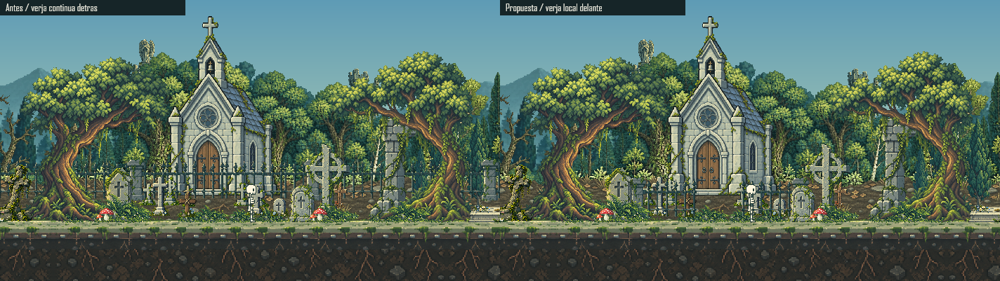

# Cementerio Y Verja Local

2026-10-20. Distribucion aprobada por el usuario para integrarla en su carpeta estable. [Entrega y verificaciones en destino](CEMETERY_MOTION_DELIVERY.json).

## Cambios

- Las nueve cruces de iglesia y los tres marcadores adicionales comparten parallax 0.66 con su tierra. Se mantienen las dos alturas y el orden entre filas, sin crear una velocidad distinta por lapida.
- La proyeccion usa `round(ancla * parallax) - round(camaraContinua * parallax)`. Cada plano recibe una traslacion entera comun; la camara no se redondea antes de multiplicarla ni se redondea cada sprite despues de restar.
- Se ajustan las coordenadas de las antiguas piezas mas rapidas para conservar aproximadamente su composicion a camara 280. No se redibujan ni escalan sus PNG.
- La verja deja de repetirse. Dos tramos de 84px y una apertura central de 64px ocupan 232px, mas el espesor de sus dos pilares exteriores, frente a la iglesia.
- El apoyo de la verja pasa a cuatro pixeles por encima del sendero. Se dibuja despues de ambas filas del cementerio y antes de los monumentos cercanos; los barrotes tapan las cruces donde corresponde, sin hacer opaco el hueco entre ellos.

La separacion de planos y su velocidad relativa se contrasta con la documentacion primaria de [Godot: 2D Parallax](https://docs.godotengine.org/en/4.5/tutorials/2d/2d_parallax.html). El agrupamiento concreto y la formula de redondeo son decisiones de este renderer Canvas 2D; no se incorpora Godot ni una dependencia nueva.

## Revision Visual

Ambos lados usan el renderer principal compilado desde la base respaldada y la propuesta, los mismos PNG, Miga, recorrido, hora y camara. El WebP lossless muestrea seis segundos cada 50ms; su bucle reinicia el recorrido. Es evidencia offline, no grabacion ni medicion de FPS del navegador. Las seis vistas nuevas `cemetery-{west,center,east}-{day,night}.png` muestran el contexto completo.

## QA Y Limites

[Resultados reproducidos](CEMETERY_MOTION_QA.json). Se comprueba separacion constante durante movimientos fraccionarios y caminatas a 30/60/120 FPS simulados, pausa exacta, anclaje a la tierra, oclusion y longitud finita. El test de borde subpixel incluye ambos lados del umbral exacto de redondeo, sin confundirlo con el umbral entero de la camara.

El pixel art sigue avanzando en pasos de pixel: no se promete movimiento subpixel sin escalones. La correccion elimina la variacion relativa dentro del cementerio, no convierte una prueba offline en validacion del escalado CSS, DPR o rendimiento real. El acceso automatizado al navegador sigue bloqueado y no se intenta evadirlo con otro controlador.

No cambian originales/nativos, paletas, iluminacion, anatomia/animaciones de Miga, locomocion candidata, IA, guardados, velocidades del juego, limites, HUD, seguimiento o zoom de camara, dependencias ni Git. La proyeccion comun tambien corrige el redondeo de los demas placements; su fase puede cambiar hasta un pixel, sin cambiar sus factores de parallax.

La longitud/altura y distribucion de la verja estan aprobadas. Sigue pendiente el QA interactivo en navegador; la aprobacion visual no se presenta como benchmark ni comprobacion automatizada de controles.
