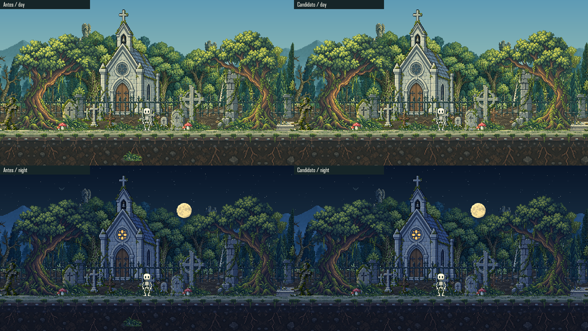
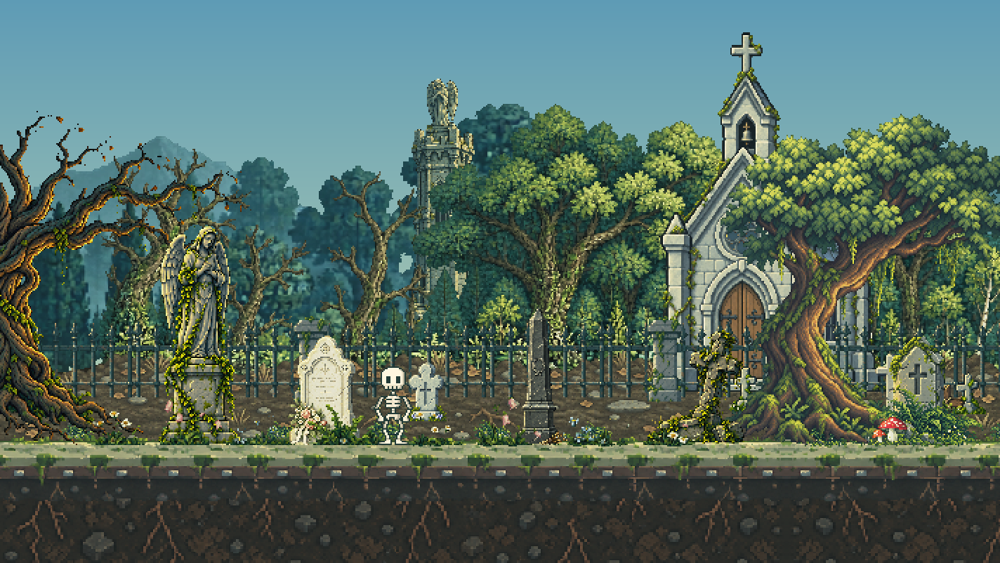
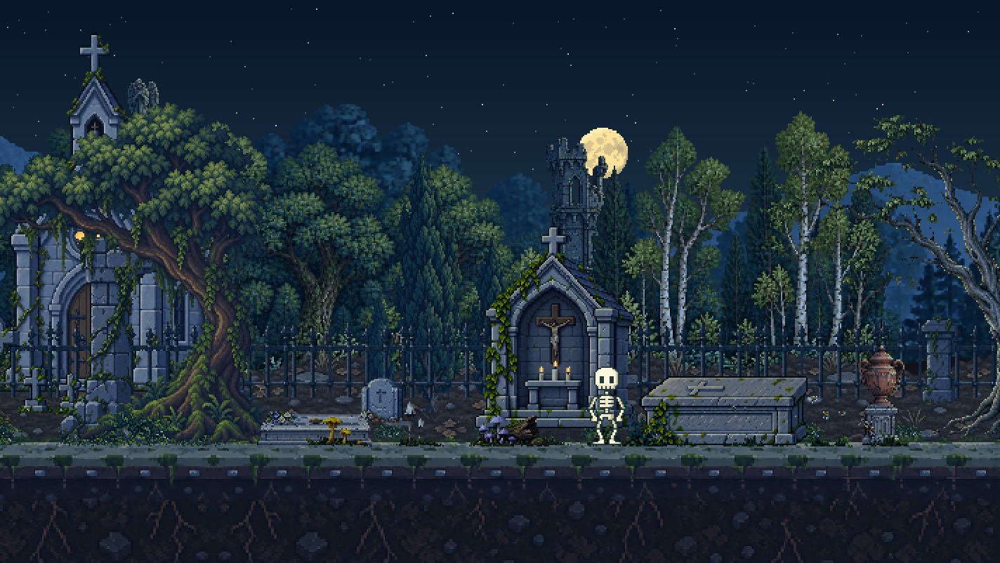

# Cementerio Continuo

2026-10-20. Escenario aprobado por el usuario, junto con la direccion anatomica de Miga para seguir afinandola. La entrega estable y sus verificaciones se registran en [CONTINUITY_DELIVERY.json](CONTINUITY_DELIVERY.json). Esto no aprueba un motor completo ni sustituye los clips activos del personaje.

Se retiran las cinco colocaciones de plantas debajo del sendero, incluida la del centro. Los matorrales, flores y hongos de la superficie se conservan por indicacion del usuario. La tierra, piedra y raices aprobadas no se redibujan.

Tres piezas nuevas amplian el campo de tumbas: memorial trilobulado de 29x42, cruz de roble seco de 23x38 y lapida con flores de 40x32. Se colocan una vez cada una en coordenadas globales, con apoyos distintos. Las nueve cruces/lapidas de la iglesia permanecen. No hay seleccion de assets por zona, saltos de terreno ni repeticion de monumentos unicos; los nombres del visor son puntos de navegacion del mismo bioma, no limites del escenario.

La entrega aprobada usaba velocidades de parallax distintas para estos marcadores. La [correccion posterior aprobada de cementerio y verja](CEMETERY_MOTION.md) los agrupa en un plano rigido y limita el hierro al sector de la iglesia. El registro de entrega de esta pagina corresponde a la base anterior; la entrega actual se registra por separado en [CEMETERY_MOTION_DELIVERY.json](CEMETERY_MOTION_DELIVERY.json).

Comparacion nueva compilada desde las fuentes archivadas de la entrega anterior y el renderer candidato. Mismo encuadre, hora y pose; no se reutilizan imagenes anteriores como evidencia nueva. Son renders offline, no capturas de navegador.

## Biblioteca

44 PNG ambientales activos, 38 originales distintos contando los dos originales retirados de catalogo. Los 41 nativos anteriores permanecen byte-identicos; se agregan tres originales transparentes y tres exports con alpha binario. Cada pieza tiene recorte, escala proporcional, ancla y hashes en el manifiesto. Todos los activos ambientales tienen uso en el mundo.

Los nuevos originales se generan con ImageGen integrado, guiados solo por material del proyecto, sin importar packs de terceros. Fuente y nativo estan en `assets/reference-biome/source/gravestones/` y `native/gravestones/`, respectivamente. [Prompts completos, herramienta y rutas](CONTINUITY_PROMPTS.json).

## Personaje

La caminata recibe una investigacion y un candidato de rig separados del personaje de produccion. La siguiente prueba opcional compara ambas sobre el terreno real, conservando la anatomia aprobada, con camara, sombra e hitbox calculadas desde el frame dibujado. [Diagnostico, referencias y siguientes pasos](LOCOMOTION_RESEARCH.md). El resto del comportamiento no se presenta como reconstruido ni terminado.

[QA de la base anatomica](CONTINUITY_QA.json) y [QA de la prueba en terreno](LOCOMOTION_WORLD_QA.json). No se autoriza staging, commit, etiquetas ni push.
