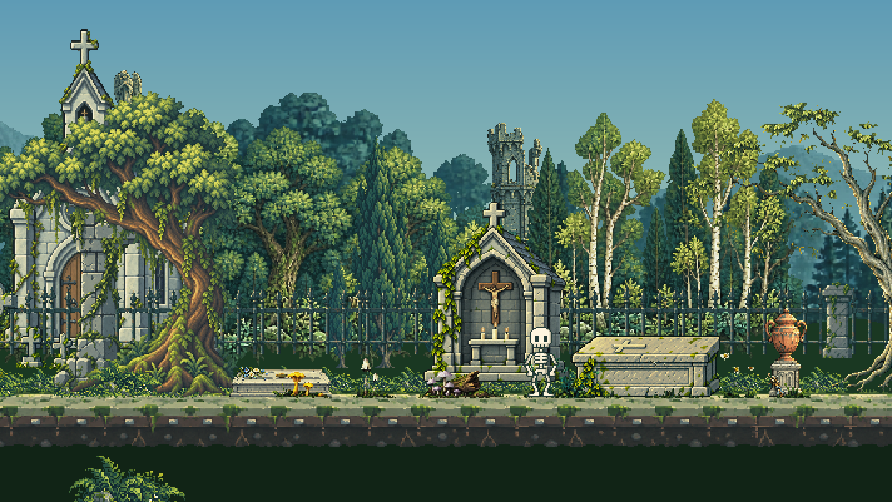

# Profundidad De Torres E Hiedra

Revision acotada del 2026-10-19. Ambas direcciones fueron aprobadas por el usuario durante la revision.

## Cambios

- Torre oriental: parallax de 0.56 a 0.22 y apoyo de -35 a -71. Comparte plano y grado de color con la torre alada, antes del bosque intermedio. Conserva posicion horizontal 1010, dibujo y tamano nativo 57 x 148. La vegetacion cercana puede ocultar la base de ambas torres de forma coherente; no se fuerza que tengan la misma altura fisica.
- Iglesia: edicion raster con ImageGen integrado, cambiando la hiedra por hojas pequenas, tallos finos y menor cobertura. Conserva original de 1013 x 1552, recorte [70,80,910,1348], export 173 x 256 y ancla [86,256]. Remuestreo nearest y alpha >=128, sin retoque manual de pixeles.
- La cobertura verde medida pasa de 3571 a 1815 pixeles (49.2% menos). Es una metrica cromatica aproximada, no un conteo de hojas. La superposicion de siluetas anterior/nueva es 98.0%; no se afirma identidad pixel a pixel de la mamposteria tras una edicion generativa.
- No cambian Miga, sus clips, reglas, dependencias, zoom, arboles, fauna ni luces. La mascara proporcional del roseton se verifica con el export nuevo; conserva 198 pixeles de cristal.
- README renovado con medios de esta revision y sin el bloque antiguo que estaba duplicado al final.

Estas dos imagenes son renders offline nuevos del renderer de produccion, 712 x 401 ampliados 2x con vecino mas cercano. No son capturas de navegador ni pruebas de rendimiento.

## QA Y Limites

- 266 pruebas del motor/catalogo, `assets:check` y build aprobados en sandbox. La regresion de luz comprueba ahora el mismo plano, escala nativa y orden de bosque para ambas torres.
- 24 renders offline: 1280 x 720, 390 x 844, 844 x 390 y 3440 x 360; tres zonas, 12:00 y 22:00. Canvas no vacio, 1022908 pixeles de alpha binario auditados y 164 archivos protegidos intactos por SHA-256. [Resultados](DEPTH_VEGETATION_QA.json).
- Navegador real a 495 x 452: visor del este de dia, claro de noche y mundo principal cargado. El intento de cambiar viewport no altero las dimensiones reales; los encuadres grandes se verificaron offline, no en un navegador de escritorio. El mundo tuvo una carga inicial incompleta que luego termino correctamente. No se mide rendimiento ni se prueba Android o desconexion. [Registro](DEPTH_VEGETATION_BROWSER.json).
- Biblioteca: 39 nativos y 33 originales distintos; no se agregan variantes ni exports duplicados. El estudio comparte la iglesia canonica con hashes nuevos. [Inventario](ASSET_INVENTORY.json).
- La comprobacion y copia estable se registran aparte en [entrega](DEPTH_VEGETATION_DELIVERY.json). No se ejecutan acciones de Git que publiquen cambios.

## Procedencia

Original y export finales: `assets/reference-biome/source/architecture/church-rose.png` y `assets/reference-biome/native/architecture/church-rose.png`. El original anterior se respalda fuera del repositorio, en el archivo de trabajo de esta revision. No se usa CLI ni API externa de imagenes.

El prompt exacto, la herramienta y los hashes estan en [registro de generacion](DEPTH_VEGETATION_PROMPT.json). Se pidio reducir hojas a un tercio y cobertura aproximadamente a la mitad, manteniendo arquitectura, perspectiva, puertas, ventanas, cruz y encuadre.
