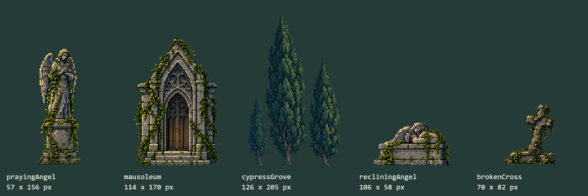

# Extension Lateral Del Cementerio

Guia de la primera ampliacion del 2026-10-15. Su recorrido y guardados se mantienen; la composicion repetida descrita en esta primera pasada se sustituye por [Identidad y vida ambiental](LIVING_WORLD.md). La propuesta actual sigue en sandbox, sin publicacion automatica.

## Recorrido

El mundo pasa de 560 a 1680 unidades: jardin de los angeles entre -560 y 0, claro original entre 0 y 560, y patio del mausoleo entre 560 y 1120. La camara mantiene su resolucion habitual de 560 unidades de ancho en escritorio; no se abre el zoom para encajar las tres zonas.

No se desplaza el origen ni a Miga para insertar el ala izquierda. Las posiciones y objetivos antiguos siguen teniendo las mismas coordenadas; guardar y cargar tambien admite posiciones negativas y mayores de 560, con el margen original de 32 unidades. No cambia la version del esquema. Volver a un build antiguo puede limitar esas posiciones a sus bordes anteriores.

La exploracion autonoma muestrea el recorrido ampliado. Cambian los limites, no las necesidades, velocidad, decisiones de descanso, personalidad, reloj o recompensas. No hay objetos interactivos nuevos ni se recuperan el farol, la runa o la planta retirada.

## Biblioteca

Cinco reconstrucciones raster independientes, guiadas por las dos referencias del usuario. No son extracciones pixel-exactas: la herramienta completa partes tapadas. Se preservan originales y versiones nativas con transparencia binaria; las catorce piezas aprobadas siguen intactas. Prompts y limites en [Procedencia lateral](../assets/reference-biome/LATERAL_GENERATION.md).

*Lamina offline sobre un fondo de contraste. No es captura de navegador ni sprite sheet: cada pieza tiene su PNG, ancla y hash propios.*

## Planos

| Plano | Movimiento frente a la camara | Tratamiento |
| --- | --- | --- |
| Bosque lejano | 0.12 | Panoramica fria y clara |
| Bosque intermedio | 0.34 | Mas detalle, base irregular |
| Capillas laterales | 0.48 | Menor escala y contraste atmosferico |
| Cipreses laterales | 0.68 | Huecos entre siluetas, sin piso incrustado |
| Tumbas distantes | 0.80 | Escala reducida y color mas claro |
| Mausoleos | 0.86 | Piedra legible y contraste intermedio |
| Verja, monumentos y sendero | 1.00 | Anclados al mundo |

Todas las posiciones proceden del mismo `Camera.pixelX`. Las capas no tienen easing, temporizadores ni seguimiento independientes. Solo la camara conserva el seguimiento aprobado. Los cambios de profundidad usan escala y color; no se introduce blur global ni una banda de niebla sobre el suelo.

El suelo alterna el tramo aprobado y su reflejo horizontal, sin modificar el PNG. Cada union enfrenta el mismo borde del original consigo mismo, incluida la zona subterranea. Las filas opacas 11 y 12 conservan el apoyo Y=0. Esta solucion sirve para el recorrido actual, no constituye un tileset de pendientes, esquinas o plataformas arbitrarias.

## Revision Y Limites

El visor ofrece las tres zonas, flechas y el recorrido completo. `?zone=west&phase=NIGHT&paused=1` permite abrir una vista controlada sin acceder al guardado. Miga sigue en primer plano y no queda tapada por los monumentos.

182 pruebas y build correctos. Renderer offline: 504 casos, 321 384 pixeles de Miga sin alteracion, atlas/fallback iguales, pausa ambiental exacta, alpha binario en 549 658 pixeles e igualdad de 208 pixeles de borde de terreno. Se conservan por SHA-256 250 archivos protegidos de arte, personaje, persistencia, reloj, HUD y dependencias. Los cambios autorizados de limites, camara y rango de exploracion se declaran por separado.

Las capturas nuevas del visor son pruebas de navegador en estados controlados. Las panoramicas y la lamina de assets son renders offline; no son evidencia de framerate, fluidez en un telefono fisico o aprobacion artistica. Pendientes: aprobacion de las dos alas, Android real, rendimiento y consumo prolongados, nuevas interacciones y prueba de desconexion completa.
