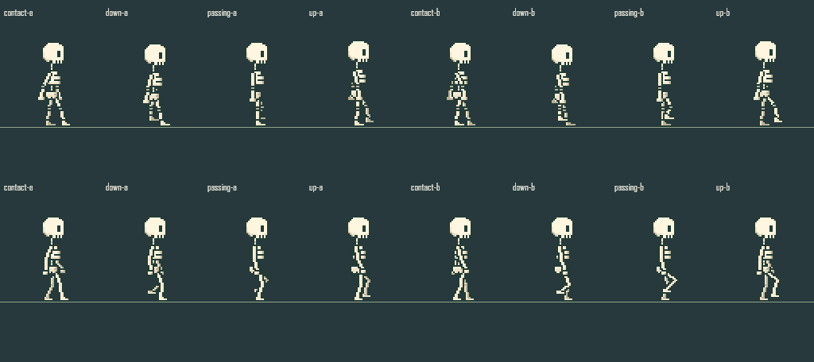
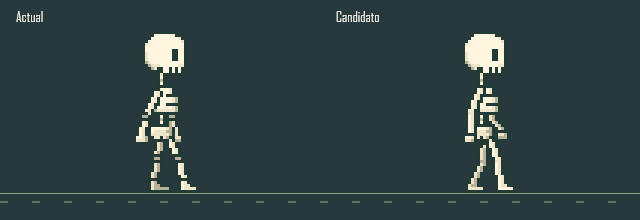
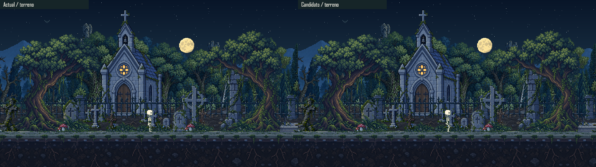

# Locomocion Y Base De Personajes

2026-10-20. El usuario aprueba la direccion anatomica para seguir afinandola. La prueba siguiente la coloca en el terreno real, aun de forma opcional. El personaje, atlas y clips activos del juego no se sustituyen. No es una aprobacion de un motor completo.

## Diagnostico Del Codigo Actual

- El rig `skeleton-v2` coloca siete piezas sobre el canvas, sin relacion anatomica padre/hijo entre coxis y piernas. La herencia de poses no equivale a una jerarquia de articulaciones.
- Las raices de las dos piernas quedan en x=32.5/33.5, y=39 durante los ocho dibujos; el coxis tiene desplazamientos verticales de +1/-1. Esa diferencia de referencias altera la lectura de donde nace el muslo.
- El ciclo dura 960 ms. La IA avanza entre 12 y 19 unidades por segundo, pero el renderer usa `stateElapsed` con la misma cadencia para todas las velocidades. Cambiar solo ese tiempo no corrige las articulaciones.
- El renderer, sombras e interaccion dependen del frame actual. Una futura sustitucion debe actualizar conjuntamente dibujo, contactos y limites, no solo el atlas.

## Referencias Consultadas

| Fuente primaria | Aplicacion al proyecto |
| --- | --- |
| [SLYNYRD, Human Walk Cycle](https://www.slynyrd.com/blog/2024/5/24/pixelblog-50-human-walk-cycle) | Estudio de contacto, descenso, paso y elevacion; ocho poses, relacion entre brazos y piernas, y plantilla anatomica antes del acabado. Sus proporciones humanas no se trasladan literalmente a Miga. |
| [SLYNYRD, Motion Cycles](https://www.slynyrd.com/blog/2020/1/23/pixelblog-25-motion-cycles) | Separacion del estudio de piernas, brazos y cuerpo. El autor advierte que su ejemplo exagera el gesto; sirve para entenderlo, no para copiar su rebote. |
| [Phewcumber, Skeleton Pack](https://phewcumber.itch.io/skeleton-pack) | Ejemplo de biblioteca con acciones separadas y variantes de equipo. Personaje de unos 32x32 dentro de frames 64x64. Se consulta como referencia, sin importar ni redistribuir sus archivos. No se usa como entrada de generacion. |
| [Godot, 2D skeletons](https://docs.godotengine.org/en/stable/tutorials/animation/2d_skeletons.html) | Raiz en la cadera, jerarquia y pose de reposo. La pagina consultada incluye aviso de actualizacion pendiente; no se importa codigo ni API de Godot. |
| [Spine, Bones](https://esotericsoftware.com/spine-bones) | Transformaciones locales y herencia anatomica; separar imagen, articulacion y orden visual. |
| [Spine, Skins](https://esotericsoftware.com/spine-skins) | Reutilizar movimiento con distintas piezas, sin vincular las animaciones a una unica apariencia. |
| [Aseprite, Slices](https://www.aseprite.org/docs/slices/) | Anclas y pivotes explicitos en los metadatos de exportacion. |

Los GIF de SLYNYRD no pudieron abrirse como imagen mediante el lector web; sus explicaciones se consultaron en la pagina. No se afirma una inspeccion cuadro a cuadro de esos GIF ni se descargan para sortear esa limitacion. La inspeccion cuadro a cuadro propia usa los pixeles de Miga.

## Decision Tecnica De Esta Prueba

Conservar el pipeline pixel-native del proyecto y probar cinematica directa con claves articulares y rasterizacion a pixeles enteros. No se deforma una imagen con una malla ni se suavizan sus bordes. Es una decision para validar la lectura de Miga, no una conclusion de que un motor propio completo sea la mejor inversion.

No se instala Spine automaticamente: su [acuerdo oficial](https://esotericsoftware.com/spine-editor-license) exige licencia valida para integrar su runtime. El prototipo no contiene su codigo. Adoptar un editor/runtime externo debe decidirse con presupuesto, licencia y necesidades reales de autoria, no solo por una demostracion visual.

## Candidato Actual

- Muestreador independiente en `src/animation/JointRig.js`: jerarquia, transformaciones locales, interpolacion ciclica, fase por distancia y apoyo vertical.
- Datos separados de rig, movimiento y piel en `studies/locomotion/`. Cadera, rodillas, tobillos, hombros, codos y munecas identificados; longitudes constantes antes de cuantizar.
- Cabeza, torax y coxis usan los bitmaps originales. Brazos y piernas se rasterizan desde las cadenas; la piel define capas, grosor, extremos y sombreado. El brazo lejano queda detras del torax.
- Zancada de prueba de 16 unidades; la fase sigue la distancia recorrida. La altura del cuerpo deriva de la pierna de apoyo, en lugar de mover el coxis sin sus descendientes.
- La primera prueba demasiado delgada y flexionada se descarto. La segunda recupera interior de hueso de dos pixeles y reduce el gesto de la pierna de apoyo.
- El laboratorio compara original/candidato, permite pausa, ciclo, direccion, velocidad, escala, articulaciones y dos paletas. La paleta alternativa no es un segundo personaje terminado.

Medios offline nuevos. Ambos usan pista a 16.67 unidades/s, donde sus ciclos de 0.96s coinciden para comparar las articulaciones sin desfasarlas; el candidato calcula su fase por distancia. El laboratorio permite cambiar esa velocidad y observar la diferencia. El WebP son 96 frames de sintesis con 40 ms por frame y cuatro ciclos completos, no una captura ni una medicion de FPS del navegador.

## Ruta De Integracion

### Prueba Actual En Terreno

El visor permite cambiar entre estudio y terreno, con luz diurna/nocturna. Ambas vistas usan el renderer principal y la misma trayectoria, pero instancias de camara independientes comprobadas para producir el mismo origen. El original usa su atlas; el candidato usa `JointActor`, con un cache acotado de 64 estados rasterizados por instancia, no 64 poses dibujadas a mano.

El dibujado de piel se traslada sin cambios de logica a `src/animation/JointSkin.js`. Rig, movimiento y piel aprobados siguen intactos. Contactos, sombra y limites de interaccion del candidato se derivan de sus pixeles almacenados, y la fase sigue el desplazamiento real incluso al topar con el limite del mundo. El visor no usa guardados ni IA. Sus giros en los extremos son inversiones instantaneas para repetir la prueba, no una animacion de giro terminada.

Estos son renders offline nuevos del renderer de produccion, no capturas del navegador. [Mediciones y limites](LOCOMOTION_WORLD_QA.json). El WebP de anatomia anterior se conserva como la base aprobada, no como evidencia nueva de camara o suelo.

### Pasos Pendientes

1. Revisar y afinar la base anatomica aprobada dentro del entorno, en ambos sentidos y con distintas velocidades.
2. Completar transiciones de entrada/salida y giros, y aprobar despues la integracion en el juego. Contactos, sombras e hitboxes se prueban ahora en el visor opcional, no se habilitan aun en produccion.
3. Adaptar reposo, observacion, reaccion y expresiones. El desarme aprobado al dormir necesita permitir piezas desprendidas; no debe quedar forzado por restricciones de apoyo de la caminata.
4. Validar un segundo personaje de proporciones y piezas realmente distintas, no solo otro color. Separar definicion visual de IA y guardado; cualquier cambio de esquema requiere migracion.

No se cambia ahora la IA, velocidad del juego, necesidades, guardados, camara ni dependencias. El mundo sigue usando el personaje anterior hasta aprobacion e integracion verificadas.

## QA Y Limites

Las pruebas cubren jerarquia invalida, conexiones, longitudes, apoyo, cierre de ciclo, velocidad, paleta, limites del canvas y conservacion de cabeza. Se prueba otra jerarquia con nombres diferentes; eso no demuestra compatibilidad automatica con cualquier criatura.

[Resultados de esta pasada](CONTINUITY_QA.json). El acceso automatizado al navegador sigue bloqueado por politica; no se utiliza otra ruta para eludirlo. Quedan pendientes prueba interactiva, encuadre real de escritorio/movil, rendimiento, aprobacion artistica e integracion de todos los estados. La compilacion y los renders offline no sustituyen esas pruebas.
