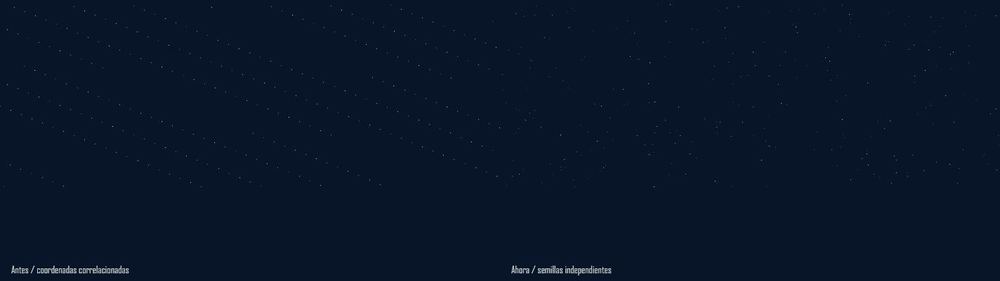
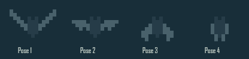
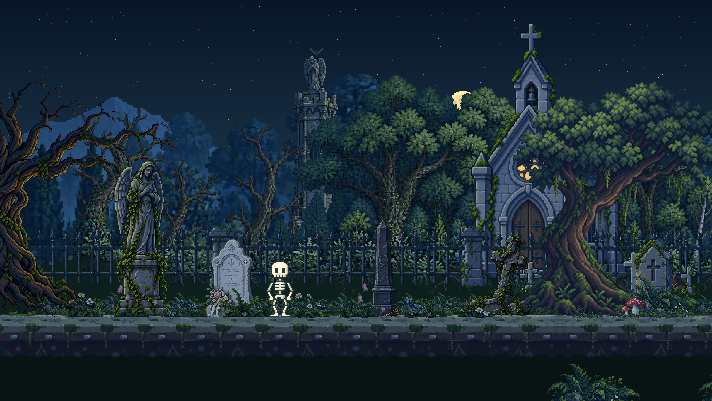

# Vida Nocturna Y Orden De Assets

Revision de 2026-10-19. Primera etapa de fauna ambiental, sin tocar a Miga, sus clips, las reglas, las necesidades, las partidas, el HUD ni las dependencias.

## Movimiento

- Hasta ocho luciernagas visibles. Sus recorridos locales tienen intervalos inmoviles; los destellos y su intensidad lenta no se sincronizan. Halo de 3 x 3 muy tenue y nucleo de un pixel.
- Un solo murcielago ocasional en todo el mundo. Pasajes de 18 segundos con seis segundos de intervalo, distribuidos entre tres rutas; no se genera otro al mover la camara. Su alpha tiene entrada y salida gradual.
- El sprite mide 13 x 9 y tiene cuatro poses de alas, con ciclo de seis pasos. La fuente editable es `assets/source/ambient/bat.js`; la consumen el renderer y la categoria Fauna del visor. Es pixel art code-native, no un PNG generado con ImageGen.
- Se dibuja despues del bosque intermedio y antes de arquitectura, cipreses y arboles cercanos: la oclusion proviene de sus mascaras reales. Las luciernagas conservan su plano cercano y Miga se dibuja al final.
- Aparicion progresiva segun la iluminacion del mismo reloj del mundo. Todo el movimiento usa el reloj ambiental existente y se congela al desactivarlo.
- Se conservan las mariposas y hojas diurnas. Abejas y libelulas quedan para la siguiente etapa, tras aprobar esta muestra.

## Estrellas

El generador anterior obtenia ambas coordenadas de semillas lineales correlacionadas. Ahora cada canal usa un hash independiente y se descartan candidatos demasiado cercanos en el campo de referencia. Sus identidades y posiciones pertenecen al mundo, no al frame o a la camara. Las estrellas siguen midiendo un pixel, con pequenas diferencias cromaticas y titilacion lenta e independiente.

*Comparacion offline del generador sobre el mismo cielo, camara y hora. Sin fondos del bioma para poder inspeccionar las alineaciones.*

## Limpieza

Se retiraron 17 copias PNG identicas del estudio de arquitectura, 4565725 bytes, y 51 directorios vacios. Los archivos compartidos quedan una sola vez en `assets/reference-biome/`. El manifiesto y visor del estudio apuntan ahora a esas fuentes canonicas; las pruebas comparan sus hashes y dimensiones.

Se conservan los originales editables, dos fuentes forestales historicas de procedencia y los atlas/fuentes del kit anterior que usan Asset Lab y las pruebas. Dependencias, builds y caches se preservan. No se uso copia espejo ni borrado recursivo. Las copias retiradas se verificaron y respaldaron fuera del repositorio antes de eliminarlas.

Detalle de rutas, hashes y directorios: `NIGHTLIFE_ASSET_AUDIT.json`. Inventario de escenario y fauna: `ASSET_INVENTORY.json`.

## Verificacion

Sandbox: 266 pruebas aprobadas, `assets:check` y build correctos. La matriz offline del renderer pasa 882 combinaciones y coteja 562422 pixeles opacos de Miga, fallback/atlas y pausa. Los 157 archivos protegidos permanecen intactos; el precache cubre 45 recursos. Resultados completos en `NIGHTLIFE_QA.json`.

La animacion nueva es un WebP lossless de 12 segundos a partir de 144 muestras, codificadas como 144 paginas; se cotejan su primer frame con el buffer original y sus 12000 ms de duracion. Es un extracto controlado, no una medida de FPS ni un ciclo completo del comportamiento.

La pasada con la altura final del vuelo completo las pruebas, el build y las 882 combinaciones antes de fallar al sobrescribir un WebP abierto por la previsualizacion. Se libero esa cache y se repitio por separado la etapa de medios con el mismo renderer compilado, comprobando duracion y primer frame. El informe registra esta recuperacion y la procedencia del conteo de pixeles.

*Medios offline nuevos del renderer principal. No representan FPS medidos en navegador.*

El control del navegador respondio al observar la vista estable anterior, pero fallo despues al adjuntar o recuperar la pestaña de QA. La comprobacion interactiva de esta revision y dispositivos fisicos siguen pendientes salvo que el informe de entrega registre evidencia nueva. La entrega a Desktop, la paridad de hashes y las pruebas/build repetidos alli se registran en `NIGHTLIFE_DELIVERY.json`. Sin staging, commit, tag o push.
