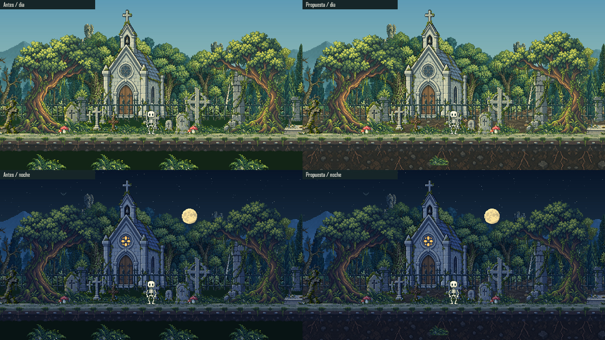

# Revision De Suelo Del Cementerio

2026-10-19. Revision implementada y probada en sandbox, aprobada visualmente por el usuario para entrega estable. La copia, respaldo y comprobaciones en destino se registran en [SOIL_DELIVERY.json](SOIL_DELIVERY.json). No hay staging, commit, etiqueta ni push.

## Alcance

El relleno verde del renderer dejaba una banda continua tras la verja y otra debajo del sendero. Los cuatro grupos inferiores estaban ligados al claro central y al borde del viewport. La propuesta conserva el sendero de 560 x 52 con ancla [0,12] y agrega dos capas raster:

| Material | Export | Uso |
| --- | --- | --- |
| `cemeterySoil` | 560 x 74, ancla [0,74] | Tierra, piedra y hojarasca entre las cruces; parallax 0.66, apoyo +4 |
| `earthFace` | 560 x 195, ancla [0,0] | Tierra y raices bajo el sendero, desde +20; solapamiento con el sendero sin cambiar su apoyo |

Ambas franjas se dibujan a escala nativa, con alternancia horizontal para unir exactamente los pixeles de sus bordes. La tierra inferior se prolonga en vistas altas sin estirarla. Recibe un factor de iluminacion 0.78 para no competir con las superficies expuestas. El relleno de respaldo usa tierra neutra, no la antigua paleta verde.

La primera muestra de tierra tras la verja era demasiado baja y dejaba huecos de cielo en el oeste. La revision visual los detecto: se amplio el original con ImageGen a una superficie de suelo continuo, se exporto una ventana proporcional de sus primeras 280 filas visibles y se recupero la cobertura de horizonte del respaldo original. Los seis renders finales y la comparacion se regeneran despues de esa correccion.

El sotobosque repetido de la verja se reduce en cantidad y escala. Los grupos inferiores pasan de cuatro a escala 1.18 a cinco a escalas 0.48-0.60, repartidos por oeste, centro y este y ligados al terreno, no al borde de pantalla. Su suma de areas proyectadas es aproximadamente un 75% menor. Esto no es una medicion de pixeles verdes de toda la escena.

No se agregan cruces: primero se evalua el material entre las nueve existentes. Miga, clips, sombras de contacto, objetos, arboles, iglesia, torres, camara, necesidades, guardados y dependencias no cambian.

## Comparacion Nueva

Los dos lados se compilan desde sus fuentes respectivas, no se retocan capturas antiguas. Canvas de cada celda: 712 x 401. Renders offline con la misma pose, camara y hora. Los seis renders `soil-{west,center,east}-{day,night}.png` se amplian exactamente 2x sin suavizado. No son prueba de FPS ni de Android.

## Procedencia Y Referencias

- El estilo principal sigue siendo el escenario aprobado y el original `source/terrain/path.png`, sin modificarlo.
- [Forgotten Cemetery, Anokolisa](https://anokolisa.itch.io/fantasy-pack-vlii-forgottencemetery): referencia de borde de terreno y separacion de materiales; no se importan sus sprites ni su paleta rojiza.
- [Graveyard Basic, HP_Gamecraft](https://hp-gamecraft.itch.io/graveyard-basic-tileset): referencia de biblioteca separada de tierra, piedras y hierba; no se importan sus archivos.
- Los dos originales nuevos se derivan con ImageGen integrado, no CLI ni pintura manual de pixeles. Se copian a `assets/reference-biome/source/terrain/`; los nativos y hashes estan en el manifiesto y el inventario. Export: recorte alpha cuando corresponde, proporcion conservada con redondeo, nearest y alpha >=128.
- [Prompts exactos y archivos finales](SOIL_PROMPTS.json).

## Verificacion

[SOIL_QA.json](SOIL_QA.json) registra las pruebas nuevas, build, inventario y matriz offline. Las regresiones cubren cobertura de extremos y uniones, suelo en vistas altas, parallax, orden frente/fondo, sombreado de tierra, distribucion de plantas y sendero intacto.

El control del navegador integrado bloqueo el acceso a una pestana de error por su politica de URL. No se sortea el bloqueo ni se afirma QA real de navegador. El servidor del sandbox responde en `http://127.0.0.1:5185/`; el visor esta disponible para revision manual en `/biome-lab.html?zone=clearing&hour=12&paused=1`. [Registro de esta limitacion](SOIL_BROWSER.json).

El usuario aprobo la comparacion final y solicito copiarla a su carpeta estable. Quedan pendientes revision manual en navegador, rendimiento, dispositivo fisico y desconexion real. La aprobacion artistica no sustituye esas comprobaciones.
