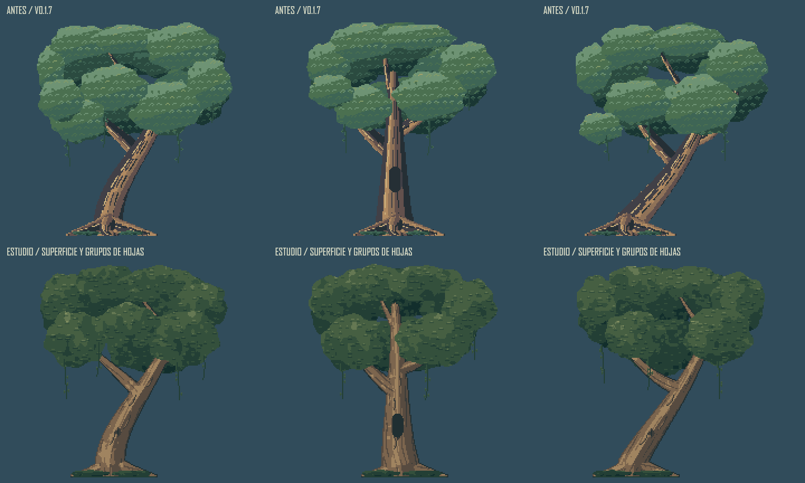

# QA De Arte Y Escena

Fecha: 2026-10-12. Alcance: escena patron en sandbox, sin entrega a Desktop ni publicacion.

**Resultado artistico rechazado:** el usuario no aprueba esta primera entrega. Los resultados tecnicos siguientes son historicos; no prueban cercania a la referencia. La [correccion de encuadre y atmosfera](WORLD_VIEW.md) documenta la revision vigente y sus nuevas capturas.

## Hallazgos Y Correcciones

| Hallazgo | Correccion | Comprobacion |
| --- | --- | --- |
| Copas con textura repetida y lectura plana | Masas y grupos irregulares, sombra interior y luz agrupada | Tres robles comparados a zoom 2 y biblioteca real |
| Uniones de madera con aspecto de piezas superpuestas | Superficie de union, bifurcaciones ancladas y taper | Planos de siete arboles, orden de pintado independiente y revision visual |
| Niebla estrecha en bandas demasiado evidentes | Bancos con densidad escalonada y bordes transparentes | Renders de tres encuadres y tres fases |
| Pulso temporal de alpha en el primer prototipo | Interpolar alpha antes de una sola composicion | Maximo RGB pasa de 4 a 2 por fotograma a 60 Hz |
| Bosque lejano demasiado uniforme | Dos siluetas distintas y contraste atmosferico por distancia | Comparativa de composicion y movimientos |
| Cipres, ruina y tumbas ocultaban las ventanas | Recolocacion del encuadre patron | 87.97% del cristal calido de las lancetas sigue legible en el render nocturno |
| Fondo tapaba la luna | Tamano nativo y distribucion de las copas | 100% de sus pixeles visibles en el encuadre nocturno patron |
| Terreno inferior sin primer plano | Reutilizar helechos debajo del sendero | Posiciones no alcanzan el suelo de Miga ni zonas de toque |

*Comparacion de fuentes a zoom 2. Las pruebas de conexion no certifican la belleza de las ramas; se revisaron tambien sus siluetas y uniones completas.*

## Motor Y Exports

- `npm run check`: 138 pruebas aprobadas y build de las tres vistas. El cache offline sigue conteniendo 19 recursos.
- Once pruebas nuevas cubren construccion de ramas, union independiente del orden, metadatos invalidos, contraste atmosferico, densidad y continuidad de niebla, encuadre de los troncos, visibilidad de capilla, limite del primer plano y escala de los astros.
- Las regresiones anteriores conservan siluetas conectadas, suelo, paletas, tiempos del viento, simetria de capilla, hueco de ruina, uniones del sendero, animaciones aprobadas, toques, guardados, descanso y descubrimientos.
- Los 441 frames y los 147 PNG se cotejan con las fuentes. Inventario exacto, sin exports adicionales obsoletos.
- SHA-256: nueve archivos protegidos del kit y 23 archivos de logica sin cambios. Ningun cambio de dependencias, IA, necesidades, recompensas, guardado o sensores.

## Renderer Offline

- 27 combinaciones: 384 x 216, 192 x 304 y 384 x 108; dia, atardecer y noche; x=32, 275 y 528.
- 216 casos de pose/direccion: reposo, caminar, observar y dormir, hacia ambos lados. Atlas y fallback producen imagenes identicas.
- Se cotejan 144990 pixeles opacos de Miga contra su fuente: no se recortan, tinen ni quedan tapados por vegetacion o niebla.
- El ajuste de movimiento ambiental congela exactamente el render. La niebla aislada se prueba durante 600 pasos a 60 Hz: diferencia maxima de dos niveles RGB entre fotogramas.
- GIF de 180 frames a 15 fps: IA real con objetivo inicial lapida, llegada, investigacion, descubrimiento y nueva decision. No es una grabacion del navegador ni una medicion de framerate.

## Navegador

Capturas actuales y revision del visor a 1280 x 720 y 320 x 720, con dia, atardecer y noche. Se revisan biblioteca por arboles, poses, pausa, caminata, descanso y extremos. El canvas movil permanece fuera del encabezado y controles. Las mediciones DOM comprueban ancho y ausencia de desbordamiento, sin sustituir la inspeccion de las imagenes.

La primera captura de algunos cambios de pose/fase mostro un canvas desactualizado mientras el navegador no se presentaba visualmente. Se rehacen las capturas con el visor visible y se comprueban sol/luna, ventana apagada/encendida y huesos descansando. No se usan las imagenes transitorias como evidencia en el README. Una accion del control de navegador agota el plazo y se recupera desde el estado accesible, sin cambiar el codigo de la app para el test.

## Limites Y Entrega

El dibujo sigue siendo una propuesta pendiente de criterio humano. La nueva guia no declara uniforme ni acabado el resto de la biblioteca. Android fisico, consumo, framerate prolongado, desconexion real y partida nocturna prolongada quedan pendientes. Los pasos a 60 Hz son una prueba offline de continuidad, no una certificacion de rendimiento.

Los 279 archivos anteriores de la carpeta estable conservan los hashes del respaldo; su Git queda intacto. README, medios y guia se actualizan en el sandbox. La copia estable se hara al aprobar la escena o pedir publicar, con preflight, permisos y comprobacion de hashes, tests y build. No se ejecutan staging, commit, tag ni push en esta propuesta.
