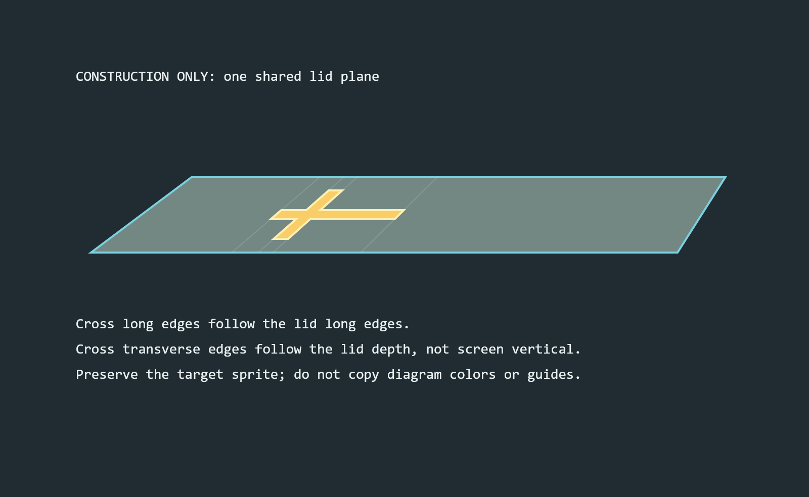
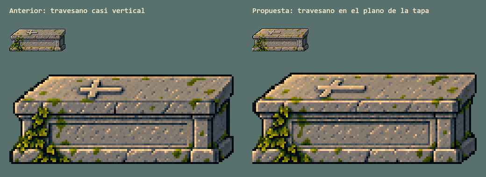
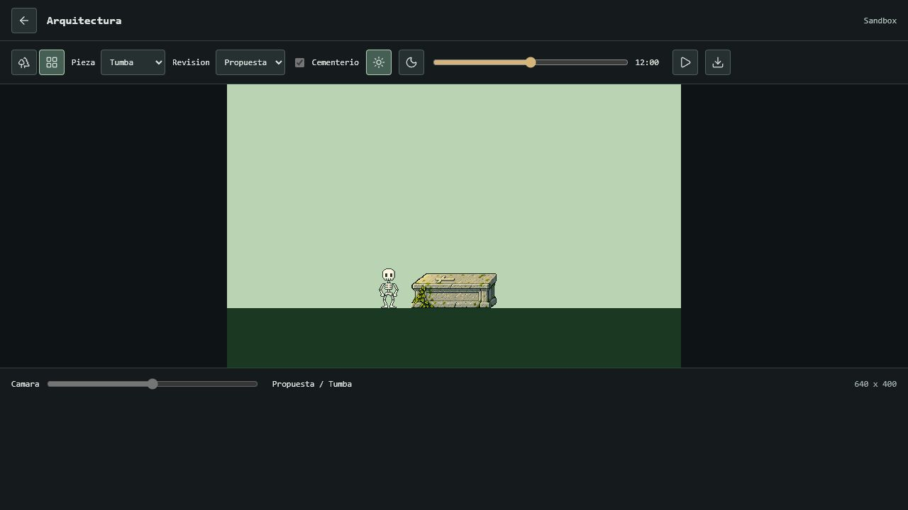

# Revision De Perspectiva De La Tumba

**Estado posterior:** el usuario solicita integrar la revision actual y llevarla a su carpeta para revisar antes del commit. La revision 6 ya forma parte del renderer principal; el texto siguiente conserva el estado previo a esa solicitud. La perspectiva sigue abierta a mejoras posteriores. [Integracion y entrega actuales](ARCHITECTURE_INTEGRATION.md).

2026-10-19, candidato 6. **Pendiente de aprobacion artistica.** No esta integrado en el mundo ni copiado a la carpeta estable. Las versiones anteriores rechazadas no se consideran una base aprobada aunque sus tests tecnicos pasaran.

## Hallazgo

El problema no era solo el tamano o la posicion de la cruz: el travesano de la revision 5 estaba casi vertical en pantalla mientras la tapa se prolongaba en diagonal. Eso hacia que pareciera girado o levantado sobre otro plano. Es una conclusion visual de esta revision, no una afirmacion de las fuentes historicas.

Se conserva la caja que el usuario acepta, la esquina derecha completa y la cruz pequena en la mitad izquierda. La nueva propuesta cambia la proyeccion del travesano y limita el relieve. La guia de construccion no es un retoque del PNG: representa de forma independiente las dos direcciones de la tapa y una cruz sobre su mismo plano.

La guia usa una aproximacion de los cuatro vertices visibles. No certifica una camara fisica, ni es un asset final. Se aporta como segunda imagen a ImageGen para fijar la geometria, sin copiar sus colores o lineas. El PNG final sigue siendo un raster generado, no un dibujo retocado a mano pixel a pixel.

## Referencias Inspeccionadas

- [Modelo Gravestone, Mechan3D / TurboSquid](https://www.turbosquid.com/3d-models/3d-gravestone-model-2347649): se inspecciono en navegador la imagen `gravestone.g11.2k.jpg`. La cruz y la losa permiten comparar los dos ejes sobre una misma superficie. Se estudia su volumen, no se importa su modelo ni su textura.
- [Bradford-on-Tone, West Somerset at War](https://wsaw.weebly.com/bradford-on-tone.html): se abrio la fotografia `crimean.jpg`, una tumba real con cruz en relieve. Sirve para comparar el contacto, la proyeccion y el grosor, no para cambiar la direccion artistica del cementerio.
- [Commemorative Structures, Historic England](https://historicengland.org.uk/images-books/publications/dlsg-commemorative-structures/heag110-commemorative-structures-lsg/): la seccion 1.3 describe el tipo de caja con losa superior. Es contexto constructivo; no se atribuye a esta guia una regla tecnica de dibujo.

La pagina de un escaneo de Cobham devolvio 403 y sus miniaturas no pudieron inspeccionarse. No se presenta como evidencia visual examinada. Las referencias consultadas no se agregan a la biblioteca del juego.

## Muestra Actual

Comparacion offline nueva a 1x y 4x sin suavizado. El export completo de la tumba es 120 x 49. Miga mantiene sus 56 pixeles de altura de cuerpo y todos sus assets y clips aprobados. La reduccion mantiene la proporcion con redondeo de un pixel, sin deformacion no uniforme intencional.

El estudio tiene 640 x 400 o un recorte de 320 x 400. La iglesia candidata aumenta a 173 x 256 y su base queda 38px por encima del plano cercano: cruz superior a 22px del borde de la vista principal. Su mascara de roseton usa coordenadas proporcionales y no las dimensiones antiguas. Esto no cambia el encuadre del juego.

## Verificacion Y Entrega

La verificacion tecnica de esta revision se registra en [VERIFICATION.md](VERIFICATION.md). No demuestra que la perspectiva sea del gusto del usuario. La aprobacion artistica, el encaje de la iglesia en el mundo completo y la copia verificada al escritorio siguen pendientes. No hay staging, commit, etiqueta, push ni release nuevos.

Navegador a 1280 x 720, canvas 640 x 400 presentado a escala nativa. La vista de piezas no representa el escenario completo. No se confunde esta captura con un render offline ni con una prueba interactiva de sus controles.

Prompts completos: [revision 6](../studies/architecture/prompt-v6.json) y [revisiones 4 y 5](../studies/architecture/prompts-v4-v5.json). Los PNG rechazados se respaldan fuera del proyecto antes de sustituir el candidato; el catalogo activo de 29 recursos no cambia.
