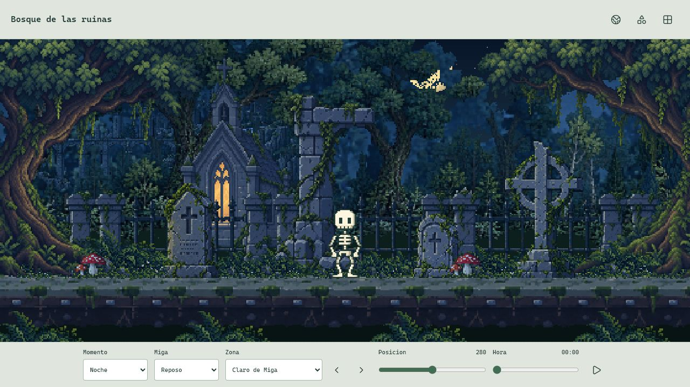
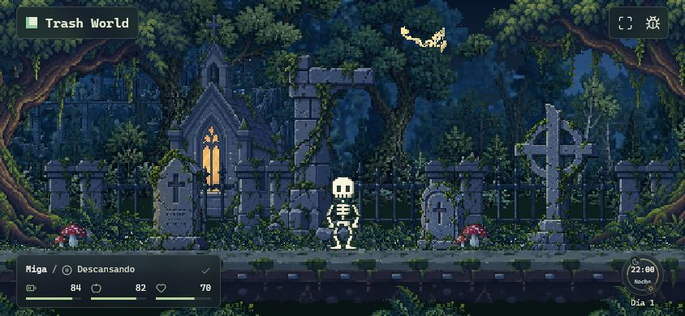
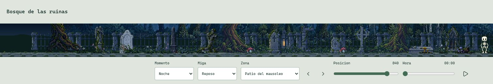
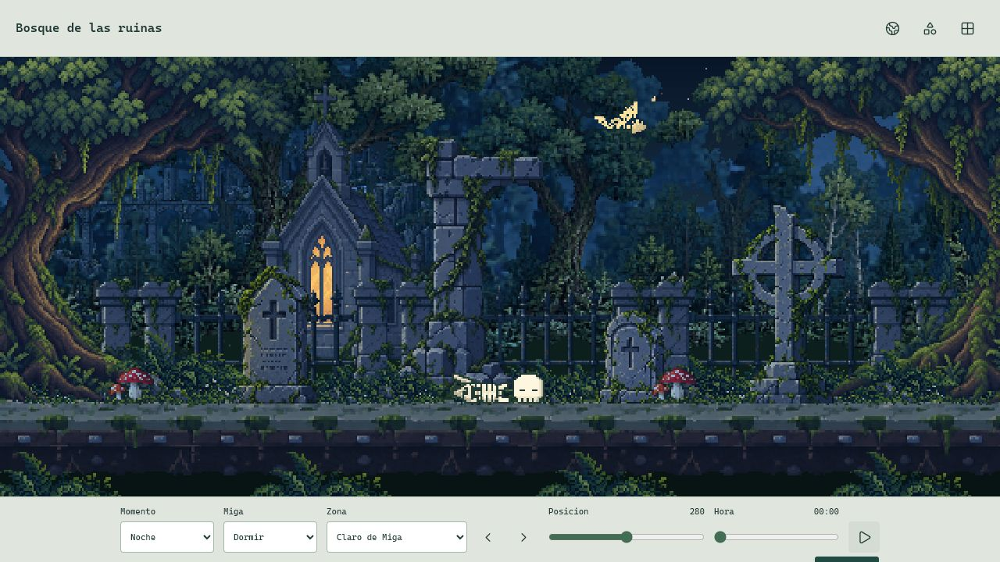
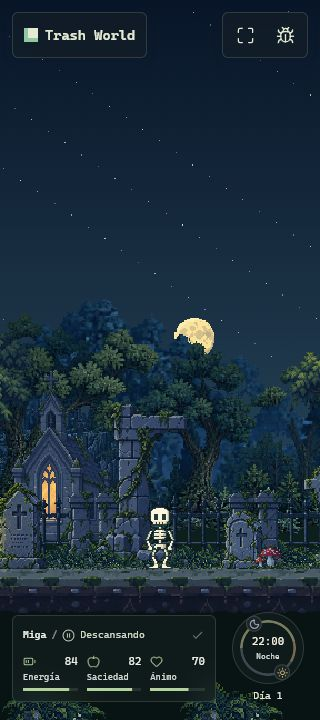
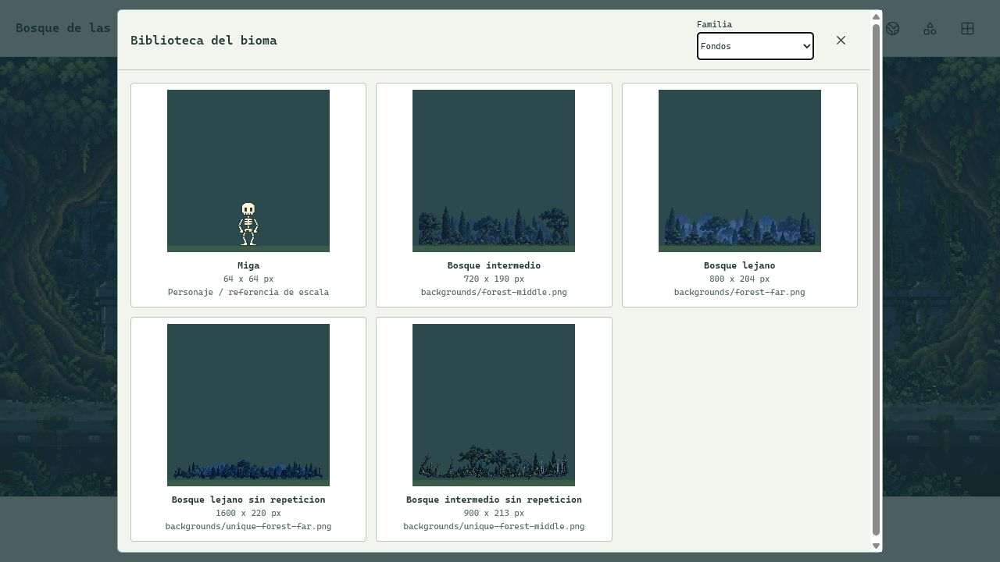
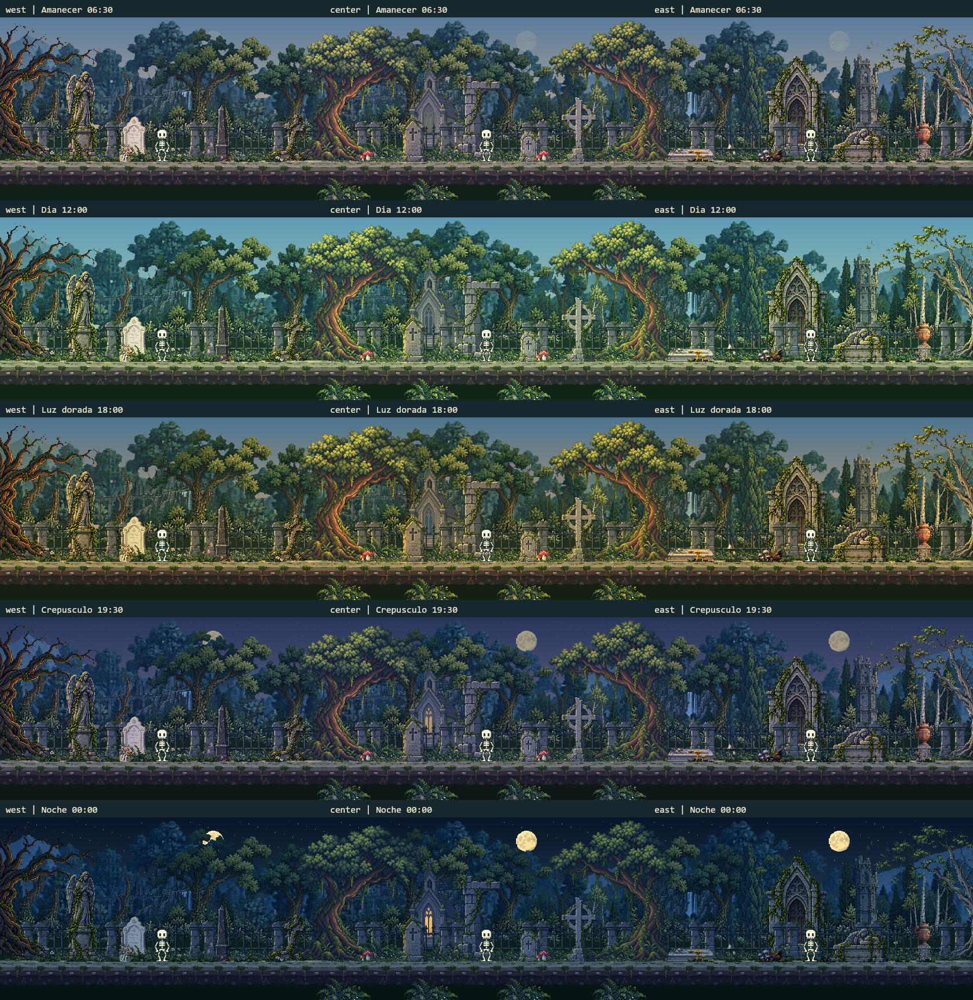
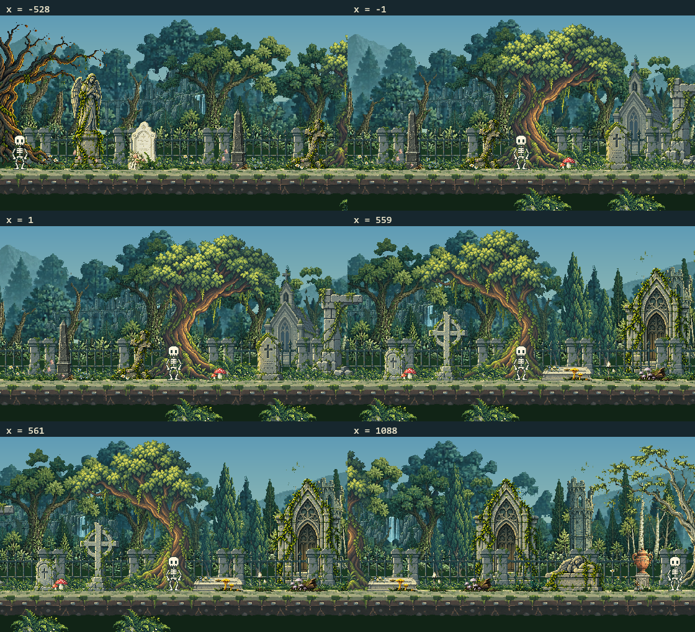

# Revision Visual Integral

2026-10-18. Auditoria de la propuesta actual del sandbox. Se revisan las tres zonas, cinco momentos horarios, PNG individuales, apoyos de Miga, biblioteca y HUD en escritorio y vertical/horizontal. **No es una aprobacion artistica ni una pasada de correccion:** no se modifica runtime, dibujos, rig o animaciones. La carpeta estable no se promueve con esta revision.

## Dictamen

La direccion artistica ya es coherente: materiales con contorno propio, hitos diferentes por zona, piedra, vegetacion y fondos cromaticos que comparten ambiente. Miga conserva buena lectura sobre el terreno. Sin embargo, no daria el acabado visual por cerrado: hay problemas de composicion que las pruebas de integridad y ausencia de recortes no detectan.

## Hallazgos Prioritarios

### P2: Luna Fragmentada Por Las Copas

En el visor central nocturno de 1280 x 720 y en el juego horizontal de 844 x 390, el bosque tapa casi todo el disco y deja fragmentos pequenos y desconectados. Es oclusion real entre capas, no un PNG corrupto. Puede ser fisicamente coherente y aun asi leerse como un dibujo roto. La captura de juego a 1280 x 720 tiene mas altura y muestra el disco completo: no es un fallo presente en todas las proporciones.

Recomendacion: reservar una ventana de cielo mediante composicion de la capa lejana y posicion del astro segun la altura util. No dibujar la luna por encima de los arboles cercanos ni eliminar profundidad para ocultarlo.

*Captura real nueva del visor a 1280 x 720. Las barras dejan un canvas de 560 x 246. No es una captura del juego a pantalla completa.*

*Captura real completa del fixture del juego a 844 x 390, sin barras del visor. La luna queda casi tapada aunque el HUD de cristal y las ventanas funcionan.*

### P2: Escala Relativa En Ventanas Muy Bajas

El ajuste `fitHeadroom` evita cortar construcciones, pero las encoge individualmente mientras Miga y los troncos mantienen su escala. En el visor de 1920 x 260, el canvas real queda en 2048 x 110: capilla, mausoleo y monumentos se leen demasiado pequenos frente al personaje y los arboles. **Que un objeto quepa no demuestra que su proporcion respecto al mundo siga siendo correcta.** En las vistas normales de escritorio no aparece esta reduccion de edificios.

Recomendacion: definir una altura minima util del visor o un encuadre comun para el escenario. Evaluar sus consecuencias antes de sustituir la politica actual; no volver a corregir solo cada coronacion por separado.

*Viewport de 1920 x 260 medido en DOM. La herramienta devuelve una imagen parcial de 1511 x 260: no muestra todo el borde derecho. El canvas medido es 2048 x 110. Es una limitacion de composicion en relacion de aspecto extrema, no una rotura de los PNG.*

### P2: Vegetacion Pequena Poco Deliberada

El grupo proporcional de 79 x 42 se reduce repetidamente para rellenar el sotobosque y el borde del camino. En esas escalas, hojas y flores se convierten en puntos parecidos y las repeticiones forman una textura mas que plantas reconocibles. El vecino mas cercano evita blur, pero no conserva detalles que ya no caben.

Ademas, `westWildflowers` y `eastFungi` son franjas compuestas de 540 px, no una coleccion de flores y hongos sueltos. Se pueden colocar como assets completos, pero sus elementos internos no tienen anclas individuales. Esto limita construir nuevas composiciones sin repetir la misma distribucion.

Recomendacion: preparar un kit pequeno de helechos, flores y hongos separados a su resolucion efectiva. Conservar las franjas actuales como composiciones disponibles, no presentarlas como un tileset o biblioteca de plantas individuales.

## Pulido Secundario

### P3: Simbolos De Estado Con Poco Contraste

El simbolo de dormir usa el verde fijo `#245449` del renderer. Sobre la vegetacion nocturna se pierde, aunque los huesos se apoyan bien y el torax conserva lectura. Es un elemento del renderer, no del sprite aprobado. Revisar tambien los otros simbolos que comparten ese color. No hace falta tocar el rig, las poses ni la animacion para resolverlo.

*Captura real posterior a reproducir y pausar Dormir. No es un frame garantizado del instante de entrada ni una medida de FPS.*

### P3: Composicion Vertical Con Mucho Cielo

En el fixture del juego a 320 x 720 y 390 x 844, el escenario se concentra en la parte baja y deja una gran superficie de cielo. No hay desbordamiento del documento ni choque entre HUD y reloj en las medidas DOM. Es una oportunidad de composicion vertical, no un bug del personaje ni una razon para agrandarlo automaticamente.

*Captura real nueva, con Renderer y WorldHUD actuales y hora fija. El fixture no lee ni guarda una partida. No equivale a un telefono fisico.*

### P3: Biblioteca Insuficiente Para Aprobar Detalle

Los fondos de 1600 y 900 px se comprimen a miniaturas de hasta 192 px. Sirven para identificar siluetas, no para juzgar ramas, pixeles o uniones. Tampoco se distingue visualmente cuales de los cuatro fondos son los dos activos y cuales las dos reservas. Falta inspeccion 1x/2x y estado de uso. Las reservas siguen precargandose, aunque no se coloquen en el mundo.

*Captura real nueva del filtro Fondos. La escala reducida de esas miniaturas no demuestra perdida de calidad del archivo.*

### P3: Enredaderas Y Proporciones Menores

Los cuatro arboles principales tienen siluetas distintas y no presentan una nueva rama gruesa claramente separada o una barra superpuesta atravesando el tronco en la inspeccion realizada. En los robles, algunas enredaderas muy finas y amarillas se leen como hilos al ampliar: un retoque local de agrupacion de hojas seria mas util que regenerar todo el arbol.

Siguen registrados los avisos menores de proporcion de cruz anular y lapida arqueada. Suelo y luna conservan los contratos de modulo y disco; el bosque antiguo afectado es reserva. No se recomienda reexportarlos todos automaticamente ni usar un porcentaje de deformacion como porcentaje de calidad artistica.

## Aspectos Que Se Conservan

- Cabeza, ojos, dientes, cuerpo y animaciones aprobadas de Miga. En las capturas de reposo y descanso el apoyo sobre el sendero no parece una plataforma flotante.
- Hitos distintos de las alas: no se repite la iglesia central en ambas zonas ni se usan espejos como nuevas variantes de monumentos.
- Vidrio frio de dia y ambar de noche; la capilla no pierde su iluminacion nocturna en las capturas actuales. Mausoleo y estatuas no se convierten en emisores nuevos.
- Paleta cromatica del bosque y lectura de distancia de la ciudadela occidental. No vuelve una lamina gris de niebla sobre el suelo.
- HUD de cristal sin bandas solidas; medidas DOM dentro de pantalla en los cinco tamanos de juego comprobados. La apertura/cierre y los filtros de biblioteca responden.
- Organizacion source/native por familias. No se borra historial dependiente de generadores/tests solo por no estar en la escena activa.

*Quince renders offline nuevos del renderer de produccion, con horas controladas y sin HUD. No son capturas del navegador ni una grabacion del ciclo autonomo.*

*Seis renders offline nuevos. Las posiciones proximas comparten clamp/origen de camara cuando corresponde; no se presentan como composiciones totalmente diferentes.*

Recursos individuales en la [lamina nativa 1x](images/visual-review-assets.png), recursos anchos en su [lamina separada a 1x](images/visual-review-panoramas.png) y muestras del [apoyo en varias poses](images/visual-review-poses.png), todas offline. Las dos laminas de biblioteca cubren los 31 recursos sin reducir los anchos para hacerlos caber en celdas pequenas. No se certifica detalle fino desde una miniatura de la pagina.

## Cobertura Y Limites

**Navegador real:** tres zonas de dia/noche en el visor, amanecer/atardecer/crepusculo centrales, reproduccion/pausa de caminata y descanso, filtros Arboles/Fondos, visor movil y muy bajo. HUD controlado a 1280 x 720, 320 x 720, 390 x 844, 844 x 390 y 320 x 320. El viewport temporal se restaura al terminar. La consola consultada no muestra errores ni avisos. Dos acciones del controlador agotan su tiempo; se comprueba el estado real despues, sin presentar el intento fallido como una validacion independiente.

**Motor y archivos:** suite completa, build, renderer de produccion offline, auditoria de originales/nativos, encuadres y hashes. Las laminas offline nuevas muestran cinco horas en las tres zonas y posiciones cercanas a fronteras y extremos. Los numeros finales estan en la seccion de verificacion de README y en el reporte de cierre de esta revision.

Fuentes de los hallazgos: `ReferenceScene` proyecta la luna antes del bosque y repite el sotobosque en su bucle de separacion 43; `ReferenceLayout.fitReferencePlacement` ajusta cada sujeto por separado; `Renderer.drawSymbol` fija el verde del simbolo; `biome-lab.drawLibrary` limita las miniaturas a 192 px. La documentacion distingue estas decisiones de un fallo de integridad del archivo.

**No cubierto:** Android fisico, DPR de varios dispositivos, FPS/consumo, desconexion real, una partida autonoma prolongada o el ciclo de 24 minutos grabado completo en navegador. Las capturas del fixture no verifican persistencia ni los botones de depuracion. El comportamiento temporal exacto de los clips se comprueba tambien en tests/offline, no se certifica por una imagen estatica.

La herramienta recorta dos capturas: 390 x 844 produce un JPEG de 390 x 780, y 1920 x 260 uno de 1511 x 260. No se confunde ese recorte instrumental con un footer o borde cortado por la aplicacion. En esos casos las afirmaciones sobre limites completos se basan en mediciones DOM. La captura vertical publicada de 320 x 720 si tiene esas dimensiones completas.

Resultado tecnico: 236 pruebas y build aprobados; 882 casos offline, 562 422 pixeles opacos de Miga cotejados y 1 337 546 pixeles nativos con alpha binario. Los 311 archivos actuales de runtime, assets y dependencias conservan sus hashes; la carpeta estable mantiene sus 385 archivos de base y Git limpio en `main...origin/main`. La verificacion tecnica no cierra los hallazgos artisticos.

## Orden Recomendado

1. Corregir lectura de la luna y fijar una politica de encuadre comun para ventanas bajas.
2. Crear vegetacion pequena modular a su tamano real; comparar en las tres zonas y de dia/noche antes de sustituirla.
3. Ajustar contraste de simbolos y composicion vertical, sin modificar Miga.
4. Anadir inspeccion nativa y estados activo/reserva a la biblioteca. Revisar enredaderas y proporciones menores como retoques locales.

No ampliar el mapa ni incorporar nuevas mecanicas antes de revisar estas correcciones. Esta auditoria deja hallazgos abiertos: no afirma que esten ya implementados.
