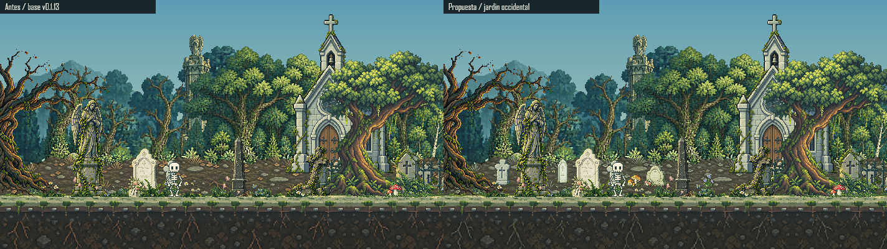
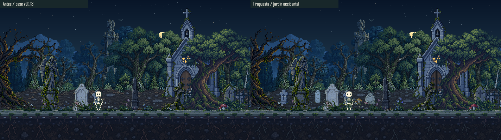
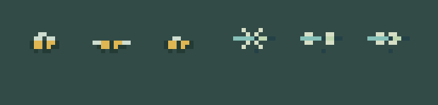
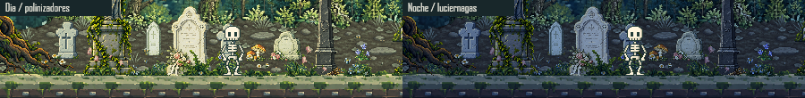
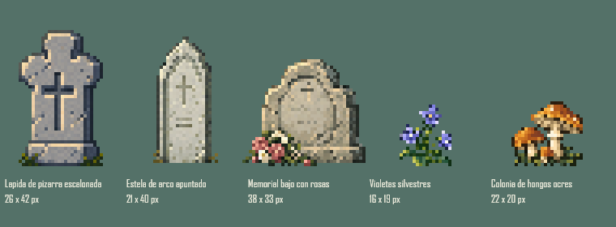

# Jardin Occidental Y Polinizadores

2026-10-20. Revision aprobada por el usuario para integracion sobre v0.1.13. [Entrega estable y verificaciones de destino](WEST_GARDEN_DELIVERY.json).

## Composicion

Tres monumentos nuevos y distintos amplian la fila de tierra del oeste: pizarra escalonada de 26x42, estela apuntada de 21x40 y memorial bajo con rosas de 38x33. Cada uno se coloca una sola vez, entre los monumentos cercanos existentes. No se repiten iglesias, estatuas ni lapidas de otras zonas. El grupo comparte el plano 0.66 de tierra, cruces y verja, sin recuperar las velocidades independientes que causaban vibracion relativa.

Las violetas de 16x19 y los hongos ocres de 22x20 cubren dos apoyos concretos del terreno, no toda su superficie. Se conservan los grupos anteriores de flores, helechos y hongos rojos; no se estampan copias nuevas ni se agregan plantas debajo del sendero. La verja aprobada sigue localizada junto a la iglesia.

## Material

`shadeReferencePixels` aplica a `cemeterySoil` y `earthFace` una mezcla mineral solo en pixeles calidos con predominio rojo/amarillo. El contraste y textura de piedra, hojarasca y raices permanecen. Los grises frios y verdes no reciben esa mezcla. Despues se aplica la iluminacion existente; no se cambia el cielo, la vegetacion general o las luces de la iglesia. Los 44 PNG anteriores conservan sus hashes.

## Vida Ambiental

- Abeja nativa de 9x6 y libelula de 13x7, cada una con dos poses de vuelo y una de reposo, definidas en `assets/source/ambient/pollinators.js` y visibles en Fauna.
- Cuatro estaciones de abejas y dos de libelulas en coordenadas del mundo, no respawn en la pantalla. Sus envolventes de vuelo tienen entradas/salidas suaves y pausas desfasadas.
- Una abeja puede posarse sobre un petalo real de las violetas. La proyeccion comparte su plano y su postura/direccion se mantienen fijas durante el posado. Se dibuja despues de su planta y antes de la verja y los monumentos cercanos, no flotando por encima de ellos. Las otras estaciones hacen pausas de vuelo: no se afirma que todas aterricen sobre flores.
- Cuatro habitats de mariposas en lugar de dos. No se repiten a intervalos por el viewport.
- Luciernagas limitadas a doce, con dos habitats netos adicionales en el oeste y un brillo minimo ligeramente mayor. Conservan pausas y destellos distintos; desaparecen durante el dia.
- El murcielago nocturno ocasional y las hojas anteriores no cambian de sprite o reglas. Pausar el movimiento ambiental congela todos estos movimientos sin detener el reloj.

La secuencia muestra seis segundos del renderer principal a tiempos fijos, con recortes nativos de 450x110 por momento y muestreo cada 50ms. Su bucle reinicia la muestra. No es una grabacion de navegador ni una medida de rendimiento.

## Biblioteca Y QA

49 PNG ambientales, 43 originales distintos incluyendo dos fuentes historicas no activas, 25 monumentos y tres sprites de fauna code-native. Originales y nativos nuevos en `assets/reference-biome/source/` y `assets/reference-biome/native/`, bajo `gravestones/` o `vegetation/`. El [registro de ImageGen integrado](WEST_GARDEN_PROMPTS.json) conserva los prompts y las rutas seleccionadas; no se usaron sprites de terceros. Un intento de limpieza alternativo de hongos se descarto, fuera del proyecto; el export elegido usa alpha >=128 como los demas assets.

[QA reproducido](WEST_GARDEN_QA.json): 317 pruebas, build y reproducibilidad; alpha/inventario; 90 renders de tres zonas, cinco horas, escritorio/movil/horizontal y ambas direcciones; contribucion visible de cada dibujo, verificada ocultandolo por separado en el renderer principal. Se distingue visibilidad de aprobacion artistica, recibida posteriormente del usuario.

No cambian Miga, el estudio de caminata, clips activos, guardados, reglas, velocidades, limites, camara, zoom, cielo, ventanas, dependencias o Git. El control automatizado de navegador sigue bloqueado; no se usa otro controlador para evadirlo. Quedan pendientes QA interactivo, FPS/consumo y dispositivo fisico. La aprobacion para copiar a Desktop no certifica esos puntos.
