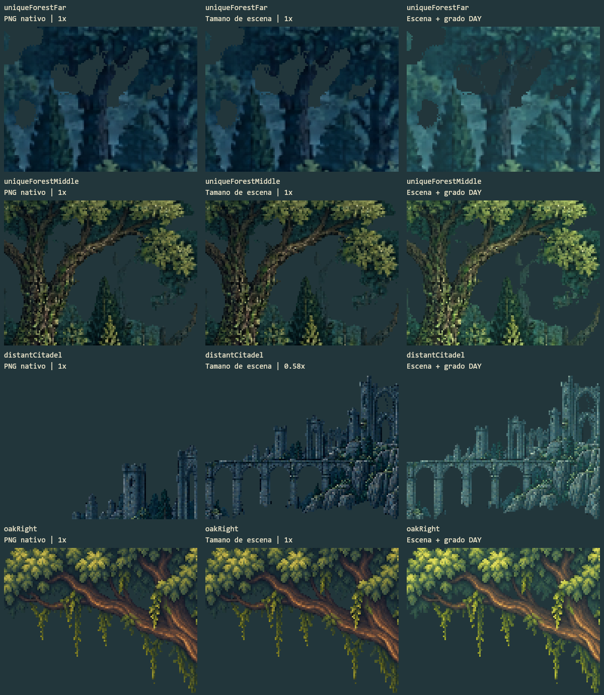
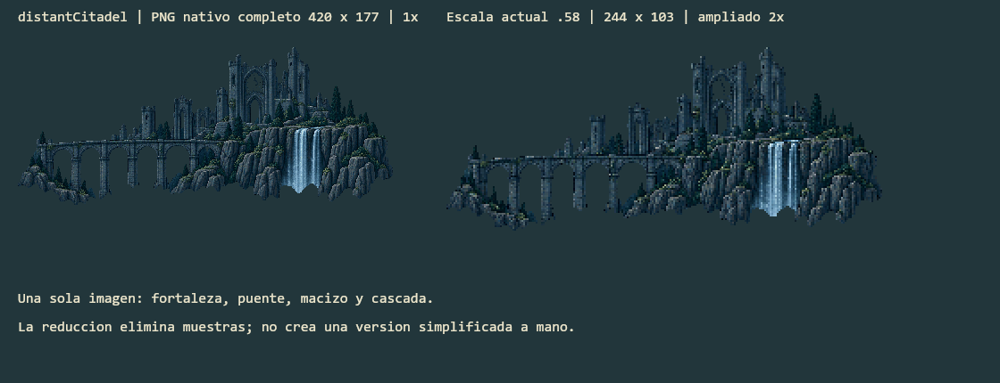

# Investigacion Del Mundo 2D

Fecha: 2026-10-19. Estado: diagnostico y propuesta, **no implementacion ni aprobacion artistica**.

Nota posterior del mismo dia: las cifras de 31 exports y dos reservas describen la base investigada antes de la [limpieza de assets](ASSET_CLEANUP.md). Ahora hay 29 exports activos y 31 originales conservados; se mantiene este estudio y su JSON como evidencia de aquella base, sin reescribir sus mediciones historicas.

## Conclusion

La siguiente mejora no deberia ser otro paquete de imagenes grandes reducido y colocado a ojo. Recomiendo un mundo 2D compuesto por planos, con arte revisado en su tamano final, terreno modular y objetos libres, una camara con escala global estable y composiciones propias por zona. Mantendria Canvas 2D y probaria Tiled como editor de composicion, sin migrar todavia el juego ni sus dependencias.

El problema no es una supuesta limitacion de colores de Canvas. Encontramos tres asuntos diferentes: coherencia espacial de la ciudadela, dibujo/densidad de detalle de los fondos y presentacion del canvas en pantallas de distintos tamanos. Se deben corregir por separado. Ninguna libreria reconstruye decisiones de dibujo perdidas al reducir una imagen.

La propuesta empieza por una sola muestra representativa del oeste: ciudadela, relieve de apoyo, dos planos de bosque, arbol cercano, verja, suelo y Miga. Debe aprobarse estatica de dia y de noche, y despues en desplazamiento, antes de modificar las tres zonas.

## Alcance Y Evidencia

- Referencia principal: las imagenes del usuario y su captura actual. No conocemos el proceso de produccion de esas referencias; no se atribuye a un juego, artista o motor sin comprobarlo.
- Investigacion: fuentes primarias de pixel art, documentacion de renderizado, mapas, exportacion y rendimiento. Las propuestas concretas de este informe son criterio para Trash World, no recetas universales extraidas de otro juego.
- Medicion nueva: PNG, manifiesto, formulas de camara, colocaciones, orden de dibujo, transformacion horaria y solicitudes de superficies del renderer actual.
- Medios nuevos: dos estudios offline de los assets existentes. No son capturas de navegador, redisenos ni una promesa de acabado.
- No se mide FPS, memoria real del navegador, consumo, Android ni el DPR de la captura del usuario. La revision visual real en navegador del 2026-10-18 esta documentada aparte en [VISUAL_REVIEW.md](VISUAL_REVIEW.md).
- No se modifican runtime, Miga, reglas, animaciones, PNG de produccion o dependencias. Esta investigacion permanece en sandbox; no se publica ni se copia a la carpeta estable.

Datos nuevos completos: [WORLD_RESEARCH_MEASUREMENTS.json](WORLD_RESEARCH_MEASUREMENTS.json).

Ampliacion del mismo dia: [escalas, perspectiva y capturas de juegos inspeccionadas](WORLD_SCALE_AND_PERSPECTIVE.md), con altura visible de Miga, comparacion de arquitectura/lapidas y condiciones de encuadre para la cruz de la iglesia. No es una implementacion de esos ajustes.

## 1. Lo Que Hace El Proyecto Hoy

La escena tiene 29 recursos colocados y dos bosques de reserva. Los archivos originales generados y los PNG nativos estan separados. Esto es una buena base de trazabilidad, pero un export con alpha binario no garantiza un dibujo deliberado a nivel de pixel.

| Asset | Recorte del original | PNG nativo | Escala declarada en escena | Desplazamiento parallax |
| --- | --- | --- | --- | --- |
| Ciudadela | 1880 x 794 | 420 x 177 | 0.58, unos 244 x 103 | 0.22 |
| Bosque lejano activo | 2086 x 287 | 1600 x 220 | 1 | 0.12 |
| Bosque medio activo | 2180 x 516 | 900 x 213 | 1 | 0.34 |
| Roble izquierdo | 1180 x 1299 | 215 x 236 | 1 | 1 |
| Roble derecho | 1146 x 1344 | 208 x 244 | 1 | 1 |
| Grupo de cipreses | 819 x 1328 | 126 x 205 | 0.9, con ajuste vertical | 0.68 |
| Sotobosque | 1413 x 751 | 79 x 42 | 1 y varias reducciones adicionales | Variable |
| Flores oeste | 1489 x 123 | 540 x 45 | 0.8 | 1 |
| Hongos este | 1490 x 132 | 540 x 48 | 0.8 | 1 |

Los factores son mediciones del proyecto, no distancias fisicas. Algunas colocaciones principales pueden reducirse mas mediante `fitHeadroom` en ventanas muy bajas.

### Los Arboles No Se Achican Durante El Juego

Los dos bosques activos se dibujan a 1:1 en el canvas. En la lamina, sus dos primeras columnas son identicas: no hay una reduccion adicional entre ese PNG y su dibujo en la escena. Parte de su apariencia blanda o moteada ya esta dentro del archivo nativo. El grado diurno modifica despues sus relaciones de color y contraste.

*Estudio offline nuevo: ventanas de 128 x 96 pixeles ampliadas exactamente 3x con vecino mas cercano. Cada columna representa esa misma cantidad de pixeles de su etapa; en la ciudadela reducida abarca mas contenido, no un recorte de motivo identico. El fondo uniforme de inspeccion no es niebla del juego. La tercera columna aplica el grado DAY de produccion.*

**Inferencia artistica:** las copas lejanas necesitan masas mas legibles, menos detalle de alta frecuencia y una separacion cromatica mejor controlada. No necesitan simplemente mas resolucion ni un filtro de enfoque. La diferencia entre una forma deliberadamente simplificada y una imagen borrosa importa mas que el numero de pixeles.

### La Ciudadela Tiene Otra Cadena

Su recorte original se reduce a aproximadamente el 22.3 % de sus dimensiones lineales, y ese export vuelve a dibujarse al 58 %. El resultado visible habitual ronda 244 x 103 pixeles del mundo. Estas cifras no son porcentajes de calidad perdida: muestran dos etapas de muestreo en las que los detalles no se redibujan.

*Izquierda: PNG nativo de 420 x 177 a 1x. Derecha: primero se reproduce su dibujo a 244 x 103 y luego se amplia exactamente 2x para inspeccion. No es un PNG nuevo propuesto para el juego.*

La imagen agrupa edificio, puente, acantilado y cascada. El renderer no puede dar a esas partes profundidad o movimiento independiente. Tampoco puede inventar lo que estaba oculto si se recortan despues.

### Camara Y Presentacion Son Otra Escala

La formula actual produce 560 x 315 para una entrada CSS de 1280 x 720, que implica un aumento CSS de 2.286x; para 1920 x 1080, 3.429x. Para una entrada CSS hipotetica de 1324 x 612 resulta 560 x 259, aproximadamente 2.364x. No se afirma que el viewport CSS ni el DPR reales del usuario coincidan con el tamano de su archivo adjunto.

`imageSmoothingEnabled = false` controla el remuestreo dentro del contexto Canvas; no recupera informacion que ya no esta en el PNG. CSS controla otra etapa de presentacion. [MDN: imageSmoothingEnabled](https://developer.mozilla.org/en-US/docs/Web/API/CanvasRenderingContext2D/imageSmoothingEnabled).

Ademas, `image-rendering: pixelated` no equivale a una garantia de bloques fisicos enteros en cualquier escala: su definicion permite una etapa final suavizada para alcanzar el tamano solicitado. Cambiar esa propiedad sin medir el navegador no es una solucion demostrada. [MDN: image-rendering](https://developer.mozilla.org/en-US/docs/Web/CSS/Reference/Properties/image-rendering).

## 2. Por Que La Estructura No Encaja

**Hecho de codigo:** el bosque lejano se dibuja antes de la ciudadela, y el bosque medio despues. La ciudadela ya queda detras del bosque medio. No basta con invertir dos capas.

**Lectura de la captura, no medida geometrica real:** la estructura combina detalle arquitectonico fino con un apoyo dificil de situar. El puente y el relieve quedan parcialmente mezclados con troncos y copas de otras escalas. Por eso puede sentirse enorme y pegada al cementerio aunque su movimiento intente presentarla lejana. Oscurecerla o reducirla otra vez no resuelve la relacion entre planos.

Propongo resolver primero estas decisiones en una composicion de masas:

1. Elegir una geografia: ciudadela sobre una elevacion lejana, con un perfil de terreno visible que sostenga torres y puente. El puente debe unir apoyos comprensibles.
2. Dejar ventanas de cielo y espacios negativos alrededor de los hitos importantes. No superponer el mismo nivel de follaje fino sobre toda la arquitectura.
3. Hacer que las bases y oclusiones expliquen la distancia. Un arbol enorme delante puede ser correcto; uno que parece brotar del mismo apoyo pero pertenece a otro plano confunde la escala.
4. Dibujar torres, huecos y remates para su tamano final proyectado. Los detalles que no caben se simplifican deliberadamente.
5. Separar edificio, relieve, puente y agua solamente donde deban tener distinta oclusion, luz, desplazamiento o animacion. Las partes del mismo plano pueden seguir compuestas para reducir complejidad.

Una estructura lejana puede seguir siendo grande. El objetivo no es convertirla en una miniatura, sino hacer creible su ubicacion. Si el original no permite esa composicion, toca redibujar o producir una nueva base, no esconder el problema con niebla.

## 3. Contrato Artistico Antes De Producir Mas

Pedro Medeiros describe la consistencia del mundo mediante un canvas base y sprites dibujados a su resolucion original; la interfaz puede seguir reglas distintas. La idea aplicable aqui es estabilizar el mundo, no imponer a Trash World la resolucion de Celeste. [Saint11: Consistency](https://saint11.art/blog/consistency/).

Nuestro contrato propuesto:

- Una unidad logica equivale a un pixel de dibujo del mundo. Los assets normales se exportan para su tamano de uso; una variante pequena se revisa como otro dibujo, no como un decimal arbitrario.
- Tabla de escala con Miga visible, altura de verja, lapida, puerta, tronco y hito distante. Medir el cuerpo visible de Miga, no todo el lienzo transparente del sprite.
- Biblioteca de colores por material y momento del dia: piedra, corteza, hojas, metal, cielo y emisivos. No imponer un limite global de 16 o 32 colores que el usuario no ha pedido.
- Contornos selectivos relacionados con el material y la luz. El primer plano debe conservar lectura; el fondo no debe competir con los ojos y huesos de Miga.
- Formas grandes primero; detalle y pixeles aislados solo donde comuniquen volumen o material. La construccion mediante grupos de pixeles ofrece un proceso mas controlable que texturizar toda la imagen. [Saint11: Cluster Sketching and Painting](https://saint11.art/pixel_art_articles/article2/).
- Lejania mediante silueta, agrupacion de masas y jerarquia de color. Menos detalle no significa desenfoque. Elegir que rasgos sobreviven a baja resolucion es una decision de dibujo. [Saint11: Thoughts on Low Resolution](https://saint11.art/blog/thoughts_on_low_resolution/).

Los PNG actuales tienen miles de RGB distintos: por ejemplo, 31 984 en el bosque lejano y 45 175 en el medio. Son datos descriptivos, **no una puntuacion de calidad ni prueba de que muchos colores sean malos**. El problema observado es como se organizan las formas y contrastes, no alcanzar un numero magico de colores.

Los originales ImageGen pueden servir como concepto, referencia de materiales o base para trabajar. Reducirlos con vecino mas cercano y poner alpha 0/255 no sustituye una limpieza artistica nativa. Al reducir pixel art, hacen falta decisiones sobre filas, columnas y detalles; una interpolacion no las toma con intencion artistica. [Saint11: Scaling Pixel Art](https://saint11.art/blog/scaling/).

No prometo que otro prompt, un aumento de resolucion o un filtro conviertan automaticamente las bases actuales en pixel art terminado. El alcance correcto incluye revisar y rehacer las formas que no funcionan al tamano final.

## 4. Resolucion Y Pantallas

No cambiaria ahora todos los PNG. Primero compararia la vista actual de 560 x 315 con una propuesta horizontal de 640 x 360 usando los mismos assets a 1x. Esta ultima encaja a 2x en 1280 x 720 y a 3x en 1920 x 1080, y mostraria mas mundo: Miga ocuparia el 87.5 % de su tamano de pantalla actual en esas condiciones. No aumenta por si sola el detalle de Miga o de los arboles.

La resolucion de diseno y el tamano de ventana son decisiones distintas. Escalar un viewport, conservar proporcion, expandir la camara y limitar el aumento a enteros son opciones con compromisos diferentes; para recorrido horizontal conviene evaluar una altura de diseno estable. [Godot: Multiple resolutions](https://docs.godotengine.org/en/stable/tutorials/rendering/multiple_resolutions.html).

**Politica propuesta, pendiente de prueba:**

1. Mundo dibujado sobre una grilla logica estable. HUD en CSS, separado.
2. Presentacion que tenga en cuenta pixeles fisicos y DPR, sin multiplicar ciegamente la resolucion artistica por el DPR.
3. Priorizar aumento entero; permitir ampliar el campo visible, recortar con limites aprobados o dejar margenes discretos. Declarar el compromiso para ventanas demasiado pequenas.
4. Perfil vertical de encuadre propio, manteniendo el mismo tamano logico de los objetos. No resolver el movil encogiendo cada edificio ni mostrando una enorme columna de cielo vacio.

Como punto de partida matematico, para un viewport de diseno `Cw x Ch`, area CSS `W x H` y DPR `d`, evaluar `k = floor(min(W*d/Cw, H*d/Ch))`. Si `k >= 1`, el lienzo puede presentarse aproximadamente a `Cw*k/d` por `Ch*k/d` CSS, alineando tambien su origen con la grilla fisica. Si `k < 1`, hace falta otro encuadre o aceptar una politica fraccionaria; no hay una ampliacion entera que quepa. La cuantizacion real del area debe comprobarse en DOM y captura.

No se puede garantizar simultaneamente pantalla llena arbitraria, campo visual identico y bloques enteros uniformes en toda ventana y todo zoom. El browser zoom y la relacion entre pixeles CSS/fisicos afectan el resultado. [MDN: Crisp pixel art](https://developer.mozilla.org/en-US/docs/Games/Techniques/Crisp_pixel_art_look), [devicePixelRatio](https://developer.mozilla.org/en-US/docs/Web/API/Window/devicePixelRatio).

El ajuste individual `fitHeadroom` actual evita recortes pero cambia relaciones de escala en ventanas bajas. Debe sustituirse, en una implementacion posterior, por decisiones de camara/composicion globales. No conviene arreglar la altura de un edificio a costa de su escala frente a Miga.

## 5. Capas Que Explican Distancia

Separaria funciones visuales, no cada objeto en su propio sistema:

| Plano propuesto | Contenido | Criterio de dibujo |
| --- | --- | --- |
| Cielo | Gradacion horaria, luna y estrellas | No tratado como material opaco de bosque |
| Relieve remoto | Colinas y horizonte | Masas amplias, pocos rasgos |
| Hitos distantes | Ciudadela y su apoyo | Silueta reconocible, huecos simplificados |
| Bosque lejano | Copas y troncos agrupados | Contraste local moderado, sin ruido de hojas individuales |
| Bosque medio | Troncos legibles y claros | Conexion espacial con el cementerio |
| Arquitectura intermedia | Verjas interiores y construcciones | Apoyos y oclusiones consistentes |
| Plano de Miga | Suelo, monumentos y arboles cercanos | Pixel y anclas estables, maxima legibilidad |
| Acentos delanteros opcionales | Pocas hojas o raices de encuadre | No tapar recorrido ni stats |

Esta tabla no obliga a ocho buffers ni ocho texturas. Varias funciones pueden compartir plano de dibujo si tienen la misma proyeccion. Los factores de parallax se ajustan despues del bloque de composicion; por ejemplo, bandas aproximadas de 0.1 para lo remoto, 0.2-0.35 para fondos y 0.45-0.7 para transicion son hipotesis de partida, no leyes ni cambios ya aplicados.

El parallax controla velocidad relativa, no calcula automaticamente perspectiva o escala. Requiere cobertura y origen de capas consistentes; una textura pequena no debe estirarse para ocultar que falta fondo. [Godot: 2D parallax](https://docs.godotengine.org/en/stable/tutorials/2d/2d_parallax.html).

La formula actual usa una sola camara y redondea posiciones; no hay prueba aqui de que cada capa tenga una latencia independiente. El movimiento muy lento puede dar pasos visibles por cuantizacion. Compararia primero desplazamiento fijo a baja velocidad y a ambos lados. Un desplazamiento subpixel de presentacion con margen adicional puede estudiarse despues, aceptando su compromiso visual; no se introduce suavizado distinto por plano para esconderlo.

Niebla propuesta: separacion cromatica entre planos y unos pocos velos localizados donde la geografia lo justifique. No otra franja horizontal gris sobre el suelo, ni blur general. Validar de dia y de noche sin que se pierda el color propio de la vegetacion. Esta es direccion artistica para nuestra referencia, no una exigencia tecnica de Canvas.

## 6. Componer Y Ampliar El Mundo

### Recomendacion: Tiled Como Editor

Tiled distingue capas de tiles, objetos, imagenes y grupos. Esto permite terreno modular y colocacion libre de objetos grandes; no obliga a convertir un arbol o una iglesia en una cuadrilla de tiles. [Tiled: Working with Layers](https://doc.mapeditor.org/en/stable/manual/layers/).

Probaria una zona con tiles de terreno de 16 o 32 unidades, elegidos segun el dibujo del suelo, y una coleccion de PNG de distintos tamanos para monumentos y vegetacion. Las panoramicas se colocarian como imagenes por plano, con limites conocidos. Los hitos grandes tendrian identificador unico y no se repetirian al extender el mapa.

El JSON de Tiled ofrece metadatos, objetos, alineacion, factores/origen de parallax y chunks de tiles. Un adaptador de build debe convertir esas convenciones a las del renderer; no se deben pegar coordenadas sin comprobar los pivotes y el origen. [Tiled: JSON Map Format](https://doc.mapeditor.org/en/stable/reference/json-map-format/).

Mantendria las coordenadas actuales de Miga y los saves: al principio el editor solo sustituiria la autoria de decoracion de una zona. Suelo de simulacion, colisiones y necesidades no cambian por importar un mapa visual. Los mapas infinitos del editor tampoco implementan por nosotros la carga por sectores del runtime. [Tiled: Infinite Maps](https://doc.mapeditor.org/en/stable/manual/using-infinite-maps/).

LDtk es una alternativa valida si el crecimiento se orienta mas a niveles y reglas de tiles. Su organizacion de mundos y sus auto-layers pueden resultar utiles, pero no justifican migrar dos veces ni afirmar que solo sirve para cuadriculas. [LDtk: World](https://ldtk.io/docs/general/world/), [Auto-layers](https://ldtk.io/docs/general/auto-layers/).

### Biblioteca Y Fuentes Editables

No moveria masivamente las carpetas existentes durante una correccion visual. Evolucionaria el manifiesto con campos de rol, plano, tamano nativo, pivot, limites visibles, estado activo/reserva, material, mascara de luz y procedencia. Las escenas contendrian colocaciones; los assets, dibujos reutilizables. Repetir un modulo de piedra pequeno es distinto de duplicar una iglesia o la misma lapida protagonista.

Para nuevos dibujos, guardaria fuentes editables a resolucion nativa, por ejemplo `.aseprite` con capas, junto a PNG y metadatos de exportacion. Un PNG importado no recupera las capas del original. Los slices pueden conservar regiones/pivotes, y la CLI permite automatizar exports y datos sin renombrar archivos a mano. No se instala ni compra ninguna herramienta en esta investigacion. [Aseprite: Exporting](https://www.aseprite.org/docs/exporting/), [Slices](https://www.aseprite.org/docs/slices/), [CLI](https://www.aseprite.org/docs/cli/).

El kit inicial necesita plantas realmente individuales: helechos, hierbas, flores, hongos y raices revisados en 1x. Las franjas florales de 540 pixeles son composiciones utiles, pero no equivalen a tener cada planta separada. Para ampliacion lateral combinaria microassets reutilizables y conjuntos singulares por zona, con espacios de descanso visual y distinta distribucion de materiales/ofrendas.

Las ramas principales deben salir de una estructura de tronco definida, reducir grosor hacia las puntas y conectarse antes de texturizar corteza. La enredadera debe seguir un apoyo creible; no atravesar el tronco ni generar una segunda silueta confusa. En la limpieza nativa revisaria primero la silueta sin follaje y luego los grupos de hojas. Son criterios concretos de revision, no algo que un atlas resuelva.

## 7. Rendimiento: Que Optimizar Y Que No

### Hallazgo Local Nuevo

El cargador precarga los 31 PNG y crea superficies coloreadas por combinacion de asset, fase y profundidad. Estas se cachean: **no se recolorea cada pixel de cada asset en cada frame**.

Sin embargo, el acceso que materializa la superficie ocurre antes del descarte por visibilidad. En una traza estatica con todas las imagenes disponibles, la vista oeste al mediodia pide 29 claves distintas y solo dibuja 14. La vista central pide 29 y dibuja 16. Es una oportunidad de evitar trabajo inicial, no una medicion de tirones ni 29 lecturas costosas nuevas en cada frame.

La suma teorica `ancho * alto * 4` de los 31 PNG nativos es 5 350 184 bytes, unos 5.10 MiB, antes de overhead y caches. Las dos reservas suman 1 200 000 bytes de esa base. El estimado de superficies pedidas para un grado al mediodia es 4 158 272 bytes; la traza no mide heap, texturas GPU ni el total residente real.

### Orden De Trabajo Propuesto

1. Leer dimensiones/anclas del manifiesto y descartar fuera de pantalla antes de solicitar una superficie coloreada.
2. Cargar biblioteca/reservas cuando se necesiten; precargar la zona vecina antes de llegar a su limite, sin introducir apariciones visibles.
3. Medir el crecimiento de caches por fase/plano y asignar un presupuesto o politica de descarte. No multiplicar indefinidamente assets por cada minuto del reloj.
4. Cachear composiciones estaticas locales si el perfilado demuestra ahorro. No aplanar todo el mundo en un canvas gigante ni congelar con ello el parallax o la luz.
5. Medir en navegador y dispositivo antes de decidir GPU, atlas, workers o streaming mas complejo.

Canvas permite pre-renderizar trabajo repetido y reutilizarlo; las dimensiones y coordenadas de dibujo tambien importan. Estas tecnicas respaldan mejoras pequenas sobre nuestro renderer existente. [MDN: Optimizing canvas](https://developer.mozilla.org/en-US/docs/Web/API/Canvas_API/Tutorial/Optimizing_canvas).

PixiJS aporta renderizado GPU y agrupacion eficiente de sprites, pero tambien recomienda perfilar y advierte que el descarte puede costar CPU. Cachear objetos complejos ahorra dibujo a cambio de memoria y requiere actualizacion si cambian. No es garantia de mejor rendimiento en esta escena sin medirla. [PixiJS: Performance Tips](https://pixijs.com/8.x/guides/concepts/performance-tips), [Cache As Texture](https://pixijs.com/8.x/guides/components/scene-objects/container/cache-as-texture).

**Decision:** mantener Canvas 2D durante la correccion artistica. Evaluar despues un adaptador PixiJS si el perfilado demuestra un cuello de botella que batching, texturas o shaders solucionen. No reescribir en Phaser, Godot o Unity como tratamiento de una ciudadela mal integrada: eso no redibuja el arte y arriesga comportamiento ya aprobado.

## 8. Luz Y Animacion Sin Destrozar El Dibujo

Primero aprobar la escena inmovil. Despues: variacion suave de luz en mascaras, pocos grupos de hojas con desplazamientos contenidos y particulas escasas por horario. Tronco y rama estructural no deben deformarse como goma; una ventana de vela no debe convertirse en un interruptor. Conservar apagado diurno y encendido nocturno gradual.

Dia y noche necesitan lectura propia de cielo, piedra y follaje, no solo una capa gris/azul encima. Compararia las mismas coordenadas a amanecer, mediodia, luz dorada, crepusculo y noche. El punto de interes debe permanecer legible y las luciernagas no deben simular estrellas flotando sobre toda la pantalla.

No se alteran en esta propuesta la animacion de Miga ni el dia de 24 minutos. Las animaciones ambientales se mantienen separadas y deben poder congelarse para comparar diseno, oclusiones y parallax.

## 9. Prueba Piloto Y Criterios De Aceptacion

| Paso | Entrega | Condicion para avanzar |
| --- | --- | --- |
| 1. Contrato y encuadre | Tabla de escala y comparativa 560/640, incluida vista vertical | Elegir campo visible y politica de presentacion sin cambiar objetos por separado |
| 2. Composicion | Oeste en masas/siluetas, con apoyo continuo del hito | Se entiende que esta cerca, medio y lejos sin niebla ni texturas |
| 3. Dibujo nativo | Una ciudadela/relieve y dos bosques limpiados, muestra dia/noche | Legibles a 1x; no depender de otra reduccion para encajar |
| 4. Integracion acotada | Solo esa muestra en el renderer actual | Misma escala, apoyos y lectura en movimiento y resize; Miga intacta |
| 5. Autoria de mapa | Una zona piloto con adaptador Tiled | Pivotes, origen, parallax y coordenadas equivalentes; sin migrar saves |
| 6. Expansion | Microassets y composiciones distintas por zona | No duplicar hitos; continuidad del terreno y presupuestos de carga |
| 7. Cierre | QA nuevo, README/capturas actuales y aprobacion | Entonces copiar/verificar estable y preparar comandos Git; no publicar antes |

QA visual propuesto:

- Inspeccion nativa 1x y ampliacion entera 2x/3x. Ningun PNG o composicion queda aprobado solo por una miniatura atractiva.
- Misma muestra de dia/noche, con y sin grado de color, y en silueta. Identificar si el problema esta en el dibujo, la composicion o el tratamiento horario.
- Recorrido lento constante y cambios de direccion: estabilidad de pixeles, uniones de sectores, continuidad de apoyos, cobertura de fondos y ausencia de desfase de capas.
- Desktop, movil vertical, horizontal y ventanas extremadamente bajas; comprobar medidas CSS, canvas, DPR y limites visibles. Resizes no deben cambiar la escala relativa entre Miga, puertas y lapidas.
- Matriz DPR 1, 1.25, 1.5, 2 y 3, y zoom 100/110/125 %, identificando combinaciones reales frente a emuladas. El tamano del archivo de una captura no sustituye esos datos.
- Revisar luna, cruces, ramas y bases durante todo el recorrido, no solo el centro. Verificar que la herramienta no recorte la propia captura.
- Preservar hashes de Miga, originales aprobados, animaciones y reglas; repetir suite/build y regresiones especificas cuando exista implementacion.

QA de rendimiento propuesto: carga fria/caliente, desplazamiento, cambio horario y memoria de caches en escritorio y Android real. Registrar distribucion de tiempos de frame, no solo FPS promedio; usar 16.7 ms para 60 Hz o 33.3 ms para 30 Hz como presupuestos a decidir, **no resultados alcanzados**. DevTools permite estudiar main thread, frames y carga; la emulacion no certifica autonomia ni comportamiento de un telefono. [Chrome: Performance panel](https://developer.chrome.com/docs/devtools/performance).

## 10. Lo Que No Se Ha Hecho

No se han redibujado la ciudadela ni los bosques, cambiado la camara, instalado Tiled/Aseprite, implementado sectores, migrado el renderer ni eliminado assets. No hay un benchmark nuevo ni una nueva prueba de navegador en esta investigacion. Los 236 tests y el build aprobados del 2026-10-18 pertenecen a aquella revision y no se presentan como ejecucion nueva.

Las mediciones y laminas de este informe se generan de nuevo con los archivos actuales. El cierre verifica por SHA-256 los 311 archivos protegidos de runtime/assets/dependencias; la documentacion es la unica entrega nueva dentro del proyecto. La carpeta estable debe permanecer intacta hasta que se apruebe una revision para entregar.

La siguiente accion recomendada es el paso 1 y un bloque de composicion del oeste, **no crecer el mundo todavia**. Asi se valida la escala y el lenguaje de planos antes de pagar el costo de rehacer todo el bioma.
