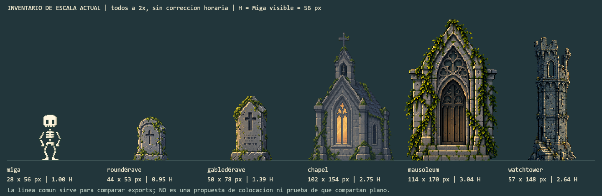

# Escalas Y Perspectiva Del Cementerio

Fecha: 2026-10-19. Ampliacion de [la investigacion del mundo](WORLD_BUILDING_RESEARCH.md).

Estado: estudio visual y criterios para una muestra piloto. **No cambia el escenario, la camara ni los PNG de produccion.**

## El Requerimiento

Las construcciones con puertas y ventanas no deben parecer juguetes junto a Miga y las lapidas. Los edificios de mayor tamano real deben organizar el fondo; el primer plano debe reservar lectura para Miga, terreno y elementos menores. La iglesia tiene que conservar su cruz reconocible en los encuadres donde se presenta como hito.

No basta con ordenar imagenes grandes detras de pequenas. Hay que distinguir tamano real sugerido, tamano proyectado y distancia. Un edificio remoto puede ocupar menos pantalla que un monumento cercano sin estar mal proporcionado; falla si su apoyo, detalle, color u oclusion hacen que parezcan compartir el mismo suelo.

## Capturas Revisadas

Se inspeccionan visualmente imagenes de las galerias oficiales en navegador, no solo resultados de busqueda. Las conclusiones siguientes son **mi lectura de esas composiciones**, no declaraciones de sus autores sobre sus motores, capas internas o formulas de perspectiva. Las imagenes publicadas son referencias promocionales; no se certifica que todas correspondan al mismo parche del juego.

No se descargan ni extraen assets de esos juegos para el proyecto. Los enlaces conservan la procedencia y no se presentan como capturas nuevas de Trash World.

### Blasphemous: Masas Y Siluetas

En el exterior de cielo rojizo, el plano transitable tiene un borde de piedra definido. Las ruinas altas forman masas reconocibles contra el cielo, mientras que vegetacion y siluetas mas suaves sugieren distancia. El detalle no esta repartido de manera uniforme sobre todas las superficies. Eso permite que una construccion grande siga pesando en la composicion sin confundirse con el borde del suelo jugable.

Aplicacion propuesta: construir primero el perfil de la ciudadela y su relieve, y dejar huecos de cielo para leerlos. No copiar su paleta rojiza ni oscurecer automaticamente nuestro bosque. [Galeria oficial de Blasphemous](https://store.steampowered.com/app/774361/Blasphemous/), [captura exterior inspeccionada](https://shared.akamai.steamstatic.com/store_item_assets/steam/apps/774361/ss_bd57bcb1e9183cbea61339727a97bcc5206677b2.1920x1080.jpg?t=1780479368).

Tambien se observa una escena interior de plataformas y piedra para contrastar el borde jugable con los muros. No se usa para deducir las proporciones de puertas: esa imagen no ofrece una puerta humana comparable claramente visible. [Captura interior](https://shared.akamai.steamstatic.com/store_item_assets/steam/apps/774361/ss_15aad017aa8ea36cc2d6c89e3f0921f89f528a54.1920x1080.jpg?t=1780479368).

### The Last Faith: Arquitectura Con Profundidad

La escena del cementerio con dialogo muestra verjas, monumentos y arquitectura monumental superpuestos, con distintas intensidades de contraste. Los retratos grandes del dialogo son interfaz: **no se usan como figuras del mundo para medir edificios**. Los personajes pequenos estan abajo, dentro del escenario. [Galeria oficial](https://store.steampowered.com/app/1274600/The_Last_Faith/), [captura del cementerio](https://shared.akamai.steamstatic.com/store_item_assets/steam/apps/1274600/ss_8f57a9fc68caf859cbfe6bebb7eb1caeee6c8f04.1920x1080.jpg?t=1769525842).

En otra captura, dos personajes aparecen sobre una terraza con balaustrada, remates ornamentales y arboles; detras, las grandes fachadas se vuelven menos contrastadas. El apoyo continuo de la terraza y la oclusion ayudan a distinguir los planos. Parte de la arquitectura monumental queda fuera del encuadre: no intentan mostrar todos los edificios completos a la vez. [Captura de terraza y fachadas](https://shared.akamai.steamstatic.com/store_item_assets/steam/apps/1274600/ss_fe881467b4f3929ff3ff5dfd66e4dbf595324171.1920x1080.jpg?t=1769525842).

Aplicacion propuesta: terreno intermedio propio para iglesia/mausoleo y relieve lejano para ciudadela. No levantar simplemente sus bases unos pixeles sobre el suelo del cementerio. La cruz de nuestra iglesia se trata como un hito protegido por decision de composicion, no porque todo edificio de fondo deba caber completo siempre.

### Kingdom Two Crowns: Bosques Que No Compiten

En la imagen diurna de dos vistas horizontales, el terreno mantiene una franja reconocible; las masas de roca lejanas se agrupan y las copas cercanas se leen por bloques de color. En la nocturna, las luces quedan concentradas en el recorrido mientras bosque y ruinas conservan siluetas escalonadas. No es necesario cubrir todo con detalle o luz para sugerir un mundo grande. [Galeria oficial](https://kingdomthegame.com/kingdom-two-crowns/), [imagen diurna inspeccionada](https://kingdomthegame.com/wp-content/uploads/2026/08/k_tc-Dead-Lands-2.webp), [imagen nocturna](https://kingdomthegame.com/wp-content/uploads/2026/08/k_tc-Dead-Lands-6.webp).

Aplicacion propuesta: redibujar agrupaciones del bosque lejano para su tamano visible y reservar detalle fino para planos mas cercanos. No copiar el agua/reflejo al suelo de nuestro cementerio ni inferir una cantidad exacta de capas desde una captura estatica.

## Mediciones Nuevas Del Proyecto

Se toma `H = 56 px`, la altura visible de `miga:stand`. Su celda del atlas mide 64 x 64, pero incluye transparencia: no se usa 64 como altura corporal. Miga permanece a 1x en el mundo.

| Elemento | Medida actual | Altura respecto a H | Lectura que requiere revision |
| --- | --- | --- | --- |
| Miga en reposo | Cuerpo 28 x 56 | 1.00 H | Referencia fija; no modificar su rig ni dibujo |
| Lapida arqueada | Export 44 x 53 | 0.95 H | Tamano cercano razonable para una lapida alta |
| Lapida a dos aguas | Export 50 x 78 | 1.39 H | Clasificar como monumento alto, no como lapida ordinaria |
| Iglesia/capilla | Export 102 x 154 | 2.75 H | Solo dos veces la altura de aquel monumento; su distancia debe quedar clara |
| Mausoleo | Export 114 x 170 | 3.04 H | Puede representar un mausoleo pequeno; no condenar sus proporciones solo por la altura total |
| Torre | Export 57 x 148 | 2.64 H | Si es una torre grande lejana, necesita escala de sus detalles y apoyo acordes al plano |

Las cinco medidas ambientales son dimensiones completas del export, no mediciones de metros, puertas o huecos utiles. No se declara que una puerta sea impasable por comparar solamente su parte rectangular: tambien cuenta la altura del arco. No se ha segmentado formalmente cada puerta/ventana.

*Lamina offline nueva, ampliada exactamente 2x, sin grado horario. La linea de base comun sirve para comparar tamanos, no propone que estos objetos deban compartir suelo o distancia. No es una captura ni un rediseno del juego.*

Datos: [WORLD_PERSPECTIVE_MEASUREMENTS.json](WORLD_PERSPECTIVE_MEASUREMENTS.json).

### Hallazgo De Colocacion

La capilla tiene `parallax` efectivo 1, igual que Miga y las lapidas, y su base solo esta desplazada 25 unidades hacia arriba. El mausoleo usa 0.86 y offset -12; la torre, 0.56 y offset -35. El campo `depth: architecture` determina tratamiento/orden, pero por si mismo no aporta una perspectiva geometrica.

Esto no prueba que un factor sea incorrecto: el parallax es una herramienta artistica, no una distancia fisica. Mi inferencia es que hoy se mezclan pistas: se dibuja una construccion como fondo, pero su movimiento y su apoyo la acercan al cementerio. Reducirla mas acentuaria la sensacion de maqueta si no se cambia esa relacion.

En la formula actual para entradas de juego de 1280 x 720 y 320 x 720, estos tres edificios conservan escala 1. No se atribuye la captura del usuario a `fitHeadroom` sin medir su viewport. En proporciones internas muy bajas, el ajuste individual puede alterar esas relaciones: el hallazgo previo sigue abierto y debe reemplazarse por una politica global de encuadre.

## Contrato De Proporciones Propuesto

Estos rangos son **hipotesis de direccion artistica para aprobar**, no escalas copiadas o medidas de los juegos citados. La altura real en metros de Miga no esta definida.

| Referencia en el plano de Miga | Rango inicial | A 56 px por H |
| --- | --- | --- |
| Lapida corriente | 0.55-0.95 H | Unos 31-53 px |
| Monumento protagonista | 1.0-1.6 H | 56-90 px, uso puntual |
| Hueco util de puerta cercana | 1.25-1.6 H | Unos 70-90 px, incluyendo arco util |
| Mausoleo pequeno cercano | 2.5-4.0 H de altura total | 140-224 px, segun el diseno |

No se agranda cada ventana hasta hacerla comparable a Miga. Su tamano depende del edificio y su proyeccion. Tampoco se reducen todas las lapidas ya aprobadas: se clasifican como piezas comunes o monumentales y se distribuyen con intencion.

Para edificios remotos, partir de una proporcion conceptual y decidir despues su tamano proyectado. Ejemplo ilustrativo: una puerta equivalente a 1.4 H daria unos 78 px en el plano cercano; con una reduccion artistica de distancia de 0.45 ocuparia unos 35 px. Puede ser correcta junto a una lapida de 53 px **si se percibe en otro plano**. Ese 0.45 no se deduce de un parallax de 0.45: son parametros independientes.

Esas cuentas sirven para disenar. La entrega final necesita un PNG revisado en su tamano proyectado, no conservar la reduccion fraccionaria como sustituto de la limpieza del dibujo.

## Organizacion Del Escenario

1. **Lejano:** ciudadela de gran tamano real, sobre un relieve que conecte visualmente puente y apoyos; detalles simplificados y cielo disponible para su silueta.
2. **Intermedio:** iglesia, torre y arquitectura secundaria sobre terrazas/caminos propios, ocluidos de forma coherente por el bosque medio. Cada estructura se situa segun su papel; no se repite la iglesia para rellenar distancia.
3. **Cercano:** Miga, suelo y objetos de tamano menor; monumentos altos puntuales. La escala de puertas cercanas se compara directamente con H.
4. **Encuadre delantero:** arboles grandes pueden seguir en primer plano. La regla de llevar arquitectura monumental al fondo no obliga a mandar todos los objetos grandes atras; un tronco cercano puede enmarcar la escena si no destruye la lectura del hito.

La vista debe leerse primero sin texturas. Despues se validan detalles, grados de color y animaciones. Mas musgo, niebla o particulas no compensa apoyos ambiguos.

## Proteger La Cruz Sin Deformar La Iglesia

- Elegir un encuadre de presentacion de la iglesia: cruz completa, remate legible y una pequena ventana de cielo o fondo sencillo detras. Probar un margen inicial de 8-12 pixeles logicos arriba.
- Medir la silueta opaca del remate, no solo el rectangulo transparente del archivo. Mantenerlo libre del HUD y de ramas de contraste similar en el encuadre principal.
- Conservar relacion entre tejado, cruz, ventanas y base: no escalar la cruz sola ni encoger todo el edificio cuando se reduce la altura de la ventana.
- Ajustar globalmente campo visible/composicion. En movil, usar un perfil de encuadre, sin cambiar proporciones de cada prop.
- Revisar el recorrido, no un unico frame: las copas con otro parallax pueden cruzar el remate despues. No prometer que la iglesia se vea completa cuando ya esta saliendo lateralmente de pantalla o fuera de su zona.
- Para ventanas extremas, definir margen, campo visible alternativo o politica de presentacion explicita antes de afirmar que todo cabe. No ocultar el problema con un ajuste individual de escala.

## Siguiente Muestra Acotada

La primera correccion a implementar debe demostrar escala y profundidad antes de expandir el mundo:

1. Lamina de proporciones objetivo y bloque de masas para el oeste y la transicion al claro; Miga al mismo tamano logico.
2. Una vista de la ciudadela con su apoyo y una vista de presentacion de la iglesia con cruz completa. No generar otro lote de assets todavia.
3. Dia/noche en las mismas coordenadas, mas una vista nativa sin colorizacion para aislar problemas de dibujo.
4. Comprobacion desktop, vertical y horizontal: misma proporcion de objetos, encuadre global y lectura de puertas/ventanas segun el plano.
5. Recorrido lento a ambos lados para verificar oclusion del remate, estabilidad de pixeles y continuidad de fondos.

Al cerrar esta investigacion, la muestra todavia no estaba implementada. Esta ampliacion aporta referencias realmente inspeccionadas, seis elementos de comparacion y cuatro entradas de camara calculadas. No aporta nuevos FPS ni pruebas del juego por si misma; se mantiene la evidencia previa con su fecha.

Actualizacion posterior del 2026-10-19: ya existe una [muestra acotada de iglesia, oratorio y tumba](ARCHITECTURE_STUDY.md), con renders, visor de comparacion y comprobaciones propias. No implementa todavia el bloque de masas de la ciudadela ni la integracion del mapa descritos arriba. Ninguna propuesta se promueve a estable sin aprobacion.
